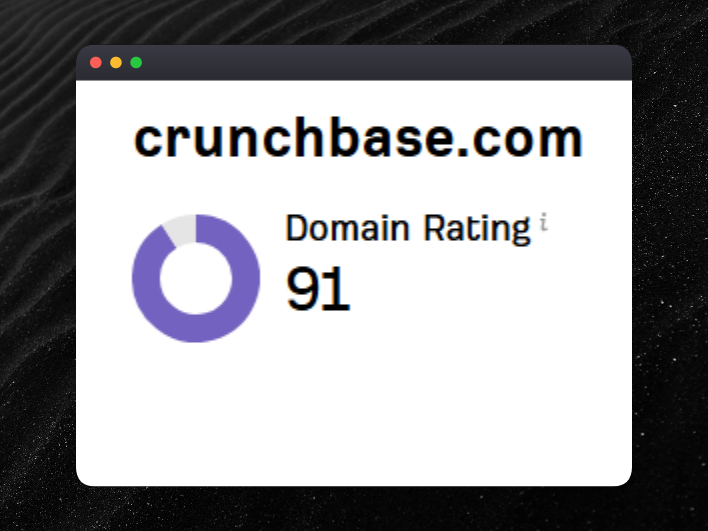
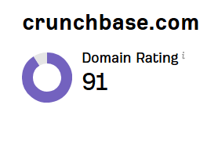

# Directory backlinks that move DR — Crunchbase, G2, 15 names

> Source: https://x.com/samigrows/status/2094684433546985907
> Author: Sami | SEO AI (@samigrows)
> Posted: 2026-09-01T07:11:00Z
> Stats (at capture): 13,955 views · 91 likes · 21 replies · 7 reposts · 219 bookmarks · 1 quote
> Captured: 2026-09-02T17:53:08Z

## Post

The fastest backlinks in SEO aren't guest posts.

They're directories most founders ignore.

Here's the list that actually moves DR:

Tier 1 (DR 80+):

Crunchbase, G2, Product Hunt, Capterra, GetApp

Tier 2 (DR 70+):

Clutch, SaaSHub, AlternativeTo, StackShare, BetaList

Tier 3 (DR 60+):

Slant, SourceForge, G2 Crowd alternatives pages, Indie Hackers, AngelList

All free. Most approve within 48 hours. Some index same day. Most are no-follow links but still has some authority.

Founders spend 3 months chasing one guest post link. This list gets you 15 links by Friday.

Reply "LIST" and get the full directory sheet with submission links.

## Directory list (post text; 15 names)

**Tier 1 (DR 80+):** Crunchbase · G2 · Product Hunt · Capterra · GetApp  

**Tier 2 (DR 70+):** Clutch · SaaSHub · AlternativeTo · StackShare · BetaList  

**Tier 3 (DR 60+):** Slant · SourceForge · G2 Crowd alternatives pages · Indie Hackers · AngelList  

Visible comments did **not** add names. The “full directory sheet with submission links” is gated on reply “LIST” (DM), not posted in-thread.

## Media

Still on this post (`media/photo.jpg`, 708×531). Quoted prior still (`media/quoted-photo.png`, 278×203).

## Quoted post

[Sami, 2026-08-30](https://x.com/samigrows/status/2094093678080119153) — 32,138 views · 195 likes · 25 replies · 569 bookmarks

> The fastest backlink you can get today is a directory submission. 90+
>
> Crunchbase, G2, Clutch, Product Hunt, Capterra. All DR 70 plus. All free. All indexable within days.
>
> Most founders spend months chasing guest posts.
>
> Ten directory submissions this afternoon beats six months.

## Author bio (at capture)

📈 Helping SaaS and ECOM brands increase revenue with SEO  
🕒 2+ Years of Experience  
📩 DM for a Customized Package/ SEO Consultancy

## Thread

fx/vx return counts only. First-level replies from `r.jina.ai` on `https://x.com/samigrows/status/…` (http URL returned jina 422 empty file). Each reply re-fetched via `api.fxtwitter.com`. Nested author replies from jina on those comments. Threadreader redirected to authenticate.

21 replies on the original. 3 first-level visible. Remaining ~18 behind X login — likely more “LIST” lead-magnet replies.

None (`replying_to` null). Quoted earlier directory tweet is 2094093678080119153.

## Comments

### Maxwell ([@max_mtwx](https://x.com/max_mtwx)) — [2094781115110424813](https://x.com/max_mtwx/status/2094781115110424813)

> agree. the real win is a fresh domain getting indexed and looking legit in the first 90 days, not the DR bump. do you bother with guest posts at all for a brand new site, or just hammer directories?

278 views · 2 likes.

#### Sami | SEO AI ([@samigrows](https://x.com/samigrows)) — [2094782243466285314](https://x.com/samigrows/status/2094782243466285314)

> Both

### Brian Hadu ([@BrianHaDu](https://x.com/BrianHaDu)) — [2094972131830636682](https://x.com/BrianHaDu/status/2094972131830636682)

> those Tier 1 sites are gold, I've seen real DR boosts from Crunchbase and G2

19 views · 1 like.

#### Sami | SEO AI ([@samigrows](https://x.com/samigrows)) — [2095050636777951486](https://x.com/samigrows/status/2095050636777951486)

> exactly

### Sahil Thakur ([@sahilthakur27](https://x.com/sahilthakur27)) — [2094819126342762726](https://x.com/sahilthakur27/status/2094819126342762726)

> LIST

133 views · 1 like. Author nested reply not visible (jina error page on this status). No sheet URL in public thread.

## Links

- https://x.com/samigrows/status/2094093678080119153
- https://www.crunchbase.com/
- https://www.g2.com/
- https://www.producthunt.com/
- https://www.capterra.com/
- https://www.getapp.com/
- https://clutch.co/
- https://www.saashub.com/
- https://alternativeto.net/
- https://stackshare.io/
- https://betalist.com/
- https://www.slant.co/
- https://sourceforge.net/
- https://www.indiehackers.com/
- https://wellfound.com/
