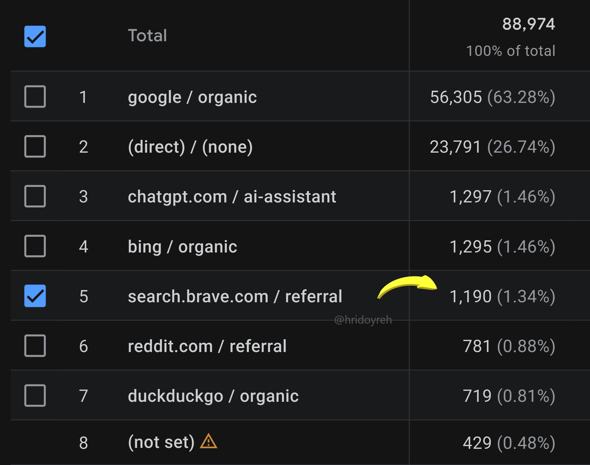
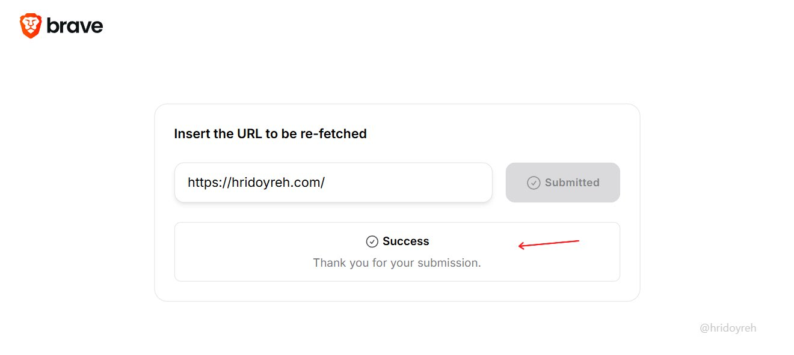
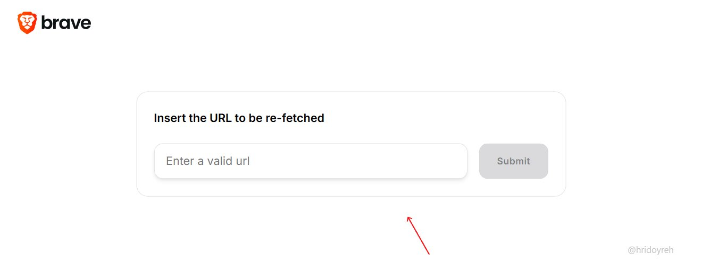

# Submit your website to Brave Search

> Source: https://x.com/hridoyreh/status/2094688982940741816
> Author: Hridoy Reh (@hridoyreh)
> Posted: 2026-09-01T07:29:05Z
> Stats (at capture): 45,590 views · 373 likes · 13 replies · 12 reposts · 635 bookmarks · 2 quotes
> Captured: 2026-09-02T18:10:58Z

## Post

Submit your website to Brave Search.

You will thank me later...

## Media

Analytics still (`media/photo.jpg`, 1935×1523, 159 KB, alt text on X: “brave submit url”). Session source / medium table, 88,974 sessions: google/organic 56,305 (63.28%), (direct) 23,791 (26.74%), chatgpt.com / ai-assistant 1,297 (1.46%), bing/organic 1,295 (1.46%), **search.brave.com / referral 1,190 (1.34%)** highlighted, reddit 781, duckduckgo 719. Watermark `@hridoyreh`.

## Quoted post (not a separate item)

[Hridoy Reh, 2026-08-30T07:30:47Z](https://x.com/hridoyreh/status/2093964632562253866) — 69,325 views · 257 likes · 16 replies · 15 reposts · 480 bookmarks

> If your website is not on Brave yet,
>
> Then just follow this:
>
> 1. Go to search∙brave∙com/submit-url.
> 2. Enter your website URL now.
> 3. Press the Submit button.
>
> Your site will appear in Search...

Quoted still (`media/quoted-photo.jpg`, 1320×528, 18 KB) — Brave “Insert the URL to be re-fetched” form at [search.brave.com/submit-url](https://search.brave.com/submit-url). Same screenshot as the Aug 30 post; this Sep 1 post’s own photo is the GA table, not the form.

Author self-reply on the quoted tweet (captured in `comments.md`): “After submitting, it will look like this:” + `media/quoted-after.jpg` (1320×591).

## Author bio (at capture)

In the last 8 years of SEO (and AI SEO since 2023) experience, I already helped more than 200 people achieve 650M+ visitors and $149M revenue…  
Website: https://seowins.io/

## Thread (Sep 1 parent)

fx/vx return counts only. `r.jina.ai` on `x.com` blocked (AbuseAlleviation until 2026-09-02T18:55:15Z). Visible replies from `r.jina.ai` on `http://fixupx.com/...`, then `api.fxtwitter.com`. Threadreader login. No separate item folder for the quoted tweet.

13 replies on the Sep 1 post. 3 first-level visible. Remaining ~10 behind X login.

None (`replying_to` null). Body in `post.md`. Quotes 2093964632562253866.

## Quoted tweet (2093964632562253866 — no item folder)

[Hridoy Reh (@hridoyreh)](https://x.com/hridoyreh/status/2093964632562253866) — 2026-08-30T07:30:47Z · 69,325 views · 257 likes · 16 replies

Steps: `search.brave.com/submit-url` → enter URL → Submit. Still: `media/quoted-photo.jpg`.

### Hridoy Reh ([@hridoyreh](https://x.com/hridoyreh)) — [2093964651973497198](https://x.com/hridoyreh/status/2093964651973497198)

Self-reply 4s later on the quoted tweet (not on the Sep 1 parent):

> After submitting, it will look like this:

4,191 views · 6 likes · 1 reply · still `media/quoted-after.jpg` (1320×591).

### Csaba Kissi ([@csaba_kissi](https://x.com/csaba_kissi)) — [2093965760875921842](https://x.com/csaba_kissi/status/2093965760875921842)

Visible on the quoted-tweet fixupx page (not re-fetched; no stats from fx):

> Great tip man!

Quoted-tweet remainder of 16 replies login-walled.

## Comments (Sep 1 parent)

### Web3 Enthusiasts🌶️ ([@Emmycrypt17](https://x.com/Emmycrypt17)) — [2094814530492666081](https://x.com/Emmycrypt17/status/2094814530492666081)

> Great Tip

113 views.

### Rajan Anand ([@anandrjn154](https://x.com/anandrjn154)) — [2094874214797132266](https://x.com/anandrjn154/status/2094874214797132266)

> Thanks for the hack

120 views.

### Alan ([@alan_josep19089](https://x.com/alan_josep19089)) — [2095147743270617218](https://x.com/alan_josep19089/status/2095147743270617218)

> Just did thanks!

4 views. Photo on X (submit confirmation); not stored here.

## Links

- https://x.com/hridoyreh/status/2093964632562253866
- https://x.com/hridoyreh/status/2093964651973497198
- https://search.brave.com/submit-url
- https://seowins.io/
