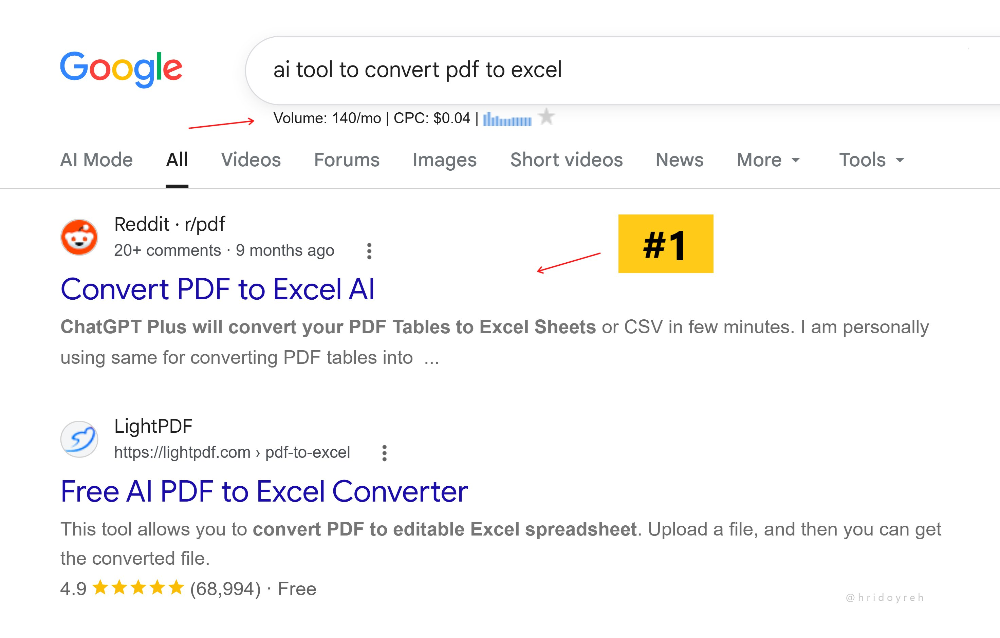

# Reddit page-1 SEO comment hack — 6 steps

> Source: https://x.com/hridoyreh/status/2094742312433684496
> Author: Hridoy Reh (@hridoyreh)
> Posted: 2026-09-01T11:01:00Z
> Stats (at capture): 7,217 views · 112 likes · 8 replies · 5 reposts · 163 bookmarks
> Captured: 2026-09-02T17:53:08Z

## Post

I personally love this SEO hack:

1. Search Google with a keyword.
2. Look for Reddit post ranking on page 1.
3. If there are any, open them.
4. Write a pretty helpful comment.
5. Mention your brand when relevant.
6. Get some upvotes now.

People will now read your comment.

And Google to visit your site...

## Media

SERP screenshot (`media/photo.jpg`, 2946×1880) — Google results with Reddit threads on page 1.

## Author bio (at capture)

In the last 8 years of SEO (and AI SEO since 2023) experience, I already helped more than 200 people achieve 650M+ visitors and $149M revenue…  
Location: 150+ SEO / AI SEO hacks ➜  
Website: https://seowins.io/

## Thread

fx/vx return counts only. Thread + first-level replies from `r.jina.ai` on the status URL, then each tweet re-fetched via `api.fxtwitter.com`. Nested author reply from jina on Filip’s comment (jina had truncated Filip with “Show more”; fx returned the full note-tweet). Threadreader redirected to authenticate.

8 replies on the original. 3 first-level visible. Remaining ~5 behind X login.

None (`replying_to` null). Steps are the note-tweet in `post.md`.

## Comments

### Filip Mitras ([@FilipMitras](https://x.com/FilipMitras)) — [2094759558421893555](https://x.com/FilipMitras/status/2094759558421893555)

> This doesn't really work as easy as you make people think to be. Most posts over 6 months are archived and can't be commented on. 70% more will get you shadow banned/banned/deleted when you comment on such old posts because Reddit moderators are dicks. There's a way to do this for pretty cheap but I wouldn't leak that. All in all if you wanna do this, make sure it's at best 1 out of 5 of your comments that are done this way and not more than 2 a day.

287 views · 4 likes · 1 reply.

#### Hridoy Reh ([@hridoyreh](https://x.com/hridoyreh)) — [2094761594786041959](https://x.com/hridoyreh/status/2094761594786041959)

> 1. It’s easy to find latest posts using the Tools button on SERPs.  
> 2. Yes, you must need karma and an old account.  
> 3. Just analyze others how they market without getting banned.

237 views · 2 likes.

### SEO Mastery ([@SEOMastery2026](https://x.com/SEOMastery2026)) — [2094935371226521861](https://x.com/SEOMastery2026/status/2094935371226521861)

> Same hack, still solid

31 views.

### Web3 Enthusiasts🌶️ ([@Emmycrypt17](https://x.com/Emmycrypt17)) — [2094811138630299879](https://x.com/Emmycrypt17/status/2094811138630299879)

> But Google and Reddit seems to be having issues.... Mayb Reddit didn't keep to promise 😂😂. I barely see them on SERP these days.

87 views.

## Links

- https://seowins.io/
