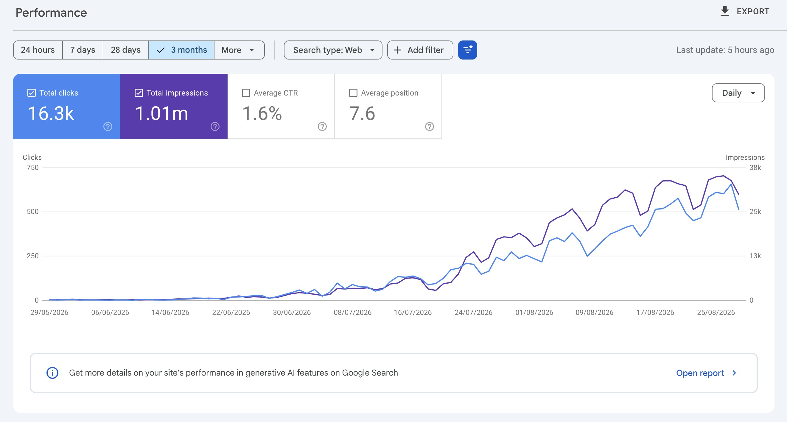

# SEO traffic to free tools, not blog posts — Bing KW + one-page tools

> Source: https://x.com/a_shimanski/status/2094770895021572502
> Author: Artyom Shimanski (@a_shimanski)
> Posted: 2026-09-01T12:54:34Z
> Stats (at capture): 20,990 views · 184 likes · 26 replies · 3 reposts · 394 bookmarks
> Captured: 2026-09-02T17:53:08Z

## Post

A lot of people asked how. So here it is 👇

Almost none of this traffic goes to blog posts. It goes to free tools.

People don't search for an article about the job. They search for something that does the job.

How I find what to build:

Bing Webmaster Tools → Keyword Research. Type a term from your niche, see real volume plus related terms.

The rest is simple:

→ one page, one tool, one job  
→ free, no signup, works instantly  
→ link to the main product somewhere on the page  
→ submit the URL in Search Console and Bing Webmaster Tools  
→ wait

The waiting is the hard part. 6 weeks of nothing for me.

## Quoted post

[Artyom Shimanski, 2026-08-31](https://x.com/a_shimanski/status/2094338304070004768) — 31,364 views · 161 likes · 55 replies

> 1.01m impressions, 16.3k clicks 🤯
>
> SEO does nothing, does nothing, does nothing, then does everything 📈

GSC-style screenshot (`media/quoted-gsc.jpg`, 2642×1418).

## Author bio (at capture)

Just a founder shipping things 🤓  
👉 http://aiedit.com ⚡ http://postformatter.com ⚡http://blurr.ing ⚡ http://unicodegames.com  
Website: https://shimanski.dev

## Thread

fx/vx return counts only. Thread + first-level replies from `r.jina.ai` on the status URL, then each tweet re-fetched via `api.fxtwitter.com`. Nested replies from jina on those comments. Threadreader redirected to authenticate. Conversation search login-walled.

26 replies on the original. 3 first-level comments visible. Remaining ~23 behind X login.

None (`replying_to` null). Method is the note-tweet in `post.md`. Quoted stats tweet is 2094338304070004768.

## Comments

### Brjan | AI Builder ([@MrBrjan](https://x.com/MrBrjan)) — [2094785891126677723](https://x.com/MrBrjan/status/2094785891126677723)

> Focusing on building tools rather than articles is a smart move for attracting traffic

307 views · 3 likes.

#### Artyom Shimanski ([@a_shimanski](https://x.com/a_shimanski)) — [2094798797326987774](https://x.com/a_shimanski/status/2094798797326987774)

> and way less crowded than the article side

### Rezaul Hoque Turjo ([@TurjoAt](https://x.com/TurjoAt)) — [2094790969178898930](https://x.com/TurjoAt/status/2094790969178898930)

> built one of these last year and the friction was abuse. a free tool with an llm call behind it needs rate limiting on day one or you're funding strangers' side projects.

#### Artyom Shimanski ([@a_shimanski](https://x.com/a_shimanski)) (nested; status id not in jina)

> yeah, that's why I keep them browser-only where I can. Zero cost per user, no rate limits to worry about

### PA13L0 ([@Fluyeporlaweb](https://x.com/Fluyeporlaweb)) — [2094860892726862263](https://x.com/Fluyeporlaweb/status/2094860892726862263)

> Increíble performance compañero! Es para https://aiedit.com?
>
> He estado trasteando con esto pero el dominio aún es muy nuevo ( poco más de dos semanas) pero ya tengo más de 1k impresiones por día, a ver si Google/Bing le tomen cariño 🙏🏼

#### Artyom Shimanski ([@a_shimanski](https://x.com/a_shimanski)) (nested; truncated by jina, no status id)

> no, it's for

Remainder of that reply was truncated / login-walled. Not confirmed which of his other domains the 1.01m impressions belong to.

## Links

- https://x.com/a_shimanski/status/2094338304070004768
- https://shimanski.dev
- http://aiedit.com
- http://postformatter.com
- http://blurr.ing
- http://unicodegames.com

## Media

