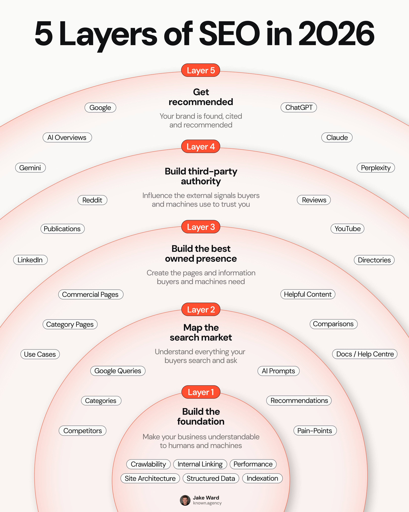

# 5 layers of SEO in 2026 — beyond ranking #1

> Source: https://x.com/jakezward/status/2094771557864292784
> Author: Jake Ward (@jakezward)
> Posted: 2026-09-01T12:57:13Z
> Stats (at capture): 16,989 views · 253 likes · 35 replies · 31 reposts · 372 bookmarks · 7 quotes
> Captured: 2026-09-02T18:10:58Z

## Post

SEO is now WAY bigger than ranking #1 on Google.

Not because Google matters less, but because the job of SEO has expanded.

Today, SEO is also about:

1. Getting found when someone searches on Google
2. Appearing in AI Overviews for Google searches
3. Getting recommended in ChatGPT answers
4. Owning the comparison searches in your category
5. Showing up on the sites influencing all of the above

And you can’t do that by JUST:

- Writing more blog posts
- Building more backlinks
- Adding schema
- Tracking a bunch of AI prompts
- Renaming SEO to “AEO”

You need the entire system working together.

Here’s how I think about the 5 layers of SEO in 2026:

## Media

Infographic (`media/photo.jpg`, 3240×4050, 705 KB) — **5 Layers of SEO in 2026**, known.agency / Jake Ward. Concentric layers, inner → outer:

1. **Build the foundation** — crawlability, internal linking, performance, site architecture, structured data, indexation.
2. **Map the search market** — competitors, categories, Google queries, AI prompts, recommendations, pain-points.
3. **Build the best owned presence** — use cases, category pages, commercial pages, helpful content, comparisons, docs / help centre.
4. **Build third-party authority** — LinkedIn, publications, Reddit, reviews, YouTube, directories.
5. **Get recommended** — Gemini, AI Overviews, Google, ChatGPT, Claude, Perplexity.

## Author bio (at capture)

Building a new kind of SEO agency  
Website: https://cal.known.agency/known/discovery-call  
Agency: https://known.agency/ (“#1 AI Search Engine Optimisation Agency” / Search Everywhere Optimisation on the Framer site at capture)

## Thread

fx/vx return counts only. `r.jina.ai` on `x.com` blocked. Visible replies from `r.jina.ai` on `http://fixupx.com/jakezward/status/2094771557864292784` (and `/i/status/…`), then `api.fxtwitter.com`. Palash “Show more” completed via fxtwitter note-tweet. Threadreader login.

35 replies on the original. 3 first-level visible. Remaining ~32 behind X login.

None (`replying_to` null). Five numbered jobs + “not just blogs/backlinks/schema/AEO” are the note-tweet; the layer names live on the image in `post.md`.

## Comments

### SamUnited ([@bitwsammy](https://x.com/bitwsammy)) — [2094801637202395338](https://x.com/bitwsammy/status/2094801637202395338)

> No it’s not lol what you mentioned is different things and it’s not considered search engine optimization. These bots in your comments are weird too. These posts suck.

280 views · 2 likes.

### Troy VanMaanen ([@TroyVanmaanen](https://x.com/TroyVanmaanen)) — [2094773645356790098](https://x.com/TroyVanmaanen/status/2094773645356790098)

> It’s cool to visual this like Maslows hierarchy of needs

224 views · 1 like.

### Bagchi da 🥬 ([@PalashBagchi11](https://x.com/PalashBagchi11)) — [2094816548473246174](https://x.com/PalashBagchi11/status/2094816548473246174)

> The biggest challenge is in figuring out what your potential customers are asking. Every ai search tool will include my brand name in the search prompt to show that my brand is visible to chat engines. And that never happens with real users. Found this free tool to solve that problem https://nqz.ai/ai-search-prompt-generator

15 views · 1 like. Note-tweet. Card: Free AI Search Prompt Generator — nqzai.

## Links

- https://known.agency/
- https://cal.known.agency/known/discovery-call
- https://nqz.ai/ai-search-prompt-generator
