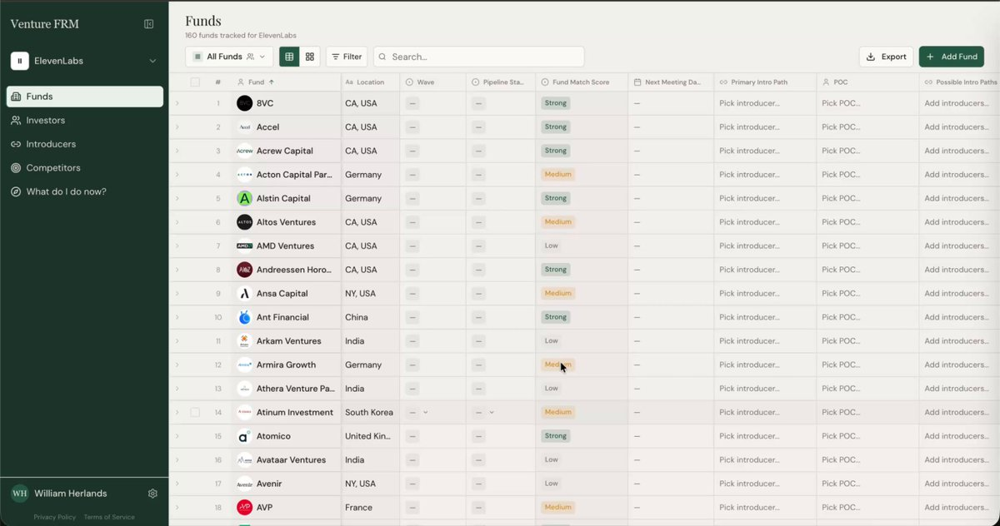

# Meet investors in waves — venture fundraising FRM

> Source: https://x.com/harris/status/2094820035344621901
> Author: Aaron Harris (@harris)
> Posted: 2026-09-01T16:09:50Z
> Stats (at capture): 7,788 views · 69 likes · 4 replies · 1 repost · 152 bookmarks
> Captured: 2026-09-02T17:25:49Z

## Post

One of the best fundraising tools is the simplest: meet investors in waves 🌊

Plan all your pitches within 1-2 weeks to generate a competitive auction among investors.

We built the concept into our venture fundraising FRM (beta access below).

But honestly you can do this with Google Sheets. Just requires being organized.

FRM link - https://frm.theventurecodex.com/

## Media

[media/video.mp4](media/video.mp4)

13.6s product video (`media/video.mp4`, 1366×720 via yt-dlp; source also has 2734×1440). Thumb: `media/thumb.jpg`.

## Author bio (at capture)

Founder Magid | Was Partner at YC | Deel, Scale, Fomo, Bedrock Robotics, Kernel, Groww ++  
https://theventurecodex.com/  
Profile website: postround.substack.com

## Thread

fx/vx Twitter APIs return reply *counts* only (no conversation payload). First-level replies below are from `r.jina.ai` on the status URL, then each reply was re-fetched via `api.fxtwitter.com`.

4 replies on the original; 3 first-level replies were visible without login. The fourth is behind X’s “See all the replies” gate. No author self-reply / pinned comment.

None.

## Comments

### SHAER ([@SHAERintel](https://x.com/SHAERintel)) — [2095045230596853830](https://x.com/SHAERintel/status/2095045230596853830)

> waves work. picking the wrong two weeks is what kills them. fall partner calendars get eaten by whatever their firm is sponsoring, so a wave landing on a big event week gets you associates and reschedules. worth checking what your targets are attending before you lock dates

### Liban (lee~ben) Kano ([@libankano](https://x.com/libankano)) — [2094934283492147363](https://x.com/libankano/status/2094934283492147363)

> Why would you delete afterwards

(No author reply captured.)

### mick.artisan.cash ([@IdMintThat](https://x.com/IdMintThat)) — [2094896160364187766](https://x.com/IdMintThat/status/2094896160364187766)

> Very cool! Checking it out :)

Remaining reply was behind X login.

## Links

- https://frm.theventurecodex.com/
- https://theventurecodex.com/
- https://postround.substack.com/
- https://theventurecodex.com/browse
