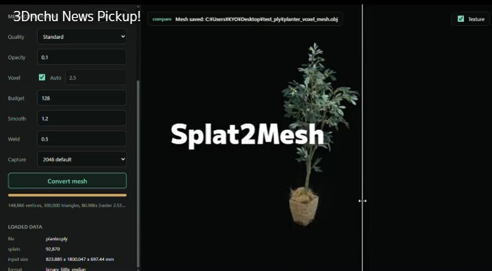

# Splat2Mesh — free Win tool, 3DGS PLY → OBJ/GLB

> Source: https://x.com/ymt3d/status/2094826117056414132
> Author: 3D人-3dnchu- CG情報ブログ (@ymt3d)
> Posted: 2026-09-01T16:34:00Z
> Stats (at capture): 22,699 views · 250 likes · 0 replies · 34 reposts · 240 bookmarks · 2 quotes
> Captured: 2026-09-02T17:53:08Z

## Post

3D Gaussian SplattingデータをOBJやGLBのポリゴンメッシュへ変換できる無料ソフト！Win

Splat2Mesh  
https://3dnchu.com/archives/splat2mesh/  
by @ArcanaMfg

#3DGS #Splat2Mesh

## Media

[media/video.mp4](media/video.mp4)

7.36s amplify video (`media/video.mp4`, 718×396 via `video.twimg.com`). Thumb: `media/thumb.jpg`.

## Author bio (at capture)

TA＆CGアーティスト職をしつつ、隙間時間に趣味でCG系情報ブログ「3D人-3dnchu-（すりぃでぃんちゅ）」を運営しています。  
Location: Japan.  
Website: http://3dnchu.com/

## Thread

fx/vx return counts only. `r.jina.ai` on the status URL hit a 403 shell + login wall. Threadreader redirected to authenticate. Conversation search login-walled.

0 replies on the original (`replying_to` null). 2 quotes were not returned by `api.fxtwitter.com/.../quotes` (same payload as the parent).

None on this bookmark. Vendor launch (not a reply): [Arcana Mfg @ArcanaMfg 2094648474377839018](https://x.com/ArcanaMfg/status/2094648474377839018)

> 3DGSをMeshへ変換するソフトウェア「Splat2Mesh」を本日公開しました！  
> 3D Gaussian SplattingデータをOBJ / GLB形式へ変換できます。  
> 個人利用・非商用利用は無料です。  
> https://arcana-mfg.com/splat2mesh/  
> English: https://arcana-mfg.com/en/splat2mesh/

## Comments

None visible. Remaining quotes behind X login / missing from fx.

## Links

- https://3dnchu.com/archives/splat2mesh/
- https://arcana-mfg.com/splat2mesh/
- https://arcana-mfg.com/en/splat2mesh/
- https://arcana-mfg.com/splat2mesh_dl/Splat2Mesh_v1.0.zip
- https://arcana-mfg.com/splat2mesh_dl/sample.ply
- https://arcana-mfg.com/splat2mesh_dl/update.json
- https://arcana-mfg.com/eula-a/
- https://arcana-mfg.com/
- https://x.com/ArcanaMfg/status/2094648474377839018
- https://github.com/ArcanaMfg
- https://www.youtube.com/watch?v=CwtxJJTOV28
- https://www.youtube.com/watch?v=7LH-aloguBU
