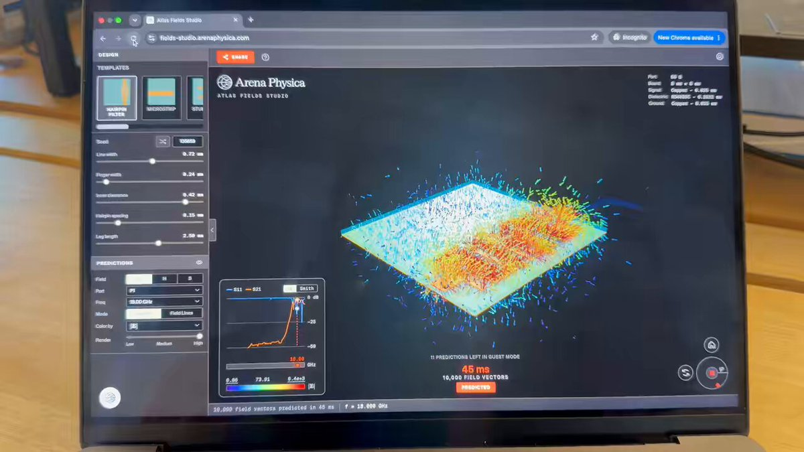

# Atlas Fields Studios — EM fields around PCB designs, free

> Source: https://x.com/Trevs_Dev/status/2094840529997410525
> Author: Trevor B (Trev The Creator) (@Trevs_Dev)
> Posted: 2026-09-01T17:31:17Z
> Stats (at capture): 40,560 views · 1,059 likes · 22 replies · 100 reposts · 686 bookmarks · 8 quotes
> Captured: 2026-09-02T17:39:26Z

## Post

After years of working in electronics, this feels like a full circle moment. Many late nights later we are releasing Atlas Fields Studios, free for everyone

https://fields-studio.arenaphysica.com

The Fields Studio App lets you explore electromagnetic behavior around PCB designs
#buildinpublic

## Media

[media/video.mp4](media/video.mp4)

15.8s amplify video (`media/video.mp4`, 1280×720 via yt-dlp format `http-2176`). Thumb: `media/thumb.jpg`.

## Author bio (at capture)

Design Engineer @arenaphysica | iOS Developer | Augmented Reality Enthusiast | 3D-Modeling Hobbyist | baconeggandcheese Connoisseur  
Location: Bedford Stuyvesant, Brooklyn  
Website: https://bklyndev.com

## Thread

fx/vx return counts only. Thread + first-level replies from `r.jina.ai` on the status URL, then each tweet re-fetched via `api.fxtwitter.com`. Nested reply from jina on Neal’s comment. Threadreader redirected to login.

22 replies on the original. Author self-reply + 1 first-level comment visible. Arena Physica nested reply on that comment. Remaining replies behind X login / “Something went wrong” on the parent thread fetch.

### Trevor B ([@Trevs_Dev](https://x.com/Trevs_Dev)) — [2094840586989682797](https://x.com/Trevs_Dev/status/2094840586989682797)

> A note from our team: Today, we’re excited to unveil Heaviside-1, @ArenaPhysica’s second generation foundation model for electromagnetism. 5 months since the release of Heaviside-0, Heaviside-1 is a crucial milestone on our quest to build EM superintelligence: a foundation model

fx/jina both stop at 280 characters (`is_note_tweet: false`). Has 7.x s amplify video (not downloaded). Posted ~13s after the parent. Full writeup: https://www.arenaphysica.com/publications/heaviside-1

## Comments

### Neal ([@nealc404](https://x.com/nealc404)) — [2095122871479656455](https://x.com/nealc404/status/2095122871479656455)

> Have you any comparison between the generated electromagnetic flow vs a real one?
> Interface is dope btw!

#### Arena Physica ([@arenaphysica](https://x.com/arenaphysica)) — [2095134590327251228](https://x.com/arenaphysica/status/2095134590327251228)

> Thanks @nealc404! Great question, we actually talk about this in our technical writeup: https://www.arenaphysica.com/publications/heaviside-1

8.8s amplify video on this reply (not downloaded).

Remaining ~20 replies were behind X login.

## Links

- https://fields-studio.arenaphysica.com
- https://www.arenaphysica.com/publications/heaviside-1
- https://www.arenaphysica.com/publications/rf-studio
- https://www.arenaphysica.com/terms-of-service
- https://www.arenaphysica.com/privacy-policy
- https://x.com/Trevs_Dev/status/2094840586989682797
- https://x.com/arenaphysica/status/2095134590327251228
- https://bklyndev.com
