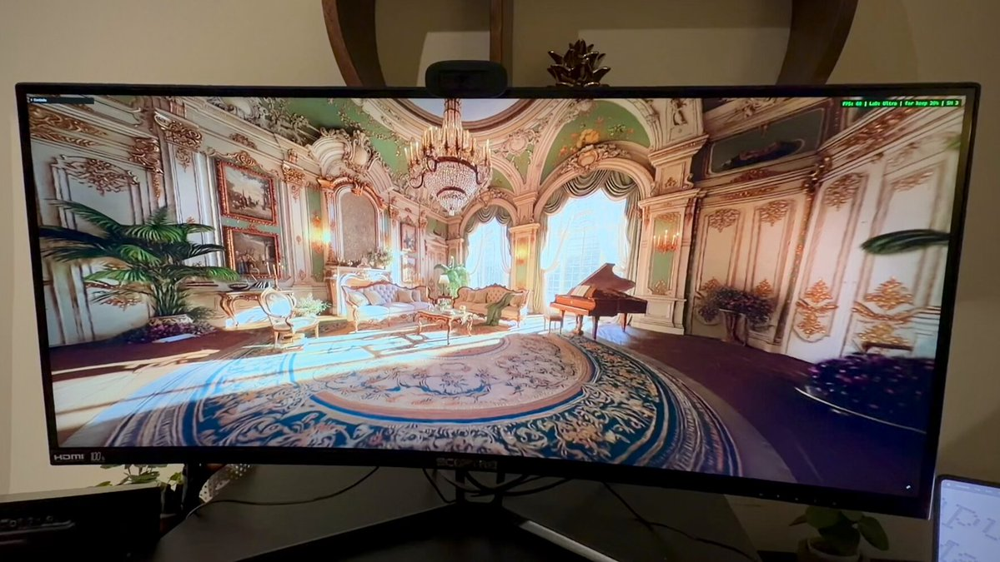

# Atlas + spark.js + three.js scene from one input image

> Source: https://x.com/XRarchitect/status/2094864872853119216
> Author: Ian Curtis (@XRarchitect)
> Posted: 2026-09-01T19:08:01Z
> Stats (at capture): 19,490 views · 244 likes · 14 replies · 17 reposts · 106 bookmarks · 4 quotes
> Captured: 2026-09-02T17:23:28Z

## Post

This scene was generated from one input image. Atlas fills the remaining gaps.

→ atlas (world labs)  
→ spark.js  
→ three.js

Attached: ~30s video (1766×994 H.264), saved as `media/atlas-spark-three-scene.mp4`.

## Author follow-up (same thread)

[Input image for reference](https://x.com/XRarchitect/status/2094881923764199717) — still of the source photo (`media/input-image.jpg`, 2048×1152).

## Author bio (at capture)

Design @theworldlabs · xrarchitect.xyz

## Media

[media/atlas-spark-three-scene.mp4](media/atlas-spark-three-scene.mp4)

## Thread

fx/vx Twitter APIs do not return a conversation list. Thread text below is from `r.jina.ai` on the status URL plus `api.fxtwitter.com` on each visible reply. Original has 14 replies; login wall hid the rest.

### Ian Curtis ([@XRarchitect](https://x.com/XRarchitect)) — [2094881923764199717](https://x.com/XRarchitect/status/2094881923764199717)

> Input image for reference

Photo: 2048×1152 JPEG (`media/input-image.jpg`). Posted ~1h after the video (2026-09-01T20:15:46Z).

## Comments

### David Pantera ([@davidpantera_](https://x.com/davidpantera_)) — [2094866520904274236](https://x.com/davidpantera_/status/2094866520904274236)

Product @theworldlabs.

> sheeesh now in VR

**Author reply** ([2094866638885752858](https://x.com/XRarchitect/status/2094866638885752858)):

> need to test later today 😎

Remaining replies not available without X login.

## Links

- https://www.worldlabs.ai/blog/atlas
- https://sparkjs.dev
- https://www.worldlabs.ai/blog/spark-2.0
- https://xrarchitect.xyz
- https://x.com/XRarchitect/status/2094881923764199717
