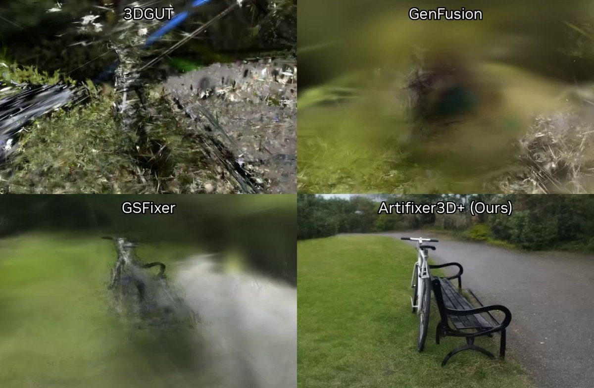

# NVIDIA ArtiFixer — video diffusion that rebuilds broken/blurry 3D scans

> Source: https://x.com/0x0SojalSec/status/2094929928865341832
> Author: Md Ismail Šojal (@0x0SojalSec)
> Posted: 2026-09-01T23:26:31Z
> Stats (at capture): 8,553 views · 202 likes · 2 replies · 23 reposts · 205 bookmarks
> Captured: 2026-09-02T17:38:09Z

## Post

NVIDIA Open-source a model that rebuilds broken, blurry 3D scans from angles you never captured.

like the 3D “auto-fixer.” It uses video diffusion to generate the camera angles you never captured, then reconstructs the scene from the generated frames.

 - 70x faster, Finishes in 1 to 4 steps
- Beats SOTA by 3dB
- you can use just text prompts

- http://huggingface.co/nvidia/ArtiFixer

## Media

[media/video.mp4](media/video.mp4)

16.3s amplify video (`media/video.mp4`, 1654×1080 via `video.twimg.com`; native 3308×2160 also published). Thumb: `media/thumb.jpg`.

## Author bio (at capture)

Cyber_Security_Re-searcher || Ai Re-searcher || AI-Sec|| Malware Analysis II iOS || Pwn || 0SINT || Project AI-StrikeSec || 0ldAccounts Suspended @0xSojalSec ||  
Location: localhost.  
Website: https://www.linkedin.com/in/0xsojalsec/

## Thread

fx/vx return counts only. Conversation list APIs failed:

- `api.fxtwitter.com/.../status/{id}` and `/replies` — parent tweet only
- `api.vxtwitter.com` — reply *count* (2), no thread
- `cdn.syndication.twimg.com/tweet-result` — truncated note-tweet + media
- `r.jina.ai` on `http://x.com/0x0SojalSec/status/…` — post body + HF card only
- `r.jina.ai` on conversation search — login wall
- Threadreader — login wall
- xcancel — shut down; nitter.poast.org — DNS fail

No author self-replies (`replying_to` null). Thread text is the note-tweet in `post.md`. 2 replies not captured without X login.

## Model (from tweet URL, not comments)

Tweet links **https://huggingface.co/nvidia/ArtiFixer**. Verified:

- Paper: de Lutio et al., *ArtiFixer: Enhancing and Extending 3D Reconstruction with Auto-Regressive Diffusion Models*, SIGGRAPH 2026. [arXiv:2603.00492](https://arxiv.org/abs/2603.00492)
- Code: [nv-tlabs/ArtiFixer](https://github.com/nv-tlabs/ArtiFixer) (Apache-2.0, 635★ at capture)
- Project: https://research.nvidia.com/labs/sil/projects/artifixer/

## Links

- https://huggingface.co/nvidia/ArtiFixer
- https://github.com/nv-tlabs/ArtiFixer
- https://research.nvidia.com/labs/sil/projects/artifixer/
- https://arxiv.org/abs/2603.00492
- https://arxiv.org/pdf/2603.00492
- https://research.nvidia.com/labs/sil/projects/artifixer/assets/paper.pdf
