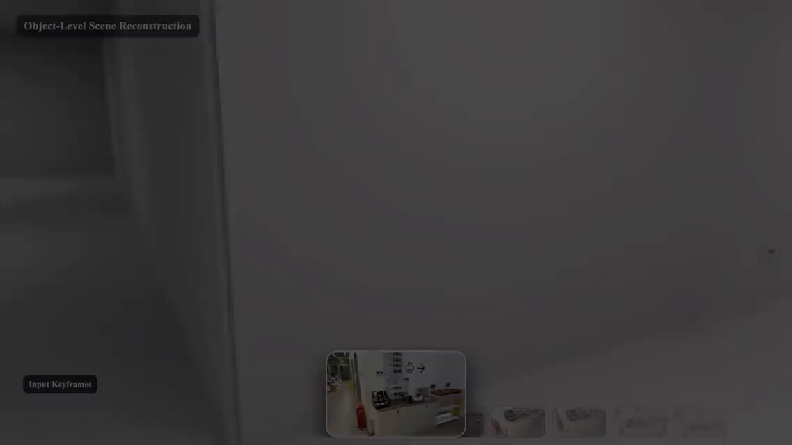

# ByteDance Lucida: indoor video → editable 3D assets

> Source: https://x.com/tokufxug/status/2094961942058418268
> Author: Sadao Tokuyama (@tokufxug)
> Posted: 2026-09-02T01:33:44Z
> Stats (at capture): 5,175 views · 91 likes · 1 reply · 10 reposts · 79 bookmarks
> Captured: 2026-09-02T17:25:49Z

## Post (JA)

屋内動画を編集可能な3Dアセット化するByteDance「Lucida」🏠

🔹ByteDanceの「Lucida」が屋内動画から3Dシーンを再構築  
🔹VLMやSeed3D 2.0を活用しReal-to-Simを実現  
🔹物体検出やポーズ整合により、個別の3Dアセットとして生成

実世界の動画から編集可能な3D空間を作る試み。  
情報元はリプ欄。

## Post (EN gloss)

ByteDance Lucida turns indoor video into editable 3D assets. It reconstructs a 3D scene from indoor video, uses a VLM and Seed3D 2.0 for real-to-sim, and emits individual 3D assets via object detection and pose alignment. Source is in the reply.

## Media

[media/video.mp4](media/video.mp4)

42.9s video (`media/video.mp4`, 1138×640 via yt-dlp). Thumb: `media/thumb.jpg`.

## Author bio (at capture)

AR app development; Apple Vision Pro / Android XR / spatial computers. 200+ Vision Pro tech posts.  
https://1planet.co.jp/work/consulting

## Thread

fx/vx return counts only. Author self-reply captured via `r.jina.ai` then `api.fxtwitter.com`. Reply count = 1; that reply *is* the source pointer. No other first-level replies.

### Sadao Tokuyama ([@tokufxug](https://x.com/tokufxug)) — [2094962032718270497](https://x.com/tokufxug/status/2094962032718270497)

> 情報元ページ  
> https://www.linkedin.com/feed/update/urn:li:activity:7500698034956181504/

Card: Alejandro Pallarés Nadal / linkedin.com (repost of Arminas Valunas). Posted 21s after the parent.

## LinkedIn source (public guest view via r.jina.ai)

Arminas Valunas post (reposted by Alejandro Pallarés Nadal):

> Lucida from ByteDance. It turns indoor video into editable 3D scenes, reconstructing objects as simulation-ready assets.  
> 🔹 VLM-based object detection and referring descriptions  
> 🔹 Strong pose alignment  
> 🔹 High-fidelity real-to-sim digital twins  
> 🔹 Multi-view masks, boxes, partial point clouds  
> 🔹 Seed3D 2.0 for image-to-3D asset generation  
> Link in the comments

First LinkedIn comment (Arminas Valunas): Project: https://lucida-r2s.github.io/

Other LinkedIn comments (not X): Walid M Samuel (downstream asset consistency), Fusara AI (robotics training), plus generic praise. Paper/code not posted in the X thread.

## Links

- https://lucida-r2s.github.io/
- https://arxiv.org/abs/2608.30821
- https://arxiv.org/pdf/2608.30821
- https://arxiv.org/html/2608.30821
- https://arxiv.org/abs/2605.13862
- https://seed.bytedance.com/en/seed3d_2_0
- https://www.linkedin.com/feed/update/urn:li:activity:7500698034956181504/
- https://www.linkedin.com/posts/alexpallares_activity-7500698034956181504-5n_-
- https://x.com/tokufxug/status/2094962032718270497
