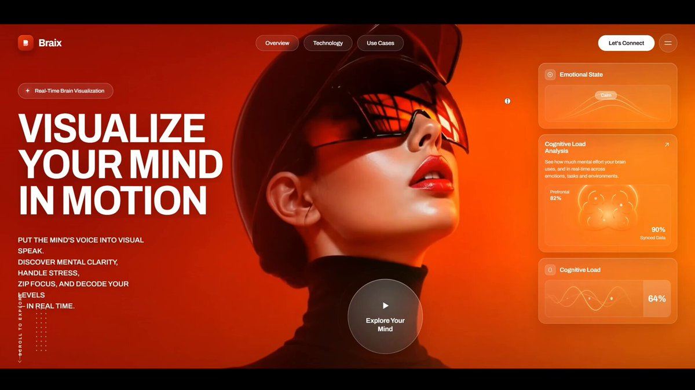

# Scroll-animated $5k site without writing CSS — ChatGPT + Gemini + Claude Code

> Source: https://x.com/himanshubuildss/status/2094984529853530345
> Author: Himanshu Hingorani (@himanshubuildss)
> Posted: 2026-09-02T03:03:29Z
> Stats (at capture): 3,149 views · 54 likes · 5 replies · 12 reposts · 71 bookmarks
> Captured: 2026-09-02T17:31:40Z

## Post

Stop building flat AI websites. 🛑

Here is how to build a $5,000 scroll-animated interactive website without writing a single line of CSS manually.

We chained ChatGPT, Google Gemini, and Claude Code together to engineer the entire 300-frame scroll sequence.

Here is the exact tech stack and workflow 🧵👇

## Media

[media/video.mp4](media/video.mp4)

748.2s amplify video (`media/video.mp4`, 1280×720 via yt-dlp; source also has 1920×1080). Thumb: `media/thumb.jpg`.

## Author bio (at capture)

Founder @ http://scrolltide.co  
Turning static websites into interactive experiences with AI ✦  
Explore 200+ prompts, ideas & web inspiration ↓  
Profile website: https://www.scrolltide.co/ebook

## Thread

fx/vx return counts only. Thread + first-level replies from `r.jina.ai` on the status URL, then each tweet re-fetched via `api.fxtwitter.com` (needed because jina truncated tweet 2 with “Show more”). Threadreader unrolled nothing (login wall).

5 replies on the original. Author thread is 3 tweets (parent + 2 self-replies). 1 first-level non-author comment was visible. Remaining replies behind X login.

### Himanshu Hingorani ([@himanshubuildss](https://x.com/himanshubuildss)) — [2094984533078876523](https://x.com/himanshubuildss/status/2094984533078876523)

> The multi-agent pipeline:
>
> 1️⃣ Assets: Pinterest for UI reference + ChatGPT to generate the neural-interface subject.
> 2️⃣ Cinematic Motion: Google Gemini to animate the still portrait into a fluid video.
> 3️⃣ Extraction: Ezgif to slice the video into 300 sequential frames (30fps).
> 4️⃣ AI Orchestration: Claude Code AI agent reading the visual layout and writing the frontend.
> 5️⃣The Tech Stack: React, Vite, Tailwind CSS, and Framer Motion to tie the 300 frames to the user's scroll position.

Note-tweet. Posted 1s after the parent. Self-reply of the parent.

### Himanshu Hingorani ([@himanshubuildss](https://x.com/himanshubuildss)) — [2094984535503204553](https://x.com/himanshubuildss/status/2094984535503204553)

> You don’t have to spend hours fighting with AI to recreate this.
>
> I packaged the entire architecture—the Framer Motion math, the scroll choreography, and the exact Claude prompts—into a single blueprint.
>
> Check Link in Bio ✌️

Replies to tweet 2. Bio link at capture: https://www.scrolltide.co/ebook

## Comments

### Zubia Sheraz ([@zubiasheraz](https://x.com/zubiasheraz)) — [2095165152492761514](https://x.com/zubiasheraz/status/2095165152492761514)

> Looks unique!

Remaining replies were behind X login.

## Links

- https://www.scrolltide.co/
- https://www.scrolltide.co/ebook
- https://www.scrolltide.co/pricing
- https://www.scrolltide.co/templates
- https://x.com/himanshubuildss/status/2094984533078876523
- https://x.com/himanshubuildss/status/2094984535503204553
