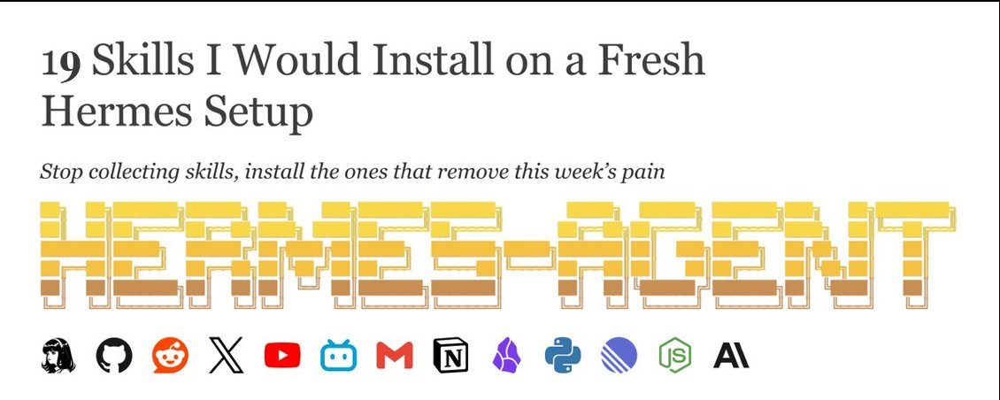

# 19 Skills I Would Install on a Fresh Hermes Setup (15x Powerful Hack)

> Source: https://x.com/painn_x/status/2095060006127149480
> Author: painn (@painn_x)
> Posted: 2026-09-02T08:03:24Z
> Stats (at capture): 692,230 views · 1,403 likes · 54 replies · 131 reposts · 4,517 bookmarks · 14 quotes
> Captured: 2026-09-21T15:33:42Z via api.fxtwitter.com
> Author bio (at capture): AI/tech | Dev | Building in public /  / Dm open ✉️

## Post

call me insane...but this is the closest thing to AGI i've ever seen

19 skills turn an agent into a worker
eyes, ears, hands, a memory

give this article to your agent

it'll be the most productive thing you do this week https://x.com/i/article/2094079614112890881

## Article

Title: 19 Skills I Would Install on a Fresh Hermes Setup (15x Powerful Hack)
URL: https://x.com/i/article/2094079614112890881

Preview: If I had to wipe Hermes and rebuild from scratch, I wouldn't start with an empty chat window and just wing it.
Skills would come first. Always
A default install still works fine on its own. But once

Cover still: `media/article-cover.jpg`. Original: https://pbs.twimg.com/media/HRJKLeXXUAAWzj0.jpg

Full body (verbatim from api.fxtwitter.com):

If I had to wipe Hermes and rebuild from scratch, I wouldn't start with an empty chat window and just wing it.

Skills would come first. Always

A default install still works fine on its own. But once skills are in, it's not really a fair comparison anymore. That's the actual difference between a chatbot that just answers you and an agent that researches, writes code, edits video, fixes your writing, runs repeat tasks, and keeps ten jobs going without you sitting there watching a terminal the whole time.

Here's the exact set I'd reinstall. Not everything out there just the 19 that cover most of what I actually use an agent for.

What each one does. When it's worth installing. What you can leave alone for now.

List at a glance

What a skill is

Think of it as a saved recipe the agent can load on demand. You write the process once, the agent runs it forever. No re-explaining the same steps every session, and the output stops drifting.

Skills are files. That's the whole trick. You install the ones that remove a pain, and the agent keeps them.

The 19 skills

1.Agent-Reach

Repo: Panniantong/Agent-Reach

Stars: ~73k

it is a CLI that gives an agent access to public sites like X, Reddit, YouTube, and GitHub. all for freee

What it fixes

Agents choke on login walls, blocked scrapers, and messy HTML when you ask them to check social reactions or pull video info.

How it helps

You just ask in plain language; "see what people are saying about this on X" and it retrieves it without you setting up separate API keys per platform.

When to use it

 Content research, competitor tracking, social listening. Usually the first thing worth installing.

2. Browser Harness

Repo: browser-use/browser-harness

Stars: ~17k

A browser automation layer connecting an agent to your actual browser via CDP.

What it fixes

Static browser tools breaking whenever a site's layout changes.

How it helps

Writes new helper functions on the fly when it hits an unsupported step.

When to use it

Tasks like pulling recent posts from a profile or downloading files. Start with a separate browser profile. giving an agent your real browser carries real risk.

3. i-have-adhd

Repo: ayghri/i-have-adhd

Stars: 26.6k

A skill that changes how an agent responds; action first, numbered steps, no preamble or sign-off.

What it fixes

Answers buried under filler like "Great question!" or "Hope this helps!"

How it helps

Strips the conversational padding so the useful part comes first.

When to use it

Every agent, honestly; it's a default-response style change, not a task-specific tool.

4. codebase-memory-mcp

Repo: DeusData/codebase-memory-mcp

Stars: ~40k

An MCP server that indexes a codebase into a persistent knowledge graph.

What it fixes

Burning tokens rereading files every session just to answer "what calls this?"

How it helps

Lets the agent query relationships directly instead of re-scanning the whole repo.

When to use it

Medium-to-large repos or multi-service codebases where context limits are a real bottleneck.

5. OpenMontage

Repo: calesthio/OpenMontage

Stars: ~49k

An open-source agentic video production system — scripting, editing, captioning, exporting.

What it fixes

Agents that can discuss video work but can't actually produce it.

How it helps

Chains together the pieces of a real production pipeline instead of one-off tool calls.

When to use it

Short-form content, explainers, product demos — anywhere you want an agent doing actual video work, not just talking about it.

6. Composio skills

Repo:Mission Control /ComposioHQ/skills

Skills that teach an agent to work with Composio's integration layer — auth, sessions, triggers.

What it fixes

The mess of wiring an agent into Gmail, Slack, GitHub, or a CRM safely.

How it helps

Standardizes how agents connect to and act inside real apps.

When to use it

Any setup where the agent needs to take real actions outside local files.

7. Defuddle

Repo: kepano/defuddle

Stars: ~9k

A library/CLI that strips a web page down to its core content as clean Markdown or HTML.

What it fixes

Agents getting tripped up by nav bars, ads, and cookie banners when fetching pages.

How it helps

Converts a messy URL into a clean article automatically.

When to use it

Research, clipping content into notes, feeding clean text into an agent's context.

8. Mission Control/Minions

Repo: agent37-platform/minions

Stars: ~625

A kanban-style control panel for tracking Hermes tasks.

What it fixes

Losing track of parallel sessions running in raw terminals.

How it helps 

Live view of tool calls, human approval before marking something done, per-task settings, all stored locally.

When to use it

Running several jobs at once and needing one screen to manage all of them.

9. addyosmani/agent-skills

Repo: addyosmani/agent-skills

Stars: ~89k

 A set of production engineering skills covering spec, plan, build, test, review, ship.

What it fixes

"Vibe coding" — building without structure, tests, or review gates.

How it helps

Encodes habits experienced engineers already follow, applied automatically.

When to use it

Real products or multi-day features — not quick throwaway scripts.

10. Resemble AI Detect

Repo: resemble-ai/detect-skill

A detection skill for AI-generated or manipulated audio, image, and video.

What it fixes

No easy way to flag fake or altered media before an agent uses it in research or content.

How it helps

Adds a screening step before trusting or reposting a clip.

When to use it

Moderation, brand-safety checks, verifying media before citing it. Treat results as a signal, not final proof — keep a human in the loop for high-stakes decisions.

11. Loopy / Loop Library

Repo: Forward-Future/loopy

Stars: ~3k

A catalog of agent "loops," plus a skill for finding, adapting, and running them.

What it fixes

One-shot prompts that only get one attempt at a problem that needs iteration.

How it helps

Repeats a step, measures the result, keeps it only if it improved things, and stops on a clear condition.

When to use it

Performance tuning, flaky tests, cleanup work — anywhere the first pass usually isn't the final answer.

12. Anthropic Cybersecurity Skills

Repo: mukul975/Anthropic-Cybersecurity-Skills

Stars: ~30k

A large open-source library; 818 skills across 34 security domains, mapped to frameworks like MITRE ATT&CK and NIST CSF.

What it fixes

Coding agents having no real security instincts by default.

How it helps

Gives structured playbooks for investigations, detection, and threat modeling instead of ad hoc guesses.

When to use it

Security work on systems you own or have explicit permission to test. it includes offensive techniques, so scope matters.

13. claude-mem

Repo: thedotmack/claude-mem

Stars : 92k

A memory compression system that stores session history locally.

What it fixes

Re-explaining your stack and preferences every time you start a new session.

How it helps 

Compresses past sessions into long-term memory and pulls relevant context back in automatically; <private> tags keep sensitive info out.

When to use it

Any recurring project where repeating context every session wastes time.

14. youtube-full

Repo: ZeroPointRepo/youtube-skills

Stars: ~540

A toolkit for YouTube transcripts, search, channel browsing, and playlists.

What it fixes

yt-dlp getting blocked on cloud IPs, which breaks most "summarize this video" requests.

How it helps

Pulls transcript and metadata directly without fighting scraping issues.

When to use it

Learning from tutorials, researching competitor videos, pulling course notes.

15. make-interfaces-feel-better

Repo: jakubkrehel/make-interfaces-feel-better

Stars: ~3k

it is a skill focused on interface polish  spacing, hover states, icons, hit areas, motion.

What it fixes

AI-built UIs that technically function but feel slightly off or generic.

How it helps

After a page is built, it does a pass focused purely on feel rather than features, catching things like dead hover states or cramped buttons.

When to use it

Any time an agent has just shipped a frontend; dashboards, landing pages, internal tools.

16. SkillClaw

Repo: AMAP-ML/SkillClaw

Stars: ~2.5k

 A system that evolves skills based on real usage, digesting sessions in the background.

What it fixes

Skill folders turning into a mess of duplicates and half-finished notes over time.

How it helps

Cleans and compounds what's been learned automatically instead of manually.

When to use it

Once you already have a base set of skills; it's an optimization layer, not a starting point.

17. Matt Pocock skills

Repo: mattpocock/skills

Stars: ~224k

A set of small, editable, composable daily-engineering skills.

What it fixes:

The gap between having no process and having a process so heavy you can't debug it.

How it helps

Stays small enough to modify yourself while still adding structure.

When to use it

TypeScript and app engineering, ticket triage, day-to-day shipping work.

18. Humanizer

Repo: blader/humanizer

A rewriting skill based on known patterns of AI-sounding text.

What it fixes: Drafts that are useful but read like generic press copy; stock phrases, uniform lists, inflated language.

How it helps

Rewrites, checks for remaining tells, and rewrites again, without changing facts or inventing details.

When to use it

Any public-facing writing — posts, docs, client emails — before it goes out.

19. oh-my-hermes (OMH)

Repo: witt3rd/oh-my-hermes

Stars: ~270

A multi-agent orchestration setup built for Hermes, covering research, requirement-gathering, planning consensus, and execution checks.

What it fixes

One agent rushing a big task, skipping requirements, and calling it done without proof it actually works.

How it helps

Forces a structured pass through planning and verification before code gets written.

When to use it

Unfamiliar domains or multi-day builds, where getting the plan right matters more than moving fast.

The stacks

Nineteen is the full set. You don't need all of it on day one. Here's how it fits together:

Starter stack — Agent-Reach, youtube-full, Defuddle, Humanizer, Minions, i-have-adhd. Internet access, video learning, clean page text, clean public writing, every job on a board, and an agent that talks to you like a person.

Serious coding stack — codebase-memory-mcp, addyosmani/agent-skills or Matt Pocock skills, oh-my-hermes, make-interfaces-feel-better, claude-mem. Stop rereading the repo, real engineering process, plan-then-verify, a UI pass at the end, and a memory that survives the night.

Content and media stack — OpenMontage, youtube-full, Humanizer, Resemble Detect. Video production, source material, captions and posts that sound human, and authenticity checks before you trust a clip.

Power-user growth stack — SkillClaw, Loopy, Browser Harness, Composio skills. Skills that improve from real use, repeated work that becomes loops, real browser chores, real app integrations.

Install order if you're new

Don't install all 19 on day one.

Day 1 — Agent-Reach, Humanizer, youtube-full, i-have-adhd. Internet eyes, human-sounding output, and an agent that doesn't waste your time.

Day 2 — Minions (if you run multiple jobs), Defuddle, and one engineering pack (Matt or Addy).

Day 3+ — codebase-memory-mcp once you're in real repos, oh-my-hermes when tasks get big, claude-mem when you're tired of re-explaining yourself, OpenMontage and Browser Harness only when you actually need those jobs.

More skills is not automatically better. A small set you actually trigger beats a junk drawer.

Security and common sense

A few of these touch real browsers, real codebases, or security tradecraft. Simple rules:

Only run offensive security skills on systems you're allowed to test

Separate browser profiles for autonomous browser agents

Read install scripts before piping them into a shell

Keep secrets out of prompts and skill logs

Prefer local-first tools when the data is sensitive

If I only had one hour on a new machine

I would install in this order: Agent-Reach, Humanizer, youtube-full, Matt Pocock skills or addyosmani/agent-skills, codebase-memory-mcp, Minions. Then claude-mem and i-have-adhd. Then I would ship real work for a week before touching the rest.

And when something hurts, the fix is obvious:

blind online → Agent-Reach

fake drafts → Humanizer

session chaos → Minions

repo thrash → codebase-memory-mcp

weak engineering process → Matt Pocock or Addy Osmani

video work → OpenMontage

real browser chores → Browser Harness

no memory between sessions → claude-mem

AI-talk wasting your time → i-have-adhd

Do not collect skills like stickers. Install the ones that remove the pain you feel this week.

Skills are not stickers. Install the ones that remove a pain you have this week, not the ones that sound cool.

Conclusion

A fresh Hermes agent with this set is a smart system: internet research without babysitting APIs, repo memory that doesn't thrash tokens, engineering process that doesn't vibe-code your app into a hole, content tools that watch video and clean drafts, a board so ten jobs don't disappear, and loops and evolving skills so the setup gets sharper over time.

That is the fresh setup I would trust.

The agent is free. The skills are files. The only thing you need is a pain worth removing.

stay up tp date for more free AI setups and agent workflows🙌

Note: article contains 19 inline image(s) (DraftTweetImage mediaIds) not directly downloadable via API; bodies above are verbatim text.

## Media

Article cover original: https://pbs.twimg.com/media/HRJKLeXXUAAWzj0.jpg (`media/article-cover.jpg`)

## Thread

No author self-replies visible at capture (conversation replies did not load in the logged-in bridge session; X conversation endpoint rate-limited, 13/13 pages returned the main post only).

## Comments

54 replies counted by API; none retrievable at capture (bridge n=1 article on URL-verified page after 4–6 scroll rounds; r.jina.ai x.com access blocked until 2026-09-21T15:59:15Z).

## Links

- https://x.com/i/article/2094079614112890881
- https://github.com/ZeroPointRepo/youtube-skills
- https://github.com/ayghri/i-have-adhd
- https://github.com/AMAP-ML/SkillClaw
- https://github.com/DeusData/codebase-memory-mcp
- https://github.com/browser-use/browser-harness
- https://github.com/resemble-ai/detect-skill
- https://github.com/kepano/defuddle
- https://github.com/jakubkrehel/make-interfaces-feel-better
- https://github.com/ComposioHQ/skills
- https://github.com/mattpocock/skills
- https://github.com/blader/humanizer
- https://github.com/Panniantong/Agent-Reach
- https://github.com/Forward-Future/loopy
- https://github.com/mukul975/Anthropic-Cybersecurity-Skills
- https://github.com/witt3rd/oh-my-hermes
- https://github.com/thedotmack/claude-mem
- https://github.com/agent37-platform/minions
- https://github.com/calesthio/OpenMontage
- https://github.com/addyosmani/agent-skills
