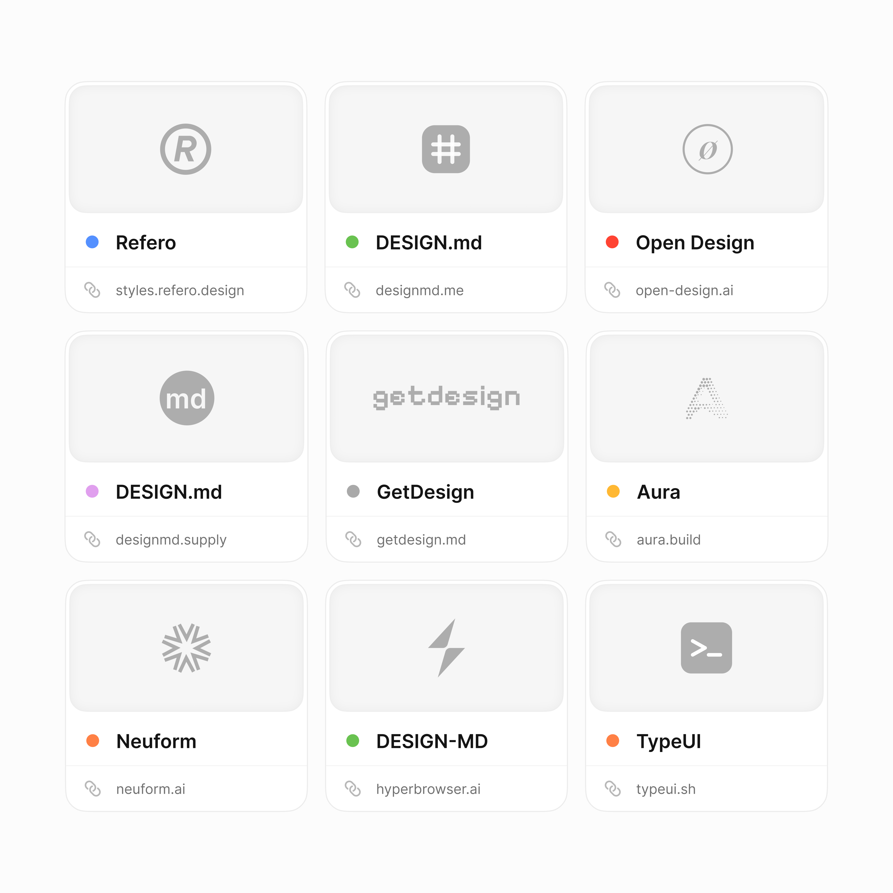

# Best websites to get DESIGN.md

> Source: https://x.com/tranmautritam/status/2095078647652917329
> Author: Tran Mau Tri Tam (@tranmautritam)
> Posted: 2026-09-02T09:17:28Z
> Stats (at capture): 70,652 views · 1,444 likes · 29 replies · 171 reposts · 2,812 bookmarks · 4 quotes
> Captured: 2026-09-02T17:39:26Z

## Post

Top best websites to get DESIGN.md. Save for later 👇

- http://styles.refero.design
- http://designmd.me
- http://open-design.ai
- http://designmd.supply
- getdesign.md
- http://aura.build
- http://neuform.ai
- http://design-md.hyperbrowser.ai
- http://typeui.sh

What am I missing?

Note-tweet (Typefully). Display used mathematical bold “DESIGN.md”. `getdesign.md` had no t.co wrapper in the tweet; it resolves to https://getdesign.md/ (HTTP 200).

## Media

One still, 4096×4096 PNG (`media/photo.png`). Collage/graphic of the listed DESIGN.md sites. No native video.

## Author bio (at capture)

Product Designer • Ex. UI8 Design Lead • Built http://Pixlo.me  
Envato Power Elite + UI Best Seller on Themeforest  
AI Explorer  
111K+ Dribbble  
Location/DM: hello@tranmautritam.com  
Website: http://tranmautritam.com

## Thread

fx/vx return counts only. Thread + first-level replies from `r.jina.ai` on the status URL, then each tweet re-fetched via `api.fxtwitter.com`. Nested replies from jina on Patrick’s comment. Quotes tab and conversation search login-walled. Threadreader redirected to login.

29 replies on the original. 1 author promo self-reply + 1 first-level comment with an extra DESIGN.md URL were visible. Remaining replies behind X login — likely more “what am I missing?” links.

### Tran Mau Tri Tam ([@tranmautritam](https://x.com/tranmautritam)) — [2095104614685356403](https://x.com/tranmautritam/status/2095104614685356403)

> Enjoy my content? Click the link to explore more! https://tranmautritam.com 👈 @tranmautritam

Promo card, not a list add. ~3h after the parent.

## Link list (post + visible comments)

From the parent:

1. https://styles.refero.design/
2. https://designmd.me/
3. https://open-design.ai/
4. https://designmd.supply/
5. https://getdesign.md/ (posted as `getdesign.md`)
6. https://aura.build/
7. https://neuform.ai/
8. https://design-md.hyperbrowser.ai/
9. https://typeui.sh/

From comments:

10. https://www.sokosumi.com/tools/design-md (Patrick Tobler)

## Comments

### Patrick Tobler ([@Padierfind](https://x.com/Padierfind)) — [2095087368013308011](https://x.com/Padierfind/status/2095087368013308011)

> https://www.sokosumi.com/tools/design-md too ;D

Card: Free DESIGN.md generator for AI coding agents | Sokosumi. 2 replies · 16 likes · 1,136 views.

#### Tran Mau Tri Tam ([@tranmautritam](https://x.com/tranmautritam)) — [2095101601145102703](https://x.com/tranmautritam/status/2095101601145102703)

> Awesome, thanks for sharing 🥰

#### $beacn ([@BEACNpool](https://x.com/BEACNpool)) — [2095102473669062724](https://x.com/BEACNpool/status/2095102473669062724)

> Might have to snipe IOG website lol 😍

No extra DESIGN.md URL.

Remaining ~27 replies were behind X login.

## Links

- https://styles.refero.design/
- https://designmd.me/
- https://open-design.ai/
- https://designmd.supply/
- https://getdesign.md/
- https://aura.build/
- https://neuform.ai/
- https://design-md.hyperbrowser.ai/
- https://typeui.sh/
- https://www.sokosumi.com/tools/design-md
- https://tranmautritam.com/
- http://Pixlo.me
