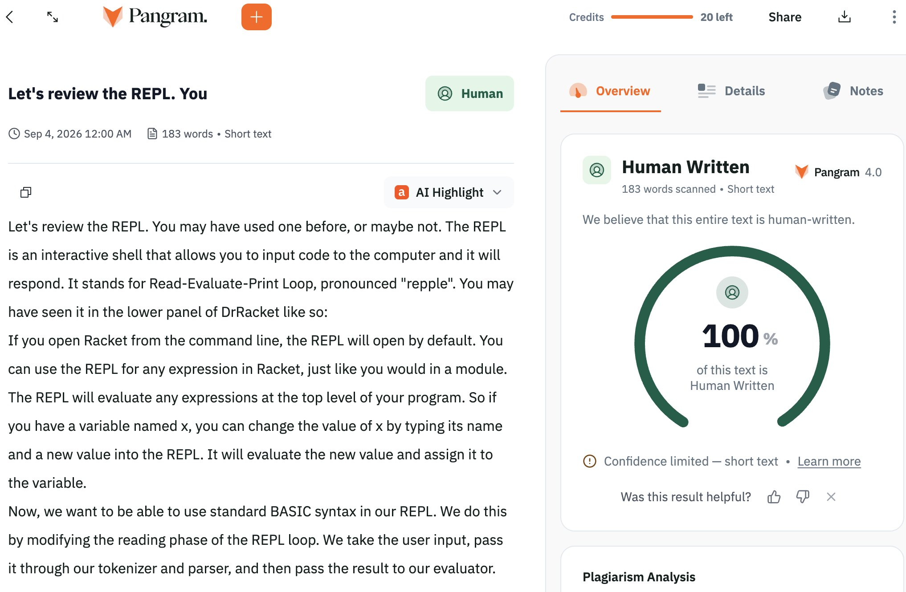

# Finally generated some text that scores 100% human on pangram. Now Qwen3-8B-Base instead of 4B and trained on 4k

> Source: https://x.com/NavinFS/status/2096089511889600731 — @NavinFS (NavinF) — posted Sat Sep 05 04:14:17 +0000 2026 — likes 857 · reposts 23 · replies 30 · views 43520 (at capture)

> Author bio: http://github.com/NavinF Python/C++/Java

## Post

Finally generated some text that scores 100% human on pangram. Now Qwen3-8B-Base instead of 4B and trained on 4k articles instead of 500. Single RTX 4090.

## Media

Original (photo): https://pbs.twimg.com/media/HRbNquyaMAA13h-.jpg?name=orig

## Thread

### @NavinFS — [2096135417087328430](https://x.com/NavinFS/status/2096135417087328430)

> @max_spero_ odds on min parameters needed to humanize text consistently? For my use cases, I think 8B is almost enough: https://x.com/NavinFS/status/2095436287977419179

### @NavinFS — [2096284796091777266](https://x.com/NavinFS/status/2096284796091777266)

> @_machi47 @ImLunaHey https://x.com/NavinFS/status/2096218709736227324

### @NavinFS — [2096283455789449392](https://x.com/NavinFS/status/2096283455789449392)

> @notjazii https://x.com/NavinFS/status/2096218709736227324

### @NavinFS — [2096148846007226676](https://x.com/NavinFS/status/2096148846007226676)

> @ttywisp People pay good money to my competitors and that was on my mind when I trained the 4B model. Well maybe not "good money" per se, but certainly enough to get me more GPUs. Planning to put it up for free on bunnystomp soon https://x.com/NavinFS/status/2096148846007226676/photo/1

### @NavinFS — [2096218815206199386](https://x.com/NavinFS/status/2096218815206199386)

> @fyidhrumil https://x.com/NavinFS/status/2095387555151933883

### @NavinFS — [2096286531288002916](https://x.com/NavinFS/status/2096286531288002916)

> @aryantwitting ~4 hours for just training. ~1 day for the full pipeline incl generating slopified articles to train on

### @NavinFS — [2096288328152924447](https://x.com/NavinFS/status/2096288328152924447)

> @RebentischT Trying. Pangram warns below ~200 words while my model is trained on 250 words median. Much bigger outputs than what it was trained on tends to make it repeat or otherwise degrade which kinda matters more than whether it's classified human

### @NavinFS — [2096284243756507146](https://x.com/NavinFS/status/2096284243756507146)

> @theTonyLab did that, didn't find a single one that rewrites text agressively enough to be considered creative nor any that beat pangram

### @NavinFS — [2096509648778183089](https://x.com/NavinFS/status/2096509648778183089)

> @LH Will do. TBH I never considered that, but it kinda makes sense. The text should be cleaner than pages from my web search index. But I'm not sure if I have enough model capacity to handle so many different writing styles so we'll see!

### @NavinFS — [2096362142866051408](https://x.com/NavinFS/status/2096362142866051408)

> @TonioBF soon!

### @NavinFS — [2098555670660632846](https://x.com/NavinFS/status/2098555670660632846)

> @LH will try to put up some docs tomorrow. Also hoping I can get inference running on another machine with a 3090 so people can play with the model online

### @NavinFS — [2096289851498967069](https://x.com/NavinFS/status/2096289851498967069)

> @OzanAndac_ You fine tuned it using that same system prompt right? If not, the model is still trying to predict the next token after your prompt which will lead to weird results if your prompt is unlike anything it saw during pretraining

## Comments

### @LH — [2096507627467427956](https://x.com/LH/status/2096507627467427956)

> @NavinFS This is so awesome. Can you please also download the LaTeX source for a bunch of highly-cited math, physics, and CS papers from the last 20 years (excluding the last 2 years, to avoid LLM output), and add these to your training set, so it can handle scientific writing?

### @OzanAndac_ — [2096257630977061209](https://x.com/OzanAndac_/status/2096257630977061209)

> @NavinFS How do you manage to make Qwen3-8B-Base work consistently for higher context? When I tried to tweak it with long system prompts, it started putting weird ASCII characters in the middle of my articles every time. Now I'm testing some other method & model

### @RebentischT — [2096219621909057766](https://x.com/RebentischT/status/2096219621909057766)

> @NavinFS Does it stay at human with longer texts (above the "low certainty due to short Text" warning threshhold)?
