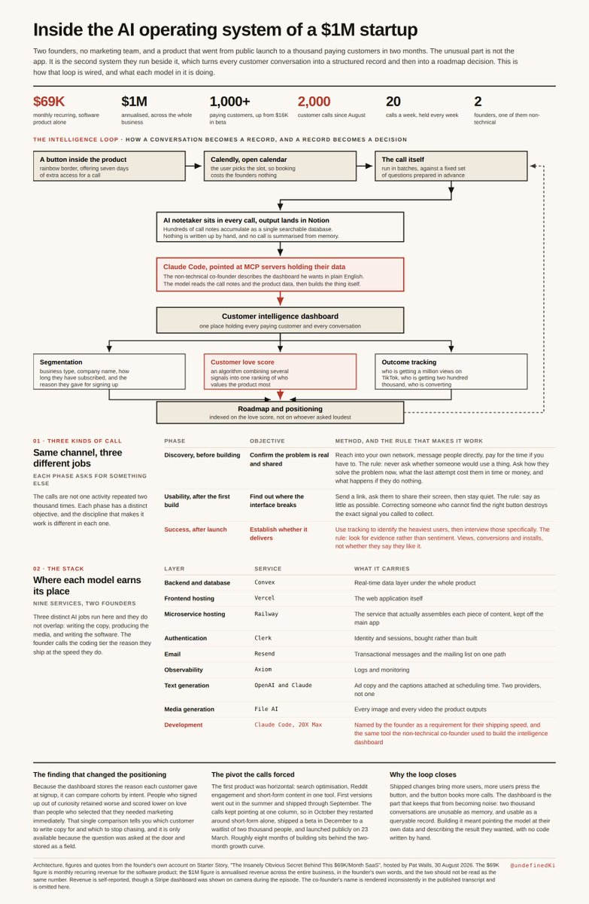

# A two-person AI startup crossed $1 million in annualized revenue two months after launch. The founder just walked

> Source: https://x.com/undefinedKi/status/2096224107121516997 — @undefinedKi (Yarchi) — posted Sat Sep 05 13:09:07 +0000 2026 — likes 739 · reposts 84 · replies 43 · views 106483 (at capture)

> Author bio: AI & tech researcher | Data engineer | Building cool stuff | Sharing everything I learn

## Post

A two-person AI startup crossed $1 million in annualized revenue two months after launch. The founder just walked through how the whole thing runs.

Fastlane makes short-form video ads. You paste your website, it finds what is trending in your niche, builds the content, and posts it. The interface is Tinder. Swipe right and it is live on TikTok in five minutes.

The interesting part is the layer behind the product.

Every customer call runs with an AI notetaker and a fixed question set, and the notes land in Notion. Hundreds of them. Then they pointed Claude at that database and had it build a dashboard they call customer intelligence.

It segments every paying customer by business type, how long they have subscribed, and the reason they gave when they signed up. It scores each one on how much they love the product, and the roadmap is indexed on that score rather than on requests.

That scoring produced the finding that shaped their positioning. People who signed up out of curiosity retained worse than people who picked "I need marketing now."

The non-technical co-founder built the dashboard himself, using Claude Code against MCP servers holding their data, describing what he wanted in plain English.

The calls that fill it come from a rainbow-bordered button in the app offering seven days of extra access. Two thousand of them since August.

Full breakdown in the article below.

## Media

Original (photo): https://pbs.twimg.com/media/HRdIt0IaIAAgzSt.jpg?name=orig

## Quoted post

[@undefinedKi (Yarchi)](https://x.com/undefinedKi/status/2095876609689498067) — posted Fri Sep 04 14:08:17 +0000 2026 — likes 360 · reposts 39 · replies 22 · views 702875 (at capture)

> https://t.co/1P5kgpB1X8

## Links

- https://x.com/i/article/2094921767374532608

## Thread

### @undefinedKi — [2096224193335398421](https://x.com/undefinedKi/status/2096224193335398421)

> Sources:
>
> Interview with the founder: https://www.youtube.com/watch?v=BA_fC95p43c
>
> Launch record: https://www.producthunt.com/products/fastlane-3

## Comments

### @Mitre88 — [2096266161327358258](https://x.com/Mitre88/status/2096266161327358258)

> @undefinedKi this https://www.amazon.com.mx/Agent-Engineer-Designing-Long-Running-Production-ebook/dp/B0HB3NP8G7/ref=sr_1_3?dib=eyJ2IjoiMSJ9.4JSGoiI7_29lZzl-voMtayB9WVd8KElppR4B5XHRDfdrTh2SMqi1FKfOie3Q1ohd1P9rDIwArbeBLN7By8lg8Q.udwrZBOZ811jSpeCEot9AeKyVTcMaz1naSIZXzx34qc&dib_tag=se&qid=1788623728&refinements=p_27%3AAlejandro+Hernández+Mitre&s=digital-text&sr=1-3&text=Alejandro+Hernández+Mitre

### @NikhilLamba6 — [2096709242854293757](https://x.com/NikhilLamba6/status/2096709242854293757)

> @undefinedKi yeah, that's the current thing.
> One-person business.
>
> If someone wants to do this, cost efficiently and model efficiently, sharing a post here:-
> https://x.com/NikhilLamba6/status/2096707077939101739?s=20

### @OMID_0909 — [2096234888949051654](https://x.com/OMID_0909/status/2096234888949051654)

> @undefinedKi https://x.com/omid_0909/status/2096118554449858984

### @mdapiio — [2096472181521653927](https://x.com/mdapiio/status/2096472181521653927)

> @undefinedKi https://mdapi.io

### @AIAngelInvestor — [2096603301613891794](https://x.com/AIAngelInvestor/status/2096603301613891794)

> @undefinedKi This is exactly the kind of lean AI execution that gets me excited. Two people, real revenue, Claude doing the heavy lifting on customer intelligence. The love-score roadmap is brilliant too.

### @RohOnChain — [2096242801319239722](https://x.com/RohOnChain/status/2096242801319239722)

> @undefinedKi wow, just a two person startup making 1 mil in just 2 months - insane bro

### @Media_Mentors — [2096712598331015242](https://x.com/Media_Mentors/status/2096712598331015242)

> @undefinedKi We aren't too far behind you!  Took us 7 months.  Closing in on $2M ARR

### @finlayekins — [2096769773770281267](https://x.com/finlayekins/status/2096769773770281267)

> @undefinedKi @gauravsbuilding this is tuff you got some game time analysis happening

### @GrowthForks — [2096604449338962297](https://x.com/GrowthForks/status/2096604449338962297)

> @undefinedKi curious how they calibrated the “love the product” score. was it mostly call data, usage data, or a mix of both?

### @MrrrOzi — [2096224688112353682](https://x.com/MrrrOzi/status/2096224688112353682)

> @undefinedKi Two people and a bot just out-hustled every agency on the block, and the bot wrote the ads.

### @gauravsbuilding — [2096771630194381254](https://x.com/gauravsbuilding/status/2096771630194381254)

> @undefinedKi *three-person startup.

### @PangoGolf — [2096610133316903125](https://x.com/PangoGolf/status/2096610133316903125)

> @undefinedKi video creation step just says “Live AI” which isn’t a thing

### @DanielSmidstrup — [2096326854164587001](https://x.com/DanielSmidstrup/status/2096326854164587001)

> @undefinedKi just curious" might be the most expensive signup reason :D

### @marcheelitaa — [2096811393702064192](https://x.com/marcheelitaa/status/2096811393702064192)

> @undefinedKi website to posted video with zero human editing in between
