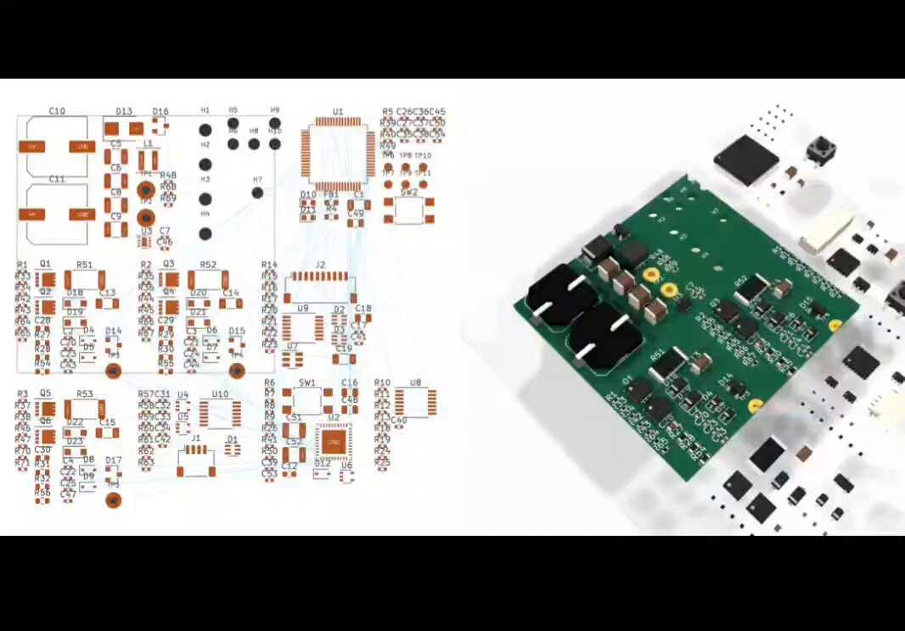

# 3 KiCad MCP servers bringing AI into PCB design  1. KiCad MCP Server by Seeed Studio Analyze schematics & PCBs, trace

> Source: https://x.com/Alacritic_Super/status/2096269926302613765 — @Alacritic_Super (Praveen Kumar Verma) — posted Sat Sep 05 16:11:11 +0000 2026 — likes 500 · reposts 76 · replies 10 · views 71141 (at capture)

> Author bio: FinTech by day. At night I build DIY robots that think with their bodies. Embodied AI, microcontrollers & open-source hardware for makers. DM for collab.

## Post

3 KiCad MCP servers bringing AI into PCB design

1. KiCad MCP Server by Seeed Studio
Analyze schematics & PCBs, trace pin-level connections, inspect designs, run ERC/DRC and automate parts of the workflow.
 https://t.co/iLggIsBzfj

2. KiCAD-MCP-Server by mixelpixx
A feature-rich option for AI-assisted PCB design. Supports schematic editing, component placement, routing, DRC/ERC, custom footprints/symbols, manufacturing exports and more.
 https://t.co/KPKHdqOmJh

3. kicad-mcp by lamaalrajih
An open-source MCP integration for connecting AI clients with KiCad projects and automating PCB/EDA workflows.
 https://t.co/2ivURTRJmq

## Media

Original (video): https://video.twimg.com/amplify_video/2096162248402313216/vid/avc1/1066x744/oz05ysdj7rpWFMMD.mp4?tag=29

Original (thumbnail): https://pbs.twimg.com/amplify_video_thumb/2096162248402313216/img/XL__D26DVPuLnxjd.jpg

## Quoted post

[@Alacritic_Super (Praveen Kumar Verma)](https://x.com/Alacritic_Super/status/2096162271517196465) — posted Sat Sep 05 09:03:24 +0000 2026 — likes 138 · reposts 16 · replies 7 · views 54723 (at capture)

> Idea today. PCB tomorrow.
>
> This is GPT-6 Astra working in KiCad, taking a circuit schematic and turning it into an actual PCB layout.
>
> It handles things like placing components and routing copper traces which are two of the most time-consuming parts of PCB design.
>
> For hardware engineers, this could mean spending less time on repetitive layout work and more time on designing, testing and improving the actual product.
>
> AI-assisted hardware design is getting seriously interesting.

## Links

- https://github.com/Seeed-Studio/kicad-mcp-server
- https://github.com/mixelpixx/KiCAD-MCP-Server
- https://github.com/lamaalrajih/kicad-mcp

## Thread

### @Alacritic_Super — [2096269929729359921](https://x.com/Alacritic_Super/status/2096269929729359921)

> AI can now go beyond explaining your PCB and actually interact with your KiCad workflow.

### @Alacritic_Super — [2096605880695582975](https://x.com/Alacritic_Super/status/2096605880695582975)

> If you want to try out beta version of Konnect by mixelpixx which is rewritten in rust of option 2. Try this
> https://github.com/mixelpixx/Konnect

### @Alacritic_Super — [2096605470022894030](https://x.com/Alacritic_Super/status/2096605470022894030)

> @haarts It is updated version of mixelpixx only currently at beta release
> https://github.com/mixelpixx/Konnect

### @Alacritic_Super — [2096578140663623834](https://x.com/Alacritic_Super/status/2096578140663623834)

> @Vexldiy True. Even for starting this is good.

### @Alacritic_Super — [2096291633025482756](https://x.com/Alacritic_Super/status/2096291633025482756)

> @catmanyau You will have to use better models to make schematics in one shot otherwise you have to iterate multiple times. You are just giving prompts and agent is listening to your commands so you can change it anytime.

### @Alacritic_Super — [2096405356360655197](https://x.com/Alacritic_Super/status/2096405356360655197)

> @vitalduval It will not take much time for integrated process, we just have to integrate plugins for processing each piece of the process.

### @Alacritic_Super — [2096404779828490428](https://x.com/Alacritic_Super/status/2096404779828490428)

> @FlowOpsDaily True. It is worth to read and they shipped their own version for it.

### @Alacritic_Super — [2096406090519101680](https://x.com/Alacritic_Super/status/2096406090519101680)

> @KanagawaMarcos Totally agree. Standard coding benchmarks are already saturated, so we definitely need a dedicated physical
> hardware details.

### @Alacritic_Super — [2096524050289807693](https://x.com/Alacritic_Super/status/2096524050289807693)

> @AeracerFpv This is also good to describe details in zenith file and use pcbnew command to nmbuild boards and layouts

### @Alacritic_Super — [2096290953938280482](https://x.com/Alacritic_Super/status/2096290953938280482)

> @tryingET Because people already know about kicad and have been using it for a long time.

## Comments

### @catmanyau — [2096289514956189868](https://x.com/catmanyau/status/2096289514956189868)

> @Alacritic_Super the manufacturing export support is the key detail here, not just ai reading schematics. can these servers recover cleanly when a drc violation requires changing placement or routing?

### @vitalduval — [2096362373842194833](https://x.com/vitalduval/status/2096362373842194833)

> @Alacritic_Super Absolutely insane. The PCB is super clean too.
> Wonder when we'll get a fully integrated process where AI does the schematic and parts sourcing too.

### @AeracerFpv — [2096438112822177952](https://x.com/AeracerFpv/status/2096438112822177952)

> @Alacritic_Super Kicad MCP pro is good also I use Diode PCB for Fable to describe the PCB in a .Zen file that then gets layed out in Kicad.

### @FlowOpsDaily — [2096297718918623408](https://x.com/FlowOpsDaily/status/2096297718918623408)

> @Alacritic_Super Seeed Studio connected to MCP is the technical detail that makes this worth reading.

### @KanagawaMarcos — [2096334743792992755](https://x.com/KanagawaMarcos/status/2096334743792992755)

> @Alacritic_Super Would be cool to see a benchmark comparing AI in hardware design
