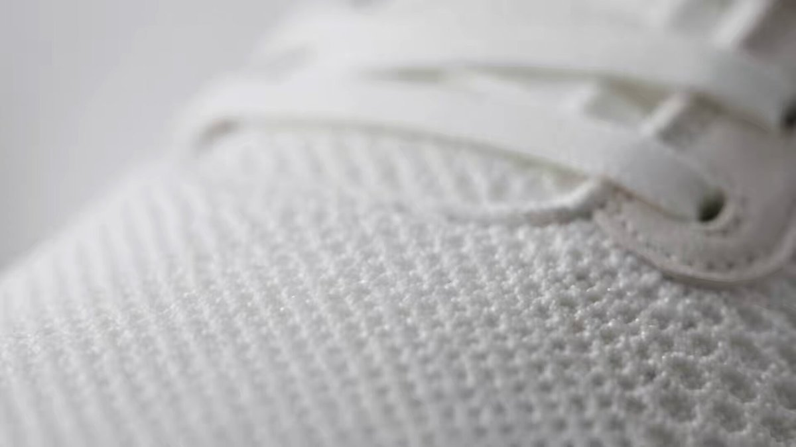

# GPT-6 Astra generated this shoe advert. Using GPT Images 2.0 it was able to generate the initial shoe product, then

> Source: https://x.com/jerrod_lew/status/2096307244921164232 — @jerrod_lew (Jerrod Lew) — posted Sat Sep 05 18:39:29 +0000 2026 — likes 521 · reposts 41 · replies 41 · views 56702 (at capture)

> Author bio: Artist, creator and educator. Teaching you to tell stories without limits. Consider subscribing to my newsletter: https://jerrodlew.beehiiv.com/

## Post

GPT-6 Astra generated this shoe advert.

Using GPT Images 2.0 it was able to generate the initial shoe product, then bring it to life with storyboards and UGC.

Highly recommend connecting a creative MCP like Magnific to ChatGPT!

Check out all the images below. https://t.co/pgNBrUgSqC

## Media

Original (video): https://video.twimg.com/amplify_video/2096307205016637440/vid/avc1/1920x1080/JbxKNwCHZ44Xt6X4.mp4?tag=16

Original (thumbnail): https://pbs.twimg.com/amplify_video_thumb/2096307205016637440/img/KxjWFogRrHrXJDWs.jpg

## Thread

### @jerrod_lew — [2096307273404719118](https://x.com/jerrod_lew/status/2096307273404719118)

> Here are the two original images created with GPT-6 Astra!
>
> Everything from here was prompted and build directly afterwards. https://x.com/jerrod_lew/status/2096307273404719118/photo/1

### @jerrod_lew — [2096307318636048532](https://x.com/jerrod_lew/status/2096307318636048532)

> Here are some images of the storyboards created by GPT-6 Astra.
>
> It used ChatGPT Images 2.0 to generate them with Krea Agents. https://x.com/jerrod_lew/status/2096307318636048532/photo/1

### @jerrod_lew — [2096307420922523871](https://x.com/jerrod_lew/status/2096307420922523871)

> Multiple UGC videos were generated with GPT-6 Astra and the Krea Agent as well.
>
> I asked for multiple styles to iterate what would work best with the shoe product.
>
> Really loved how it all came together. https://x.com/jerrod_lew/status/2096307420922523871/video/1

### @jerrod_lew — [2096307525264326917](https://x.com/jerrod_lew/status/2096307525264326917)

> More UGC style content created with GPT-6 Astra! https://x.com/jerrod_lew/status/2096307525264326917/video/1

### @jerrod_lew — [2096338668579336650](https://x.com/jerrod_lew/status/2096338668579336650)

> @animiotics ?
>
> https://openai.com/index/introducing-chatgpt-images-2-0/

### @jerrod_lew — [2097083809917493454](https://x.com/jerrod_lew/status/2097083809917493454)

> @bartek_wl Is it "slop" because you don't like it?
>
> I think it's pretty cool that Astra could help create these assets from scratch!

### @jerrod_lew — [2096571020912021981](https://x.com/jerrod_lew/status/2096571020912021981)

> @congyiszizu Magnific was used for the video, Astra planned and prompted everything for me

### @jerrod_lew — [2097083846701551617](https://x.com/jerrod_lew/status/2097083846701551617)

> @itsSaira_1 Thank you!

## Comments

### @_IGI_Media_ — [2096325729990369445](https://x.com/_IGI_Media_/status/2096325729990369445)

> 😂😂
> Seeing Astra on the sneakers reminded me that my sense of humor is sometimes not welcomed by those targeted by it.
>
> Was in the grocery store, and a lady i know was reaching for a pound of butter.
> Me "that butter has AI in it"
> She tossed it back on the shelf with the same distain as if you notice you picked up something that had shit on it.
>
> I had told him what i'm currently doing.
> He told me his mom is scared of AI.
>
> Her son was in tears.
> he picked up the butter and gently placed it back in the cart.
> she looked at him smiling and me smiling  then politely swore at me :-P

### @glennchrpntr — [2096311039944007910](https://x.com/glennchrpntr/status/2096311039944007910)

> @jerrod_lew The impressive part isn’t any single image. It’s going from a product concept to a coherent campaign without losing the visual identity halfway through.

### @itsthedonhashim — [2096324819918659785](https://x.com/itsthedonhashim/status/2096324819918659785)

> @jerrod_lew @jerrod_lew cool use of AI! curious if you hit any challenges with the UGC part? when I tried something similar, integration was a bit tricky.

### @ggtt211931 — [2096460628714278982](https://x.com/ggtt211931/status/2096460628714278982)

> @jerrod_lew 这里面有个细节：你上面提到的是用ChatGPT的Image二点零，然后生成的这个图片。然后又用了这个GPT 6 Astra，然后生成的广告。也就是说，先在ChatGPT里边生成类似的图片，然后再到CodeX里边调用GPT 6 Astra这个模型来生成广告，对吗？因为现在的ChatGPT是没有GPT 6 Astra这个模型的。这一点真是割裂。

### @DaebakbuysPh — [2096785071873376327](https://x.com/DaebakbuysPh/status/2096785071873376327)

> @jerrod_lew been doing similar shoe ad workflows, chatgpt for storyboard and shot logic then krea nodes to reuse the same product setup across ugc variations.

### @websterweby — [2096461333948735884](https://x.com/websterweby/status/2096461333948735884)

> @jerrod_lew damn that shoe actually looks clean.
>
> the storyboard part is what gets me, feels like a whole ad agency in one prompt now

### @congyiszizu — [2096511415062245671](https://x.com/congyiszizu/status/2096511415062245671)

> @jerrod_lew Hi Jerrod, what did you use for the actual video. Was this a third party app/plugin or was it all Astra and GPT Images?
