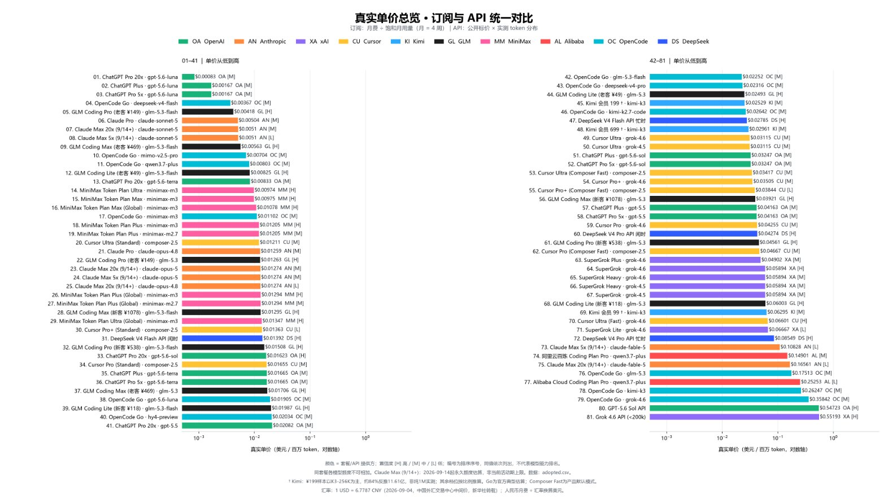
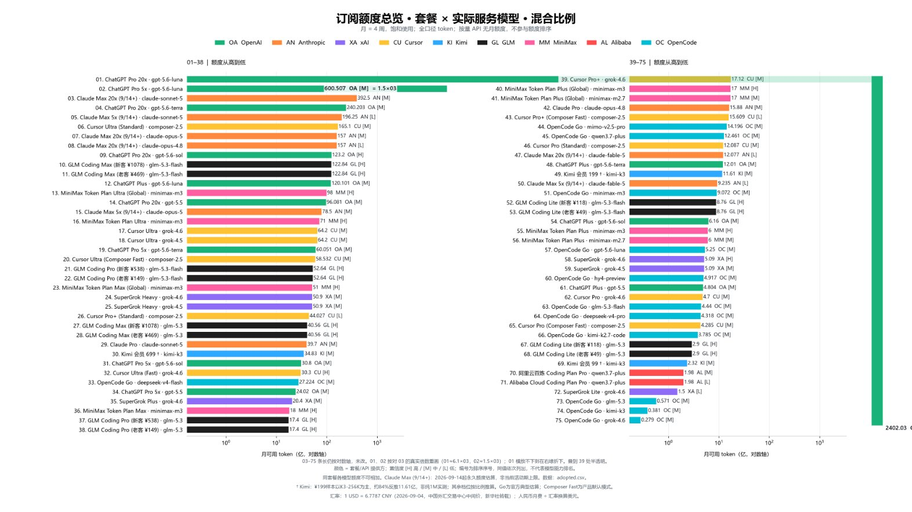

# 介绍"真实 API 计价法"——将你为 AI 订阅所支付的价格和你所真实获得的额度做比较，并以此进行模型的真实计价。以及以此计价法所绘制的帕累托前沿图。 即：订阅价格 / Tokens 额度 在此计价法下，传统的 AI

> Source: https://x.com/Fei2411/status/2096307755481211346 — @Fei2411 (FeiZ) — posted Sat Sep 05 18:41:31 +0000 2026 — likes 943 · reposts 77 · replies 77 · views 192010 (at capture)

> Author bio: Personal Agent Dev · Economics·AI Engineer Specializing in how AI can be applied to life 📮caposolestull@gmail.com

## Post

介绍"真实 API 计价法"——将你为 AI 订阅所支付的价格和你所真实获得的额度做比较，并以此进行模型的真实计价。以及以此计价法所绘制的帕累托前沿图。

即：订阅价格 / Tokens 额度

在此计价法下，传统的 AI 性价比认知被彻底打破：以性价比著称的 DeepSeek V4 Flash 和 Grok 4.6，在此计价下分别仅排名 #31（闲时 API，$0.01392/MTok）和 #63（SuperGrok Plus，$0.04902/MTok）。

而一直被认为高价格的 GPT-5.6 Sol 和 Opus 5，则分别最高排名 #33（$0.01623/MTok）和 #23（$0.01274/MTok）。此外，我们也看到了一组非常震撼的数据——在此计价法下，GPT-5.6 Luna 排名 #1，在ChatGPT Pro 20x 的真实 API 计价仅为 $0.00083/MTok。令人惊叹的模型！ @OpenAI 

此外，我们还对订阅额度的数据进行了测算及整理，在图 2 中你应该能清晰看到它们的排名。特别说明，仅 1、2对3 采取真实比例绘制，其他均为对数测算。

数据均来源于网络公开资料与用户实测截图，如果你有准确的使用数据，欢迎分享在评论区或者私信我。完整数据库和算法将在之后开源在https://t.co/x2tw3axw6W

## Media

Original (photo): https://pbs.twimg.com/media/HReUygZbgAAKIu3.jpg?name=orig

Original (photo): https://pbs.twimg.com/media/HReUygXacAAn4nC.jpg?name=orig

## Links

- https://github.com/FeiZhuLulu/real-api-pricing

## Thread

### @Fei2411 — [2096307759771943355](https://x.com/Fei2411/status/2096307759771943355)

> 完整数据：
> 序号  套餐                               价格/月   服务模型           月额度(亿)  $/MTok   置信度
>
> 1     ChatGPT Pro 20x                    USD 200   gpt-5.6-luna       2402.03     0.00083  medium
> 2     ChatGPT Plus                       USD 20    gpt-5.6-luna       120.101     0.00167  medium
> 3     ChatGPT Pro 5x                     USD 100   gpt-5.6-luna       600.507     0.00167  medium
> 4     OpenCode Go                        USD 10    deepseek-v4-flash  27.224      0.00367  medium
> 5     GLM Coding Pro (老客 ¥149)         CNY 149   glm-5.3-flash      52.64       0.00418  high
> 6     Claude Pro                         USD 20    claude-sonnet-5    39.7        0.00504  medium
> 7     Claude Max 20x (9/14+)             USD 200   claude-sonnet-5    392.5       0.0051   medium
> 8     Claude Max 5x (9/14+)              USD 100   claude-sonnet-5    196.25      0.0051   low
> 9     GLM Coding Max (老客 ¥469)         CNY 469   glm-5.3-flash      122.84      0.00563  high
> 10    OpenCode Go                        USD 10    mimo-v2.5-pro      14.196      0.00704  medium
> 11    OpenCode Go                        USD 10    qwen3.7-plus       12.461      0.00803  medium
> 12    GLM Coding Lite (老客 ¥49)         CNY 49    glm-5.3-flash      8.76        0.00825  high
> 13    ChatGPT Pro 20x                    USD 200   gpt-5.6-terra      240.203     0.00833  medium
> 14    MiniMax Token Plan Ultra           CNY 469   minimax-m3         71          0.00974  high
> 15    MiniMax Token Plan Max             CNY 119   minimax

## Comments

### @JeremyR_Pearson — [2096679557671645201](https://x.com/JeremyR_Pearson/status/2096679557671645201)

> Ok, so if we take AA's tokens-per-task data and these quota estimates the plans look kinda like this?
>
> xAI's 300$ tier starts to look like a complete joke here and holy shit that GLM 5.3 allowance for 69$ equivalent is crazy...

### @nullmasterb — [2096614037731606702](https://x.com/nullmasterb/status/2096614037731606702)

> Anthropic uses a different tokenizer and identical text consumes on average 30% more tokens. Also Anthropic just uses more steps and reasoning tokens. some models 2x more, some models 3x more. It is just not comparable.

### @neuronxwhite — [2097186455273750966](https://x.com/neuronxwhite/status/2097186455273750966)

> Devin 中使用 Fable5.1 vs Claude 订阅使用 Fable 5.1，会相差多少？

### @zhaoxiweieu — [2096418883695473136](https://x.com/zhaoxiweieu/status/2096418883695473136)

> The report burst onto the scene, and calling it a demon-revealing mirror would be no exaggeration—it directly shattered the subscription-model ghouls and goblins that had been lurking for years. This benchmark should keep going strong!

### @KerryKe62728410 — [2096357473641001054](https://x.com/KerryKe62728410/status/2096357473641001054)

> opencode go, add muse spark 1.3 into it and see. This one's pretty handy.

### @Zero85350111 — [2096996813144469586](https://x.com/Zero85350111/status/2096996813144469586)

> 我实测grok heavy 使用grok4.6 10亿token消耗周额度的40% 这么看4周的总额度在100亿左右～

### @IronwaterX92030 — [2096757808410878096](https://x.com/IronwaterX92030/status/2096757808410878096)

> 请问会实时更新么

### @xhoox123 — [2096591612142903327](https://x.com/xhoox123/status/2096591612142903327)

> 花得越多单价越便宜？强制你花更多钱吗？

### @ixhsnh8r — [2096416025898254695](https://x.com/ixhsnh8r/status/2096416025898254695)

> commandcode不应该比opencode go的deepseek便宜吗

### @Lemon00226 — [2097752533032956286](https://x.com/Lemon00226/status/2097752533032956286)

> 你这个东西太实用了，就是要求很高的时效性

### @leecz2012 — [2096622091558936806](https://x.com/leecz2012/status/2096622091558936806)

> 补了一点实际数据 做的很好

### @xiaochun_dev — [2096832500031209895](https://x.com/xiaochun_dev/status/2096832500031209895)

> 支持bro！期待后续更新！！！

### @SemiColin97 — [2096441277218685022](https://x.com/SemiColin97/status/2096441277218685022)

> Curious where Gemini ends up
