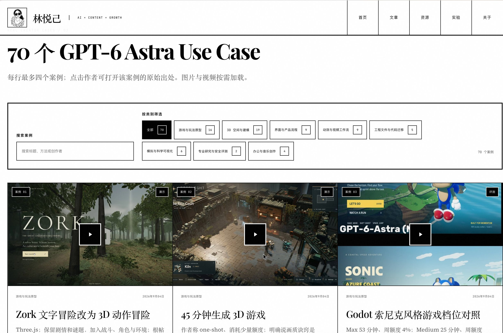

# 我天这些人动作太快了 70个 GPT 6-Astra 使用案例 还带提示词的 直接打开看效果 看提示词 去获得灵感 这个赛道开启了 堪比当年提示词啊 赶快收藏这个网址吧 评论区拿 https://t.co/Q1K5KqtzaE

> Source: https://x.com/xiaoerzhan/status/2096445044643271105 — @xiaoerzhan (小耳👂Jane｜Xiaoer) — posted Sun Sep 06 03:47:03 +0000 2026 — likes 433 · reposts 59 · replies 15 · views 30946 (at capture)

> Author bio: AI 艺术家｜Builder工具开源+审美 Github：https://github.com/Jane-xiaoer| Omia 阅读器➡️http://xiaoeromia.com ｜小耳FM ➡️https://fm.xiaoercamera.xyz/xiaoer-fm-player V: xiaoer-zhan

## Post

我天这些人动作太快了
70个 GPT 6-Astra 使用案例
还带提示词的

直接打开看效果
看提示词
去获得灵感
这个赛道开启了

堪比当年提示词啊
赶快收藏这个网址吧
评论区拿 https://t.co/Q1K5KqtzaE

## Media

Original (photo): https://pbs.twimg.com/media/HRgHSmSXsAMebN6.jpg?name=orig

## Thread

### @xiaoerzhan — [2096821882028687519](https://x.com/xiaoerzhan/status/2096821882028687519)

> You should open the original file to see if the author has released the prompts.

## Comments

### @3three_AI — [2101507137323078057](https://x.com/3three_AI/status/2101507137323078057)

> AI beauty is best to first create a character card.
>
> Otherwise, when changing poses, clothes, or scenes, the face and figure can easily drift.
>
> I've put the character card Prompt that I'm using below.

### @penny777 — [2101596477911134378](https://x.com/penny777/status/2101596477911134378)

> A particularly fun prompt: Give the image below to your AI Agent and then ask it:
>
> "Based on everything you know about me, fill both sides of this container"
>
> You'll get a really interesting result

### @glunsan — [2096819690094149873](https://x.com/glunsan/status/2096819690094149873)

> Where is the prompt?
