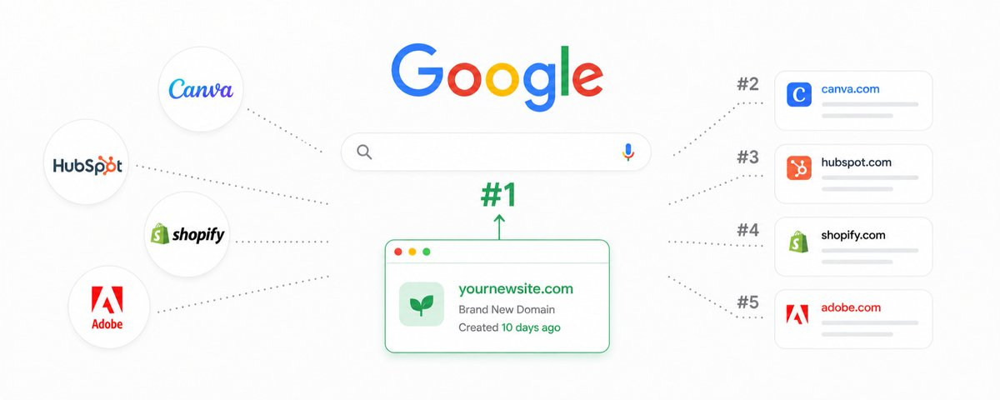

# How To Turn A Brand New Domain Into Ranking #1 On Google and AI Search (5-Step Roadmap)

> Source: https://x.com/denohawari/status/2096587991452148127
> Author: deno (@denohawari)
> Posted: 2026-09-06T13:15:04Z
> Stats (at capture): 13,241 views · 117 likes · 7 replies · 8 reposts · 387 bookmarks · 1 quotes
> Captured: 2026-09-21T15:33:42Z via api.fxtwitter.com
> Author bio (at capture): helping brands show up in AI search http://trailblazermktg.com
> Author website: https://www.instagram.com/ha.wari/

## Post

https://x.com/i/article/2096587985861124096

## Article

Title: How To Turn A Brand New Domain Into Ranking #1 On Google and AI Search (5-Step Roadmap)
URL: https://x.com/i/article/2096587985861124096

Preview: you don’t need to have been in the space for 20+ years in order to rank on Google and AI search.
a brand new site can rank #1 for a keyword that your 2-decade-old company is also targeting.
it happens

Cover still: `media/article-cover.jpg`. Original: https://pbs.twimg.com/media/HRiTqEWbAAAslEK.jpg

Full body (verbatim from api.fxtwitter.com):

you don’t need to have been in the space for 20+ years in order to rank on Google and AI search.

a brand new site can rank #1 for a keyword that your 2-decade-old company is also targeting.

it happens far too constantly to ignore.

best part is that most founders don't believe it because they've been told domain authority is everything.

yes, domain authority matters. it's just not the immoveable object people think it is.

take "resignation letter template for a nurse."

a brand new site with one page built specifically for that search can outrank Canva, because Canva's page for "resignation letter template" is broad, generic, and not written for a specific audience.

now try "logo maker."

you're not beating Canva on that one, no matter how good the page is.

if you don’t know what keywords to rank for, you’ll spend a year writing content only to be stuck on Google’s page 3.

but if you understand the right words to rank, and how to increase your chances of ranking at each step, you’ll be in Google and AI’s rankings in months, even with a brand new domain.

what i’m about to share is the exact process we use to rank clients #1 on Google and AI search.

it's driven over $30M+ in revenue and it works the same whether your domain is 10 years old or 10 days old.

its a game of strategy, not of volume. anyone can do it

Step 1: Picking the right keywords

most SEO advice starts with "find high volume keywords."

but high volume keywords are also high competition keywords. every other person in your niche is racing to rank for them too

start with your ideal customer instead.

not "marketers" - that’s too vague.

a 30-year-old senior marketer earning over $100k. a 24-year-old founder running a business doing $10M ARR.

their job, their budget, the specific problem they open Google to solve.

then find the keyword they search the moment before they'd pay you.

if you sell a Shopify website builder, "Shopify website builder" is the keyword to put on your landing page.

Step 2: Finding the right format

search "Shopify website builder" and you’ll find that every result ranking is a landing page.

that's what Google wants there, so don't put a blog post on that keyword and expect it to rank.

"best Shopify page builders" is a different story. search it and every result is a blog post.

that's a blog keyword, roughly 700 searches a month, low difficulty.

you won't outrank Shopify themselves on it. but ranking 4th or 5th still pulls a third of that traffic every month, and every person reading a "best Shopify page builders" post is comparing tools with a credit card nearby.

so before writing anything, search your target keyword on Google and look at what's actually ranking:

all landing pages → build a landing page, not a blog

all blog posts → build a blog post, not a landing page

all DR 90+ sites → unless your domain is close, pick a different keyword

that last point is where most people waste a year.

a keyword can show "0 difficulty" in Ahrefs while the top 10 results are all Canva, HubSpot and Shopify.

the tool says easy. it isn't - you're not ranking there for 18 months.

skip it and find the version of that keyword the big sites didn't bother covering.

Step 3: The unpatched “free tool” method

if you sell a Shopify website builder, you could rank a blog post for "best page builders."

or you could build a free AI logo maker tool, rank it for "AI logo maker," and pull the exact same people (founders building a brand on Shopify) except now they're using your product before they've even signed up.

they bookmark the page and come back over and over, which increases site traffic

don’t just make a generic "logo maker" - that one's locked by giant sites.

you need to niche down more into something your competitors haven’t done.

"AI logo maker" is the realistic version. if your domain reputation is 50+ with enough backlinks and a better experience than what's ranking now, you can take it.

a free tool ranks harder than a blog post and converts better too, because the person using it is already doing the thing your product does.

not just that but it also builds trust in you and your brand

the person using it might eventually look at your service and think “wow this brand has helped me for free, i wonder what their paid service can help me with.”

eventually your free tool turns into a free leadsource for you and your brand

Step 4: On-page optimization

just having the target keyword in your page often isn’t enough for it to rank

for any page you want ranking, make sure the target keyword goes in:

the H1 and as many subheaders as possible

the URL

the alt text of every image and video on the page

the call to actions

and it needs to feel natural

if it reads like a keyword was jammed in 14 times, you've done it wrong and Google knows.

but skipping this entirely (which a shocking number of sites do) is why pages that deserve to rank don't.

Step 5: Backlinks still decide most rankings in 2026

good content gets you onto page 1.

backlinks are usually what gets you from position 8 to position 1, because search results are flooded with AI content now

Google’s only option is to lean harder on sites trusted by other sites

look at any competitive keyword through the Ahrefs extension and the pattern is always the same.

the top page for "AI logo maker" has 566 referring domains pointed at that one page. the lower one has 38.

the exception is sites like Canva ranking with barely any backlinks to the page - because their domain reputation is so high they don't need them.

you're not Canva. you need the links.

what an actual backlink target looks like:

over 1,000 monthly visitors to their site

domain reputation higher than yours

actually in your niche (a healthcare SaaS gets links from healthcare blogs and healthcare news, not random general directories)

if you don't have a budget for this: find those sites, offer to write them a good guest post on a topic that fits their content, include one link back to your page.

it's slow but it compounds.

a brand new domain can go up 3-5 positions in months doing only this.

Why most SEO fails

every client result we've had came down to one thing more than any tactic above: they didn't stop at month 2.

we usually start driving traffic within the first few weeks of a new SEO push.

but the results that lock competitors out of a category came from running the same approach consistently for 6 to 12 months.

some clients we've been running for 2-3 years straight, and at this point it's extremely difficult for their competitors to outrank them.

a few of those:

a B2B finance SaaS - $1.8M+ in revenue inside 12 months from organic

an eCom SaaS - went from 132 daily clicks to 1,700+ in 6 months

an EdTech client - 6k to 60k monthly visitors in a year

a B2B SaaS we ran on Reddit + Google together - $37,300/month in organic traffic value within 3 months

the clients who won just didn't stop while their competitor restarted with a new agency every 4 months.

SEO is a long game that pays off. this is why Canva and Hubspot are essentially unbeatable now - because they’ve stuck to the same strategy for years.

How to tell if your SEO strategy works:

don’t stare at your organic clicks in month 1 and panic if they aren’t going up.

clicks move last, not first. the order is usually:

keyword rankings start climbing on Ahrefs (first)

impressions grow in Google Search Console (this is the real leading signal)

non-branded organic clicks start rising (filter out every variation of your brand name in Search Console or the number will be inflated by people already searching for you)

conversions and revenue (last)

if impressions are climbing and clicks aren't yet, it's working, just early.

if nothing's moved in 90 days, something in the keyword selection or the content is wrong - it's not the timeline.

if you want us to get your brand ranking #1 on ChatGPT, book a free discovery call below:

https://trailblazermktg.com/#meeting-calender

the brand new domain you think can't compete just needs one keyword you can actually win and enough months of not quitting to win it.

most of your competitors will quit and restart with a new agency before that ever happens. that's the only reason a new domain has a shot in the first place.

Note: article contains 2 inline image(s) (DraftTweetImage mediaIds) not directly downloadable via API; bodies above are verbatim text.

## Media

Article cover original: https://pbs.twimg.com/media/HRiTqEWbAAAslEK.jpg (`media/article-cover.jpg`)

## Thread

No author self-replies visible at capture (conversation replies did not load in the logged-in bridge session; X conversation endpoint rate-limited, 13/13 pages returned the main post only).

## Comments

7 replies counted by API; none retrievable at capture (bridge n=1 article on URL-verified page after 4–6 scroll rounds; r.jina.ai x.com access blocked until 2026-09-21T15:59:15Z).

## Links

- https://x.com/i/article/2096587985861124096
- https://trailblazermktg.com/#meeting-calender
