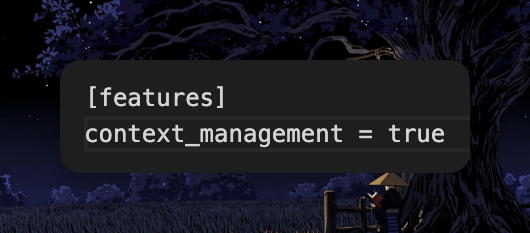

# Here's how to fix Astra Astra is a GREAT model, the problem is limits, its THIRSTY Here's how to fix it: 1. Go to

> Source: https://x.com/bil0090/status/2096675504229138541
> Author: Bilal Bakr (@bil0090)
> Posted: Sun Sep 06 19:02:49 +0000 2026
> Stats at capture: 747 likes / 45 reposts / 36 replies / 99552 views / 1179 bookmarks
> Author bio at capture: 16 y/o Software Engineer, @t3dotcodes contributor, & Co-founder @Calendaty. building cool stuff & sharing the journey 🚀💻

## Post

Here's how to fix Astra

Astra is a GREAT model, the problem is limits, its THIRSTY

Here's how to fix it:
1. Go to ~/.codex/config.toml
2. Add this:
[features]
context_management = true

Astra remembers the important parts of a long chat so it doesnt reread everything each time

Enjoy ;)

## Media

Original: https://pbs.twimg.com/media/HRjjGVNaIAAVakN.png?name=orig

## Thread

### @bil0090 — [2096676374903763186](https://x.com/bil0090/status/2096676374903763186)

> Credit to
> @songkeys
>  for the original post, but the setting got changed after the latest Codex update
>
> Had to post the correct one ;)

### @bil0090 — [2096928343673233763](https://x.com/bil0090/status/2096928343673233763)

> Based on what Codex version you're using

## Comments

### @koltregaskes — [2096845487429091758](https://x.com/koltregaskes/status/2096845487429091758)

> Is it this?
>
> [features.context_management]
> experimental_mode = true

