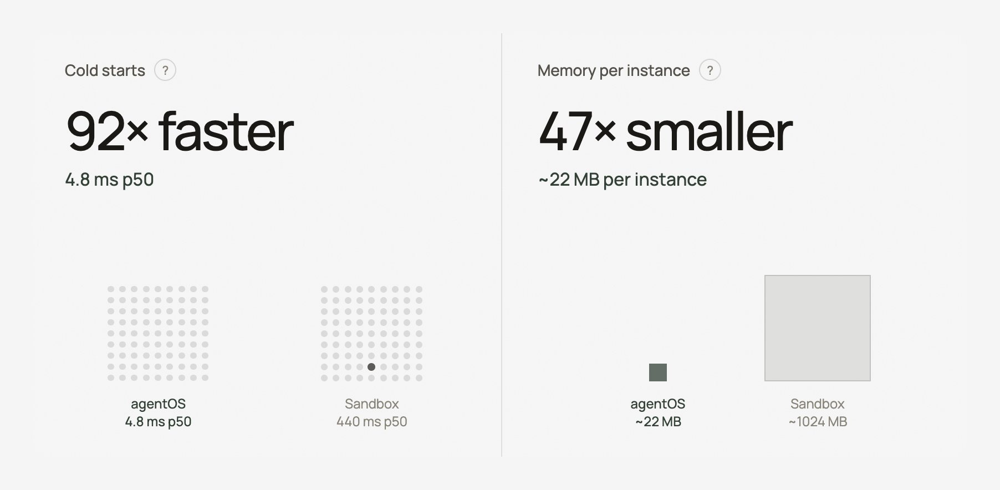

# 100% this This is why we built a WebAssembly- and isolates-based sandbox as a library that's Linux-compatible /

> Source: https://x.com/NathanFlurry/status/2096704470008889597
> Author: Nathan Flurry 🔩 (@NathanFlurry)
> Posted: Sun Sep 06 20:57:55 +0000 2026
> Stats at capture: 565 likes / 29 reposts / 15 replies / 48481 views / 565 bookmarks
> Author bio at capture: The actor guy. DMs open.

Founder @rivet_dev (YC W23 & Speedrun)

https://git.new/rivet + https://git.new/agent-os

## Post

100% this

This is why we built a WebAssembly- and isolates-based sandbox as a library that's Linux-compatible / POSIX-compliant

Vastly more resource efficient & lets you use more types of hardware

https://github.com/rivet-dev/agentos

## Media

Original: https://pbs.twimg.com/media/HRj88YAbAAAu2fq.jpg?name=orig

## Quoted post

Author: rita kozlov 🐀 (@ritakozlov) — https://x.com/ritakozlov/status/2096298097038987404

there aren’t enough CPUs to power all the agents, which means sandbox architecture requires a rethink (isolates!!!) 

watch my investor day talk (apologies in advance for making you go to linkedin but that’s the best link i got): https://www.linkedin.com/posts/cloudflare_cloudflare-investor-day-2026-developer-activity-7482508913704140800-KkVv

## Thread

### @NathanFlurry — [2096704893465792805](https://x.com/NathanFlurry/status/2096704893465792805)

> Specifics on CPU & memory efficiency are nuanced
>
> But the world is moving towards lightweight sandboxes for knowledge work, with opportunistic "sandbox escalation" as needed for the long tail when you need full x86

### @NathanFlurry — [2096763919297867839](https://x.com/NathanFlurry/status/2096763919297867839)

> yep!

## Comments

### @seflless — [2096761247152697578](https://x.com/seflless/status/2096761247152697578)

> Do either Claude or Codex successfully run in that library?

## Links

- https://github.com/rivet-dev/agentos
- https://x.com/ritakozlov/status/2096298097038987404
