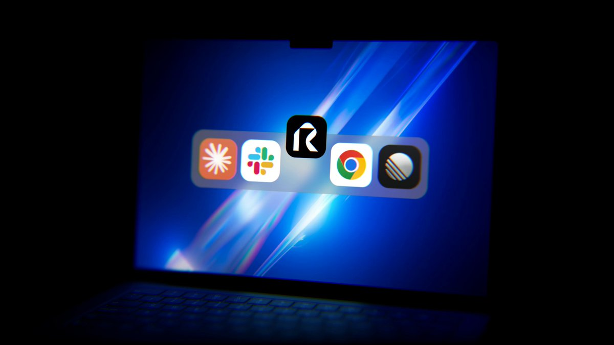

# Raylight Capture: free one-click app-to-launch-video, editable mouse paths, Claude edit

> Source: https://x.com/cy_burns/status/2096716016835342588
> Author: cy (@cy_burns)
> Posted: 2026-09-06T21:43:48Z
> Stats (at capture): 49,070 views · 674 likes · 148 replies · 40 reposts · 983 bookmarks · 5 quotes
> Captured: 2026-09-21T15:33:42Z via api.fxtwitter.com
> Author bio (at capture): Building @raylightapp

## Post

Today we're launching Raylight Capture. 100% free.

One click captures your app and turns it into a launch video.

Your screen, camera, and mouse land as separate, animatable layers.

Every mouse move becomes an editable animation block. Never re-record a bad mouse path again.

Then ask Claude to turn it into a cinematic launch video.

Comment "CAPTURE" and I'll send it over. Pair it to the app this week, get a month of Pro free 👇

## Media

[media/video.mp4](media/video.mp4)

Original video (3840x2160, 30.069s): https://video.twimg.com/amplify_video/2096714996956778499/vid/avc1/3840x2160/XBmYfNDZFZXZJZhh.mp4?tag=29
Video thumb original: https://pbs.twimg.com/amplify_video_thumb/2096714996956778499/img/AW7w6OfyhpzLolEW.jpg (`media/thumb.jpg`)

## Thread

No author self-replies visible at capture (conversation replies did not load in the logged-in bridge session; X conversation endpoint rate-limited, 13/13 pages returned the main post only).

## Comments

148 replies counted by API; none retrievable at capture (bridge n=1 article on URL-verified page after 4–6 scroll rounds; r.jina.ai x.com access blocked until 2026-09-21T15:59:15Z).

## Links

None.
