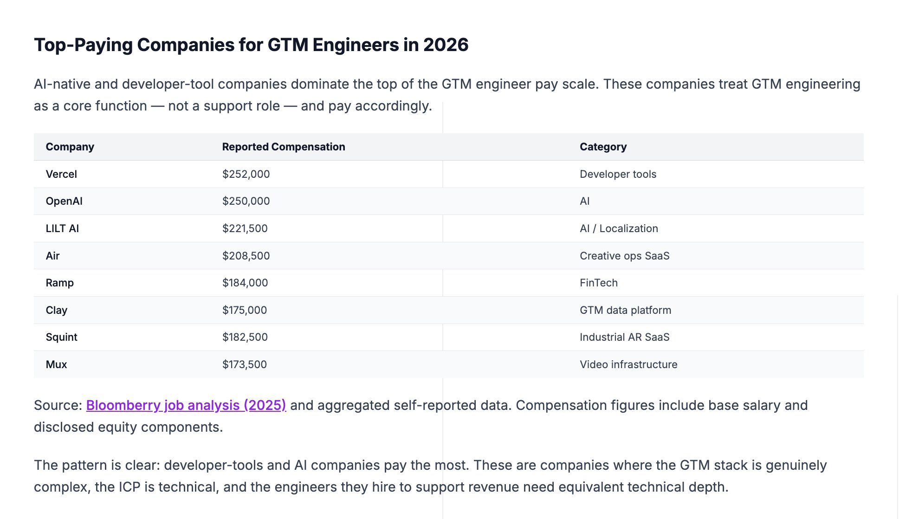

# Vercel and Open AI are both paying $250k+/year for a GTM engineer. The role did not exist before 2024. Job postings for 

> Source: https://x.com/coldemailchris/status/2096716635579301973
> Author: Christian (@coldemailchris)
> Posted: Sun Sep 06 21:46:15 +0000 2026
> Stats at capture: 56 likes / 1 reposts / 8 replies / 9395 views / 83 bookmarks
> Author bio at capture: Founder/CEO @ http://pipeline.tech — Building AI-native outbound systems for the most innovative B2B brands. Teaching GTM @ http://gtmu.io. ✝️ Jesus is King.

## Post

Vercel and Open AI are both paying $250k+/year for a GTM engineer.

The role did not exist before 2024.

Job postings for it grew 205% year over year.

Companies are hiring for it faster than the amount of qualified people that exist.

The title is 2 years old and almost NOBODY has 5 years in it.

What the top paying listings actually ask for:

- SQL and Python, in 38% of postings
- Clay, in 61%
- API integration work
- ICP definition and segmentation
- Deliverability fundamentals

Average requested experience is 4.11 years, so this is a mid career move rather than a senior only title.

And that is one of the 2 paths in the article.

The other is building an outbound GTM agency, 

where you run the same outbound systems across many clients rather than for one company.

Both paths and how to start and scale each one is broken in the article:

## Media

Original: https://pbs.twimg.com/media/HRkHm9PWcAAugA8.jpg?name=orig

## Quoted post

Author: Christian (@coldemailchris) — https://x.com/coldemailchris/status/2096681120364413108

https://x.com/i/article/2091380873677492224

## Comments

### @GeniusPothead — [2096721567455875429](https://x.com/GeniusPothead/status/2096721567455875429)

> companies paying this much shows how real the skill gap actually is

### @MauroJPelle — [2096880093117268223](https://x.com/MauroJPelle/status/2096880093117268223)

> gtm engineer is just growth marketer with sql access now

### @sorichev — [2097259370560004308](https://x.com/sorichev/status/2097259370560004308)

> 4.11 years average requested experience for a title that's 2 years old is a fun contradiction. means most of those postings are really asking for adjacent skills (SQL, Clay, deliverability) dressed up as GTM engineer experience

### @imtamhn — [2096895320336773474](https://x.com/imtamhn/status/2096895320336773474)

> GTM engineering pays high because it solves the handoff tax between sales and product.
> Most SDRs do not know how to query Postgres or chain Clay webhooks, and software devs hate touching outbound deliverability.
> The arbitrage is in connecting the pipes yourself.

### @official__millo — [2096892039367696557](https://x.com/official__millo/status/2096892039367696557)

> The title pays for people who can wire enrichment without babysitting five seats. If your GTM engineer still opens LinkedIn to copy titles by hand, the salary is funding a paste job.

### @aditya_ffca — [2097257192651153720](https://x.com/aditya_ffca/status/2097257192651153720)

> The fact that this role barely existed two years ago and is already paying $250k+ says a lot about where GTM is heading.

### @Gsandec — [2096864790660723121](https://x.com/Gsandec/status/2096864790660723121)

> Title growth is outrunning the hiring bar. Half the "GTM engineer" posts I see are still SDR work plus Clay admin under a new name.

## Links

- https://x.com/coldemailchris/status/2096681120364413108
