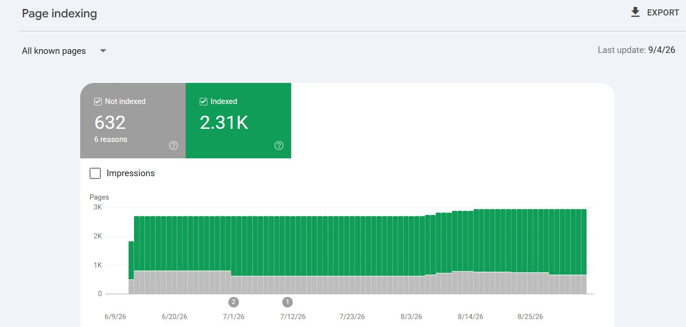

# Tip for getting pages indexed: Search Console data + AI pattern-find, content quality first

> Source: https://x.com/danielkbuilds/status/2096917237105885412
> Author: DanielK (@danielkbuilds)
> Posted: 2026-09-07T11:03:22Z
> Stats (at capture): 16,641 views · 218 likes · 16 replies · 12 reposts · 418 bookmarks · 1 quotes
> Captured: 2026-09-21T15:33:42Z via api.fxtwitter.com
> Author bio (at capture): http://CountryTaxCalc.com (~$1k/mo).  / http://Bevizio.com — is ChatGPT recommending your rival? / http://TheLaunchWall.com 🧱 free launch wall, add yours →.
> Author website: https://www.bevizio.com/

## Post

Tip for getting your pages indexed: if pages aren't indexing after a while, export your Search Console data, feed it to an AI, and ask it to find the pattern.

A lot of the time it comes down to content quality. Google spells out exactly what that means here: http://developers.google.com/search/docs/fundamentals/creating-helpful-content

I run every page I publish against that standard.

## Media

Original photo: https://pbs.twimg.com/media/HRm_DffXcAIK3nm.jpg?name=orig

## Thread

No author self-replies visible at capture (conversation replies did not load in the logged-in bridge session; X conversation endpoint rate-limited, 13/13 pages returned the main post only).

## Comments

16 replies counted by API; none retrievable at capture (bridge n=1 article on URL-verified page after 4–6 scroll rounds; r.jina.ai x.com access blocked until 2026-09-21T15:59:15Z).

## Links

- http://developers.google.com/search/docs/fundamentals/creating-helpful-content
