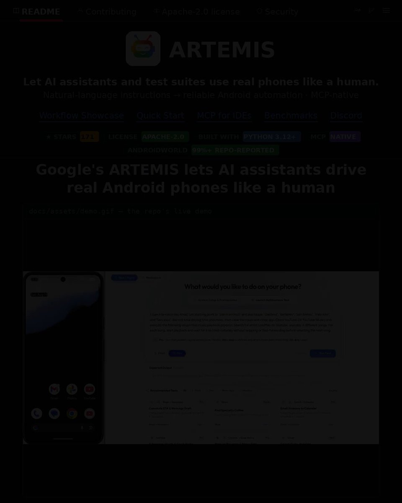

# 🚨 GOOGLE JUST MADE ANDROID AUTOMATION LOOK INSANE. Google just released ARTEMIS — an AI-powered system that turns plain

> Source: https://x.com/vicky_grok/status/2096949449906114798 — @vicky_grok (Vikas gupta) — posted Mon Sep 07 13:11:22 +0000 2026 — 54 replies, 240 reposts, 1437 likes, 1928 bookmarks, 126895 views — captured 2026-09-21T15:05:37Z
> Author bio: 75K+ Audience on LinkedIn | AI Engineer | Resume Writer | AI Content Creator | AI Enthusiast | Influencer | DM for Promotion

## Post

@vicky_grok

🚨 GOOGLE JUST MADE ANDROID AUTOMATION LOOK INSANE.

Google just released ARTEMIS — an AI-powered system that turns plain English into reliable Android automation.

Imagine telling an agent:

“Open the app, create an account, change the settings, and verify the result.”

…and letting it handle the entire Android workflow.

ARTEMIS is built to do exactly that.

→ Turns natural-language instructions into Android actions
→ Automates end-to-end workflows
→ Captures detailed logs for debugging + analysis
→ Works with AI coding assistants like Antigravity, Codex, and Claude Code
→ Achieves 99%+ success on the AndroidWorld benchmark

That last number is what caught my attention.

99%+ success rate means this isn't just an AI that can click around Android.

It's being built to make automation reliable enough for real workflows.

And because it's from Google, this is one of those projects worth watching closely.

ARTEMIS is still very new — the public repo was created in August 2026 and currently has 171 stars.

The bigger idea:

AI agents shouldn't just write code.
They should be able to operate the software that code creates. 🔥

#Google #Android #AIAgents #AI #Automation #AndroidDevelopment #OpenSource #DeveloperTools #Coding

## Media

[media/media_0.mp4](media/media_0.mp4)

Original: https://video.twimg.com/amplify_video/2096949427370160128/vid/avc1/1080x1350/y5sufxw8WR-XLmuG.mp4?tag=16
Original: https://pbs.twimg.com/amplify_video_thumb/2096949427370160128/img/97lJGSs6N_mMO2s_.jpg

## Comments

**@bc_automation** (2026-09-17T18:35:47.000Z) — https://x.com/bc_automation/status/2100654970374926817

wow

**@youraigirl24** (2026-09-07T13:22:19.000Z) — https://x.com/youraigirl24/status/2096952203114373358

Amazing share

**@Numan_A12** (2026-09-08T01:12:10.000Z) — https://x.com/Numan_A12/status/2097130842548289583

Amazing shere

**@JoseCal78024611** (2026-09-07T21:43:24.000Z) — https://x.com/JoseCal78024611/status/2097078306986217981

BNP EL TRANSPORTE DE LA INFORMACIÓN

**@monicaa_AI** (2026-09-08T00:40:43.000Z) — https://x.com/monicaa_AI/status/2097122927242273051

99% best

**@MaaxenTech** (2026-09-07T15:30:34.000Z) — https://x.com/MaaxenTech/status/2096984478195523656

That's amazing

**@Zyron_tec** (2026-09-07T14:13:48.000Z) — https://x.com/Zyron_tec/status/2096965159386570878

Truly amazing

**@AlinaViolaxyz** (2026-09-07T17:45:17.000Z) — https://x.com/AlinaViolaxyz/status/2097018380482208096

Well that's

**@david_marco45** (2026-09-07T15:03:20.000Z) — https://x.com/david_marco45/status/2096977625839435953

That's great

**@Miketokenhunter** (2026-09-08T07:10:32.000Z) — https://x.com/Miketokenhunter/status/2097221030397800724

Niets nieuws.

**@imanmanati** (2026-09-08T03:16:49.000Z) — https://x.com/imanmanati/status/2097162212087390240

@grok
 factchec

**@Ai_Horizon11** (2026-09-07T15:31:00.000Z) — https://x.com/Ai_Horizon11/status/2096984589181022651

Awesome
