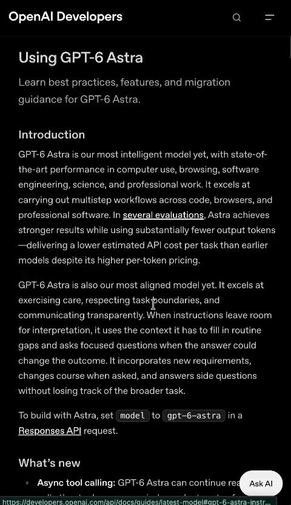

# OPENAI JUST DROPPED THE OFFICIAL GUIDE TO PROMPTING GPT-6 ASTRA This is the most important prompting update for anyone

> Source: https://x.com/sairahul1/status/2096964706099700065 — @sairahul1 (Rahul) — posted Mon Sep 07 14:12:00 +0000 2026 — 37 replies, 314 reposts, 2122 likes, 3997 bookmarks, 360554 views — captured 2026-09-21T15:05:37Z
> Author bio: Building with AI. Sharing what's wild, what's practical, and what's next.

## Post

@sairahul1

OPENAI JUST DROPPED THE OFFICIAL GUIDE TO PROMPTING GPT-6 ASTRA

This is the most important prompting update for anyone using Astra.

Bookmark this before your next build.

Most people are still prompting Astra like GPT-5. That's the mistake.

→ audit your AGENTS.md — old instructions now fight the model
→ define autonomy explicitly — Astra pauses when you expect it to continue
→ cut skill descriptions to one line — too many skills and Astra sees none of them clearly
→ stop telling it to run tests — it does this automatically, repeating it causes overtesting
→ define stop conditions — Astra needs to know what "done" means

Astra is at its best when you stop micromanaging and let it own the work.

Read the full guide before writing your next prompt.

GPT-6 Astra → Clean System Prompt → Autonomous Execution → Production-Ready Output → Ship faster

## Media

[media/media_0.mp4](media/media_0.mp4)

Original: https://video.twimg.com/amplify_video/2096904420571414528/vid/avc1/480x832/1qzadMqqx-ktxTYs.mp4?tag=29
Original: https://pbs.twimg.com/amplify_video_thumb/2096904420571414528/img/ekUmdyhWuPyYSNx7.jpg

## Comments

**@AxialisSoftware** (2026-09-07T17:04:40.000Z) — https://x.com/AxialisSoftware/status/2097008161848692960

The AGENTS.md point is especially important. With stronger instruction following, old or conflicting context can become a bigger problem than the prompt itself.

**@ToniTradez** (2026-09-09T12:36:43.000Z) — https://x.com/ToniTradez/status/2097665502009061579

Basically needs extraordinary handholding

**@zoepalmer203** (2026-09-08T13:28:44.000Z) — https://x.com/zoepalmer203/status/2097316206998921696

md game if I wanna get the most out of this powerful model.

**@AyisigiPatikasi** (2026-09-08T10:36:40.000Z) — https://x.com/AyisigiPatikasi/status/2097272905759445430

Hala en iyisi 
@claudeai

**@optixpro** (2026-09-08T07:15:54.000Z) — https://x.com/optixpro/status/2097222381773410753

three of our agents broke after upgrading to astra. this guide explained why in the first 10 minutes

**@Web3Anon88** (2026-09-08T11:23:47.000Z) — https://x.com/Web3Anon88/status/2097284762704429200

Sorry not buying your course rakesh

**@iMichaelTen** (2026-09-08T04:37:32.000Z) — https://x.com/iMichaelTen/status/2097182526175654271

Is the subtitle of the book "How to Burn Through Your 5-Hour Token Limit in About 10 Minutes"?

**@NB_darkknight** (2026-09-10T12:44:20.000Z) — https://x.com/NB_darkknight/status/2098029807263191186

@shubhishukmztq

**@zecadolar** (2026-09-07T23:48:43.000Z) — https://x.com/zecadolar/status/2097109843878257113

So boring this posts

**@_alphashark_** (2026-09-08T14:28:11.000Z) — https://x.com/_alphashark_/status/2097331165409472982

Doesn't name 1 prompt that behaves differently on Astra than GPT-5. A guide without a before-and-after is a press release.

**@CXin1128** (2026-09-08T05:14:51.000Z) — https://x.com/CXin1128/status/2097191917150728541

Let me see
