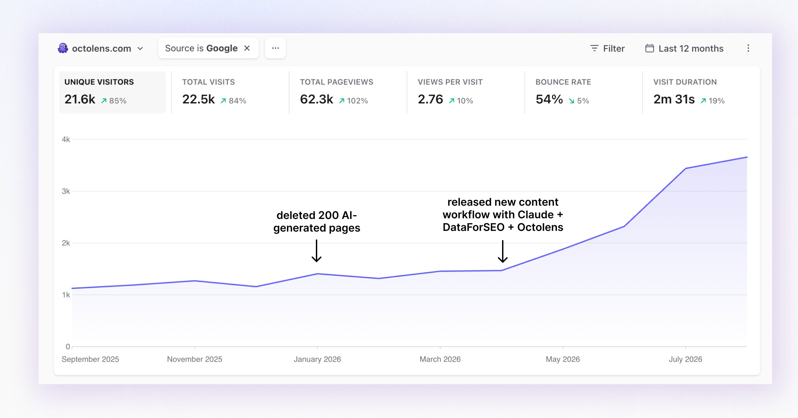

# We deleted 200 blog posts and Google traffic more than tripled — quality SEO playbook

> Source: https://x.com/LottiSchmitt/status/2096967274343047324
> Author: Charlotte Schmitt (@LottiSchmitt)
> Posted: 2026-09-07T14:22:12Z
> Stats (at capture): 34,973 views · 391 likes · 44 replies · 28 reposts · 726 bookmarks · 7 quotes
> Captured: 2026-09-21T15:33:42Z via api.fxtwitter.com
> Author bio (at capture): Co-founder / CEO of Octolens.  /  / 🐙 http://octolens.com
> Author website: https://octolens.com/

## Post

We deleted 200 blog posts end of last year and since then our Google traffic more than tripled.

Last year we published hundreds of AI-written SEO pages. Exactly zero hit Google's top 10.

This year we focused on quality. And search just became our #1 acquisition channel: 15% of new signups in spring, 20% in July, 25% in August, 36% (so far) in September.

Google traffic went from ~1K to nearly ~4K monthly visitors.

Here's the playbook we follow now:

1. Delete first.
We killed ~200 thin AI pages with low quality backlinks and kept a few dozen worth maintaining.

2. Same AI tools, better inputs.
The failed pages were written from models' imagination and little input. The new ones are written from data: live search volumes + SERPs from an SEO API (@ahrefs or @dataforseo), and verbatim quotes from real users on Reddit, Hacker News and X, every quote linked to its source using the @Octolens MCP.

3. Write the pages buyers search for.
Best-of lists that rank competitors honestly with up-to-date pricing breakdowns. Alternative pages for tools people are leaving.

4. Customer stories for recognition and original content.
Prisma, Vercel, Tally, PostHog, Render, Metabase. Original stories like these feed many other blogs and pages, which helps those rank too. Not to mention great content for socials.

5. Review everything.
People try to sell you automated SEO that just posts blogs on auto pilot and makes your domain rating grow. But from my experience its rather damaging then helpful to your SEO and brand image. Taking the time to read over content and edit it is (at least now) still necessary.

I recently open-sourced our blog writting process as a skill. https://github.com/octolens/seo-page-builder

## Media

Original photo: https://pbs.twimg.com/media/HRnslH3WAAEJEOS.jpg?name=orig

## Thread

No author self-replies visible at capture (conversation replies did not load in the logged-in bridge session; X conversation endpoint rate-limited, 13/13 pages returned the main post only).

## Comments

44 replies counted by API; none retrievable at capture (bridge n=1 article on URL-verified page after 4–6 scroll rounds; r.jina.ai x.com access blocked until 2026-09-21T15:59:15Z).

## Links

- https://github.com/octolens/seo-page-builder
