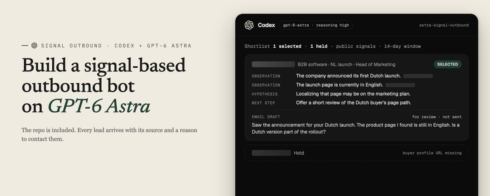

# Open-sourcing my GPT-6 Astra outbound bot: 25 signals, drafts, CRM import (comment gpt)

> Source: https://x.com/nifinet/status/2096998343004348548
> Author: Nicolas Finet (@nifinet)
> Posted: 2026-09-07T16:25:39Z
> Stats (at capture): 39,535 views · 156 likes · 155 replies · 11 reposts · 468 bookmarks · 0 quotes
> Captured: 2026-09-21T15:33:42Z via api.fxtwitter.com
> Author bio (at capture): CEO @sortlist ($1B+ generated for agencies) | http://www.overloop.com (outbound) | http://www.yourmax.ai (intent agent)
> Author website: https://nicolas-finet.com/

## Post

I'm open sourcing my GPT-6 Astra outbound bot.

Give it your offer and the companies you want to reach. It researches recent buying signals and returns a shortlist with a reason to contact each account.

The full repo includes:
- A catalog of 25 signals, from funding rounds to reposted jobs
- 10 signal combinations to look for
- Company and buyer checks with source links
- Email + LinkedIn drafts based on the actual signal
- Duplicate checks and a record of accounts you've contacted
- An import format for your CRM and intent data

It runs in Codex. I've included the setup guide and prompts to make it yours.

You review the sources and messages before sending anything.

Comment "gpt" and I'll send you the full repo.

## Media

## Quoted post

**Author:** Nicolas Finet (@nifinet)
**URL:** https://x.com/nifinet/status/2096695883077452085

https://x.com/i/article/2096684912812380160

Quoted article: How to Build a Signal-Based Outbound System on GPT-6 Astra
Quoted article URL: https://x.com/i/article/2096684912812380160

Preview: We built a signal-based outbound bot that runs on GPT-6 Astra in Codex.
Give it your offer and the kind of companies you want to work with. It searches for recent buying signals, checks the company

Cover still: `media/quote-article-cover.jpg`. Original: https://pbs.twimg.com/media/HRjr49iacAAc0cF.jpg

Full body (verbatim from api.fxtwitter.com):

We built a signal-based outbound bot that runs on GPT-6 Astra in Codex.

Give it your offer and the kind of companies you want to work with. It searches for recent buying signals, checks the company and buyer, and drafts a first message. Every lead comes with the source and a reason to contact them.

The repo is included. Below are the files and prompts to run it yourself.

The repo

The important files look like this:

profile.json holds your offer and buying criteria. You create it during setup. docs/SIGNALS.md tells Astra what to look for and what counts as evidence. bot.py runs the research. core.py checks and ranks the results.

Each run produces a readable brief, the underlying JSON, and a record of the research. These stay under .local/, alongside the account history.

The build runs in Codex with GPT-6 Astra selected explicitly. You need Python 3.10 or later, a current Codex CLI, and an account with Astra access. You can sign in through ChatGPT; that route needs no separate API key. The code is free. Model usage and any data services you connect still depend on your accounts.

Step 1. Give Astra a specific job

Start with AGENTS.md. It tells Codex how to use the repo when you ask for leads.

The important rules are simple:

The full file is already included. So is the model configuration:

The research runner also selects Astra directly. The model choice does not depend on someone remembering to pick it in the chat window.

Open the downloaded folder as a project in Codex. Your first instruction can be:

What good looks like. Codex asks who you serve, what you deliver, and which companies you can actually help.

Where it breaks. You give it “find companies that need marketing.” It has to invent the commercial judgment you left out.

Step 2. Put the offer next to the ICP

A list of industries is not enough context for research.

For a worked example, suppose you run an agency building conversion pages for B2B software launches. The campaign below is illustrative. Your setup instruction could be:

Now a launch has a useful meaning. It points to a page, an acquisition path, a positioning decision, or a localization job the agency could help with.

The same launch might be irrelevant to an agency selling employer branding. The model needs the offer to make that distinction.

Put existing customers and companies you should avoid in excluded_domains. Add genuine case studies to proof_points. If you have no relevant proof, leave the list empty. The draft should stand on the observation and the usefulness of the proposed next step.

What good looks like. You can explain why a company fits without mentioning its funding round.

Where it breaks. You loosen geography, size, and service scope until the bot can fill the list. The research starts serving a business you do not run.

Step 3. Choose signals that change the work

The repo includes 25 named signal families. Nineteen can be investigated through public sources. Six need records from tools you already use.

Here is how I would read the public catalog:

The six connected families are pricing-page visits, repeat site visits, content engagement, competitor engagement, CRM reactivation, and review intent.

Those require supplied evidence. Public web search cannot tell you who visited your pricing page or what sits in your CRM.

For the example agency, I would start with a smaller search:

A broad catalog gives you options. Your campaign should still have a point of view. Astra records which sources and signal families it actually investigated; one run does not cover the entire market.

What good looks like. Every enabled signal has a plausible path to a project you can deliver.

Where it breaks. “They raised money” becomes the reason to contact every company, regardless of the offer.

Step 4. Look for the combination that explains the timing

This is where I would spend the operator's attention.

The useful question is what the signals mean together. Five articles repeating one announcement still describe one event.

The catalog includes ten combinations. These are five I would examine closely:

A launch plus a relevant open role. The launch establishes the initiative. The role tells you which capability the company is building. For our example agency, a product launch alongside a product-marketing vacancy could justify asking who owns the launch pages. It does not prove the team is overwhelmed.

Expansion plus a gap in the local buying experience. Verify the new market. Then inspect the actual path a buyer there would take. Missing local-language pages can support a question about localization. Do not claim conversion is suffering without data.

A reposted vacancy plus a dated initiative. A repeatedly advertised role can suggest an unresolved capacity need. Add a current launch or expansion and there may be a timely project. Check that the “repost” is not just the same vacancy syndicated across job boards.

A competitor retirement plus a verified customer relationship. The retirement supplies the deadline. Evidence that the target uses the product supplies relevance. Without the relationship, you have news about a vendor and no reason to put this company on the list.

A closed-lost account plus a new trigger. The CRM record supplies the previous objection. A new leader, launch, or expansion may change it. If they previously lacked implementation capacity, fresh funding alone does not resolve that objection. Research what changed around delivery.

These combinations are research instructions in docs/SIGNALS.md. Astra reads that file on each run. You can make the emphasis more specific through Codex:

The scorer gives a small bonus for a second distinct recent signal type. Astra still has to explain the connection to your offer. The bonus does not establish that the buyer wants help.

What good looks like. Removing either observation makes the timing less convincing.

Where it breaks. You stack unrelated events until the account looks urgent.

Step 5. Make every opportunity inspectable

The research contract lives in schemas/research.json. For each candidate, Astra returns the company, buyer, dated signal, supporting sources, offer relevance, uncertainties, and drafts.

Keep these three things separate:

For the illustrative launch campaign:

Astra must verify those observations in a real run. Neither observation proves the company needs an agency. Together, they give you a sensible question to ask.

Dates matter here. A page indexed today can describe a launch from last year. The bot asks for the event date or a dated announcement, and applies your lookback window to that date.

For connected signals, prepare a JSON array using docs/EVIDENCE.md. Each record needs id, company_url, signal_type, occurred_on, source_url, and fact. There is room for up to 200 records per run.

Once you have an authorized export, ask Codex:

The runner checks that a connected signal matches a supplied record. It does not install a CRM integration for you. Review the export before using it.

What good looks like. Another person can open the source and understand why the account made the list.

Where it breaks. The hypothesis quietly becomes an assertion: “You're struggling to convert Dutch buyers.” Nothing you found supports that sentence.

Step 6. Qualify first, then rank

We put the qualification checks before the score.

A company must fit your geography, size, and industry. The buyer must have a relevant current role and a source URL. The event needs evidence and a valid date. The link to your offer must be concrete enough to explain.

Missing critical evidence puts the account on the held list. A high score cannot rescue it.

The starter uses this ranking for accounts that pass:

These weights are starting rules. Eighty points does not mean an 80% chance of buying. The relevance judgment comes from Astra; the code applies the rules to its research.

minimum_score in your profile sets the threshold. The formula lives in core.py, where you can inspect it before changing anything.

One detail we fixed during the build was company size. A search snippet looked usable, but the underlying source had not been opened. The final version requires Astra to report that it opened the size source. If it returns a range, the whole range must fit your ICP. 

Astra is instructed to keep “51 to 200 employees” as a range, rather than inventing a headcount of 125. The code checks the returned fields; you still need to review how Astra read the source.

That is the kind of miss I want visible before the first message goes out.

What good looks like. The shortlist explains who passed, and the held list explains what is missing.

Where it breaks. You lower the threshold to recover an account whose basic fit was never established. A scoring adjustment cannot supply missing evidence.

Step 7. Turn the evidence into a useful first message

The research prompt in bot.py asks for one email and one LinkedIn draft per candidate. The starter caps them at 130 words and 300 characters respectively.

The writing instruction has four parts:

For our illustrative campaign, the email could read:

Subject: Dutch launch page

Saw the announcement for your Dutch launch. The product page I found is still in English.

Is a Dutch version part of the rollout? We build conversion pages for B2B software launches. Happy to send a short review of the current page and what we'd adapt for that market.

Would that be useful?

The buyer can answer the question without accepting your diagnosis. They might already have the page in production. They might serve English-speaking customers. Either answer improves your understanding of the account.

The same distinction matters with private signals. A pricing-page visit can help you prioritize research. The message should address the business initiative you verified, without announcing that you tracked the visitor.

Before sending, ask Codex:

What good looks like. You could explain the email to the recipient using the same evidence you used to write it.

Where it breaks. The first sentence is specific and the rest could be sent to anyone. The offer has lost its connection to the event.

Step 8. Run it, review it, keep the history

Download and extract the repo. Open a terminal in that folder. If Codex is not installed and signed in yet, use the following commands. The installation command requires Node.js and npm:

Check the setup:

If you have not created your profile through Codex, use the interactive setup:

Then run the live research:

Inside Codex, you can also ask:

Each run takes live research time and can return fewer prospects than requested. Read the sources for the first few briefs. Check whether the event creates work you can help with, whether the buyer owns that work, and whether the message offers something worth replying to.

Selected events enter the local history. The same company, primary signal type, and event date will be held on a later run. A new event can qualify separately.

After you contact someone, record it. Codex can execute the documented feedback command from an instruction like this:

The default contact cooldown is 90 days. irrelevant and do-not-contact hold the company until you explicitly change its status. This history is local; keep your CRM's opt-outs current too.

Run the same saved profile when you next want a brief. For a recurring job, the machine running it needs to be awake and Codex authenticated. Start by reviewing a few runs yourself. Repeated bad fits are a reason to fix the offer, criteria, or research instructions.

Feedback changes eligibility in this version. It does not automatically retrain Astra or tune the scoring weights.

What good looks like. Each run gives you a reviewable set of new opportunities, and your prior decisions carry forward.

Where it breaks. You generate briefs without reviewing them, or start a fresh folder each time and lose the history.

Try the included examples first

The repo includes a fictional offline demo:

It shows the brief format and qualification checks without using a model or searching the web. examples/live-run.md documents a separate Astra research run, and docs/VALIDATION.md explains what we checked. We also checked the code with 39 tests, all passing.

The executable workflow runs in Codex. Uploading the ZIP to a normal ChatGPT conversation does not install the runner or its local history.

The full version: max

The repo lets you run the workflow yourself. You own the profile, decide which signals matter, supply connected data, and review the resulting messages. Every rule is there to inspect and change.

max at yourmax.ai is the full product for doing this without maintaining the local setup. It monitors buying signals, matches leads to your ICP, preserves the evidence, enriches the leads, and drafts outreach for your approval. You can move approved leads into connected sales workflows.

If you want to work through the mechanics, start with the repo. If you want ongoing signal-based outbound for your business, try yourmax.ai.

## Thread

No author self-replies visible at capture (conversation replies did not load in the logged-in bridge session; X conversation endpoint rate-limited, 13/13 pages returned the main post only).

## Comments

155 replies counted by API; none retrievable at capture (bridge n=1 article on URL-verified page after 4–6 scroll rounds; r.jina.ai x.com access blocked until 2026-09-21T15:59:15Z).

## Links

- https://x.com/i/article/2096684912812380160
- https://yourmax.ai/
- https://x.com/nifinet/status/2096695883077452085
