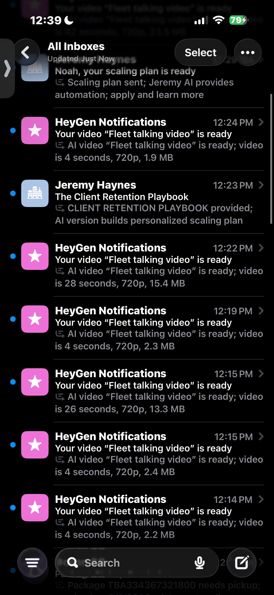
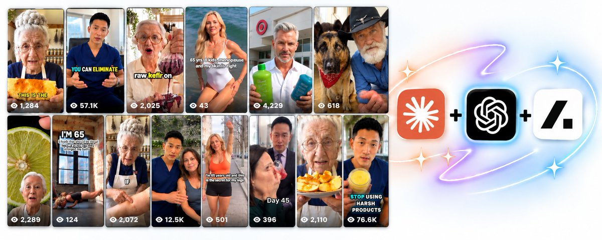

# The AI content factory is real — AI UGC at scale (quoted Astra prompts article)

> Source: https://x.com/maverickecom/status/2097002206486483074
> Author: Noah Frydberg | Tiktok Shop For Brands (@maverickecom)
> Posted: 2026-09-07T16:41:01Z
> Stats (at capture): 46,663 views · 235 likes · 4 replies · 21 reposts · 449 bookmarks · 0 quotes
> Captured: 2026-09-21T15:33:42Z via api.fxtwitter.com
> Author bio (at capture): I scale 8-9 figure ecommerce brands with human & AI affiliates | 1B+ Views, $1M+ Generated, 39K+ Creators Community | Apply to work with me 👇
> Author website: http://www.maverickcreative.net

## Post

the ai content factory is real

quite insane

videos just getting generated one after the other 🤯

## Media

Original photo: https://pbs.twimg.com/media/HRoMZDJaMAQ-Aw6.jpg?name=orig

## Quoted post

**Author:** Noah Frydberg | Tiktok Shop For Brands (@maverickecom)
**URL:** https://x.com/maverickecom/status/2096936545915682962

How brands can scale by using AI UGC and the most recent tools to do so https://x.com/i/article/2096928430289797120

Quoted article: How to use ChatGPT Astra for AI UGC so well it feels illegal  
Quoted article URL: https://x.com/i/article/2096928430289797120

Preview: Without these prompts, you are using ChatGPT Astra at about 10% of what it can do for AI creator campaigns.
These 20 prompts are the other 90%.
They are free.
Save this.
Bookmark it.
This is not “ask

Cover still: `media/quote-article-cover.jpg`. Original: https://pbs.twimg.com/media/HRnQhLgaMAAXg2j.jpg

Full body (verbatim from api.fxtwitter.com):

Without these prompts, you are using ChatGPT Astra at about 10% of what it can do for AI creator campaigns.

These 20 prompts are the other 90%.

They are free.

Save this.

Bookmark it.

This is not “ask Astra to write me UGC.”

This is how you turn Astra into an operator for the AI creator Method — the system I use to scale AI creator / AI avatar campaigns for serious Amazon and ecom brands.

I’m Noah Frydberg. I run Maverick Creative.

I build TikTok Shop affiliate systems and AI avatar creator campaigns for 8- and 9-figure Amazon / ecom brands.

This is what AI allows

More selling UGC than a human retainer can ship in a week

Time back for claims, spend, and which page to clone

Avatar life that stays locked long enough for a stranger to trust the face

Outside demand that helps Amazon rank — tracked, named, not blended

Why this beats pouring more into ads alone:

Affiliates and named creator pages drive tracked Amazon sales. Outside demand helps rank. You get a halo of organic lift. You build a creative library that compounds. And you pay creators when sales land — rates approved in writing only. No public rate sheet in this article. Ever.

Hold the thesis before any tool gets a name:

The words sell the ad. The render only has to stay out of their way.

The factory starts at customer language and ends at the render.

Never the other way around.

ChatGPT Astra, Claude, Higgsfield, Seedance, Arcads — engines inside the method.

BEFORE ANY PROMPT — load brand / campaign context

Do this first.

Open a fresh ChatGPT Astra chat.

Paste the block below with your real details filled in.

Tell Astra to remember it for the whole session.

Never re-ask for brand context after this.

You are my AI creator campaign operator for a 9-figure Amazon / ecom brand using the Maverick Method.

BRAND CONTEXT (fill every line):
- Brand name: [BRAND]
- Hero SKU / ASIN: [SKU / ASIN]
- Amazon listing URL: [AMAZON_URL]
- Category + buyer avatar in one sentence: [e.g. women 28–45 buying mineral sunscreen who hate white cast]
- Access to reviews: I can paste reviews OR you may open Chrome and read [AMAZON_URL] reviews (incl. 1–2 star)
- Top 3 competitors / winning UGC pages: [COMPETITOR_1], [COMPETITOR_2], [COMPETITOR_3] — URLs or Ad Library search terms: [SEARCH]
- Locked avatar status: [NEW / LOCKED — paste character sheet if locked]
- Voice / room acoustics notes: [e.g. warm mid-30s woman, lived-in kitchen + bath, phone mic energy]
- Owned media / Drive folder for trackers: [GOOGLE_DRIVE_URL or “I will paste CSVs”]
- Discord / ops channel (optional): [DISCORD_URL or N/A]
- Amazon Attribution dashboard access: [I will paste exports / you may guide me in Chrome]
- Naming convention for tags: [Creator]_[Platform/Source]_[Month][Year] — example: Mara_IG_Sep2026
- Comment word for this campaign: [WORD]
- Platforms in swarm: Instagram + Facebook twins (default). Others: [LIST]
- Primary goal this quarter: [tracked Amazon revenue / rank support / creative library / time back]
- What’s already tried: [retainers / Meta ads / one bio link / AI UGC with no Attribution / etc.]
- Constraints: no raw amazon.com/dp as default caption close; one Attribution link per creator per source; Linktwin wrap; pay creators only when sales land; approve rates in writing only; do not invent GMV; do not invent commission %.

HOW YOU WORK WITH ME:
1. Quick wins first. Then deeper builds.
2. Every recommendation gets Impact: High / Med / Low + estimated time.
3. When comparing options (hooks, pages, scripts, avatars), output a spreadsheet-style markdown table.
4. Never re-ask for brand context I already gave. Ask only for missing fields.
5. You may open Chrome to Amazon reviews, Meta Ad Library, Instagram, Google Drive trackers, Discord, and Attribution dashboards when I give you a URL or tell you I’m signed in — use placeholders if I haven’t pasted one yet.
6. Tools (Astra, Claude, Higgsfield, Seedance, Arcads) are engines inside the Maverick Method — not the hero.
7. Thesis: words sell; render stays out of the way; factory starts at customer language.
8. Product late (~40s on longer cuts; ~22–30s on short Reels still put product after story). Story first. Person first.
9. When you write scripts, use ~3.5 words/sec, ~30s ≈ 105 words, clips under ~9s, hook families: offer / confession / call-out.
10. End every major deliverable with: what to do next in one sentence.

Confirm you loaded this context. Summarize my brand + goal in 5 bullets. Then wait for Prompt 1.

Why this matters:
Astra without context is a guessing machine. Astra with a locked Maverick brief is an operator. Load once. Ship all week from one brain.

PART 1: LANGUAGE + RESEARCH

Prompts 1–5.

Do not generate a single avatar frame until these land.

Prompt 1 — Amazon review mining (persuasion record)

Using the brand context already loaded, open Chrome and go to my Amazon listing: [AMAZON_URL].

If you cannot browse, I will paste reviews — say “PASTE READY” and wait.

Mine reviews for a PERSUASION RECORD, not a capture record.

Include 1-star and 2-star as heavily as 4–5 star.

Extract into a spreadsheet-style markdown table with columns:
| Exact phrase (verbatim) | Theme (named enemy / live proof / exhaustion authority / one detail) | Emotion | Usable as hook? (Y/N) | Suggested hook family (offer / confession / call-out) | Notes |

Rules:
- Prefer exact buyer language over paraphrased marketing.
- Cluster the top 10 named enemies (specific: “chalk by noon,” not “bad sunscreen”).
- Flag 5 “live physical proof” moments a camera can show in one beat (wipe, stretch, pour, hold to window).
- Flag 5 exhaustion-authority lines (“I’ve tried twelve…”).
- Pull 10 one-detail lines (texture, smell, fit quirk, label line).
- Impact-rank the top 15 phrases High/Med/Low for short-form UGC + time to script (~min).

End with: the 3 complaint themes we should vault first — and why.

Why this matters:
Complaints sell. Ad libraries copy ads that already look like ads. Your buyer already wrote the script in the review section. Start there.

Prompt 2 — Meta Ad Library teardown

Using loaded context, open Chrome.

1) Meta Ad Library: search [CATEGORY / BRAND / COMPETITOR SEARCH TERMS]. Prefer ads with real impressions in-category.
2) Instagram: open competitor / winning creator pages I listed: [COMPETITOR_IG_URLS].
3) If I paste TikTok Shop comment exports, fold those in.

Build a teardown spreadsheet:

| Source (Ad Library / IG / TTS) | Hook (first 3s verbatim or closest) | Hook family | Proof beat | CTA / comment word | Identity notes (face, room, energy) | Capture vs persuasion guess | Steal structure? (Y/N) | What NOT to copy |

Then:
- List 8 structures worth stealing (structure only — not their claims, not their brand voice).
- List 5 traps (costume faces, product-at-second-one, raw amazon.com/dp in caption, blended bio links).
- Output a one-page “anti-patterns” checklist I can paste into every brief.

Remember: Ad Library winners are CANDIDATES. We prove purchase on a named Attribution tag later.

Why this matters:
You steal structure. You prove purchase on your named page. Views on someone else’s Reel are not your Attribution.

Prompt 3 — Vault builder (hooks.md / ctas.md / MoC)

From Prompt 1 + 2 outputs (and anything I paste), build my language vault as paste-ready markdown files.

Create:

1) hooks.md — sections: Offer / Confession / Call-out. Each entry:
   - Exact line
   - Source (review / competitor / original)
   - Named enemy
   - Proof moment
   - Status: candidate | testing | purchased

2) ctas.md — comment words + bridge lines that open the DM.
   - Default comment word from context: [WORD]
   - 5 alternate words that still sound human
   - 5 value-first DM openers (no hard sell in line 1)
   - 5 bridge lines before the tracked deep link
   - Rule line at top: never raw amazon.com/dp as default caption close

3) MoC.md — Map of Contents so the factory pulls by angle, category, proof type — not vibe.

4) A “purchased flag” rule: only purchases get Status: purchased. Views never do.

Output all four as fenced markdown I can drop into Obsidian or a Drive folder.
Then give me Impact High/Med/Low on which vault section to fill next if I’m short on time.

Why this matters:
Renders expire. Language compounds. The vault is the asset. If you skip it, you’re renting pretty pixels.

Prompt 4 — Hook families (batch 12, kill soft ones)

Using the vault, write 12 hooks for [HERO SKU] — 4 offer, 4 confession, 4 call-out.

Constraints:
- Talk like a friend. One message.
- Named enemy specific enough a stranger believes a human said it.
- No brand-film voice. No white-coat authority unless the buyer said it.
- Product late — the hook is about the person / problem, not the bottle at frame one.
- Respell [BRAND] the way a buyer would say it out loud.

Output spreadsheet:

| # | Family | Hook (verbatim, ≤25 words) | Named enemy | Read-aloud stumble risk (Low/Med/High) | Keep / Kill | Why |

Then:
- Mark Keep / Kill ruthlessly.
- Pick the top 3 Keeps for script expansion.
- For each Keep, write one sentence: “This wins because…”

Why this matters:
If the hook is soft, no avatar saves it. Kill in text. It’s cheaper than killing after you spent render credits.

Prompt 5 — Script math + product-late scripts

Expand the top 3 Keep hooks into full talk tracks for phone-style UGC.

SCRIPT MATH (hard):
- ~3.5 words per second
- ~30 seconds ≈ 105 words (also offer a ~45–60s cut if useful; product still late ~40s on longer)
- Clips under ~9 seconds each when we cut for generation
- One job per script — not three offers fighting in one mouth
- Story / person first; product late
- CTA = comment word that opens DM — not a raw Amazon link

For each of the 3 scripts deliver:

1) Full talk track with word count + estimated seconds
2) Beat map table:

| Seconds | Beat | On-camera action | Exact line | Clip # |

3) Product-entry timestamp (must be late)
4) Read-aloud checklist: brand respell, stumble words, one-message test
5) Impact High/Med/Low for which script to shoot first + why

End with: “Approve hook out loud before any render.”

Why this matters:
160 words in a 30-second cut looks rushed even when the pixels are perfect. Math is craft. Craft is what beats “AI or not.”

PART 2: AVATAR + PRODUCTION

Prompts 6–10.

Casting is proof. Lock forever.

Prompt 6 — Casting match (buyer peer, not your taste)

Using loaded buyer avatar + category, propose 5 casting directions for a locked AI creator page.

Spreadsheet:

| Cast direction | Peer type (nurse / older sister / gym / mom / esthetician / etc.) | Age band | Why buyer trusts this face | Wardrobe seed | Room acoustics / set | Risk if we pick wrong |

Rules:
- Match the BUYER, not my personal taste.
- Flag any cast that feels “brand model” or costume.
- Recommend ONE primary cast for the hero page + ONE backup.
- Impact High/Med/Low + time to lock character sheets.

Then write a 5-bullet casting brief I can hand to an operator or Arcads / Higgsfield / Seedance stack without re-explaining the brand.

Why this matters:
A face that feels like a peer gets followed. A face that feels like a costume gets scrolled. Trust is the conversion event before the click.

Prompt 7 — Character sheet prompts (headshot + fullbody + product still)

Write locked character sheets for the primary cast from Prompt 6.

Deliver three paste-ready prompt blocks:

A) HEADSHOT — photoreal iPhone front-facing, ~23mm feel, natural window light.
   Must lock: freckles or identity anchors, hairline, earrings, closed wardrobe, neutral lived-in wall, no logos, no text overlay, no beauty filter.
   Explicit: identity must match fullbody exactly.

B) FULLBODY — same woman, closed wardrobe only, lived-in set, chest-height camera, slight wide, hands empty unless noted, bare feet or consistent shoes.

C) PRODUCT STILL — one hero unit only. LARGE label text in quotes: "[EXACT LABEL TEXT]".
   Count: one. No melted letters. No extra tubes / colorways. iPhone photo quality.
   Rule: packshot tools may generate stills — they may NOT invent a new face for the page.

Also output a one-line LOCKED IDENTITY SUMMARY I paste into every future clip brief.

If I already have a locked sheet, open Chrome / Drive at [CHARACTER_SHEET_URL] or wait for paste — then diff and tighten, do not reinvent.

Why this matters:
A face that changes is a stranger every day. Strangers do not get followed. Lock both ways. Forever on that page.

Prompt 8 — Generation laws card (paste into every clip)

Write a HARD GENERATION LAWS card for this campaign — short enough to paste into every Seedance / Higgsfield / Arcads clip brief.

Must include these laws (tighten language, keep force):
1. Hold vs change — model holds anything; changes nothing mid-clip.
2. No fasten / tie / uncap / transform in one clip — state changes across cuts.
3. Objects start in hand when the beat needs them.
4. Count objects scene-wide (one tube = one tube).
5. Closed wardrobe — no outfit drift on this page.
6. One action per clip.
7. Viewer is the camera — phone UGC energy.
8. Faces anchor; products drift — protect face first; re-lock product stills when labels smear.
9. iPhone front-facing ~23mm + mic-block phone energy — block cinematic anamorphic brand-film looks.

Add:
- Failure examples to watch for (sixth finger, duplicate tube, melted label, self-tying laces).
- Rule: measure broken. Never “good enough.”
- AI disclosure reminder: label what platform + legal require.

Output as a single fenced block titled GENERATION LAWS — [BRAND] — [CREATOR PAGE].

Why this matters:
These laws only show up after real failed renders. Hope is not a pipeline step. Paste the card every time.

Prompt 9 — Seedance-style clip briefs (hook first)

Take the approved Script #1 from Prompt 5. Cut it into clip briefs under ~120 words each.

Skeleton for every clip:

REGISTER: iPhone front-facing UGC, 23mm, natural light, lived-in [room].
SCENE: [one clear action]. She already holds [object] if needed.
DELIVERY: [confession / call-out / offer] — warm, slightly rushed, friend energy.
EXACT QUOTE: "[verbatim line from approved script]"
HARD RULES: closed wardrobe; identity anchors; one [object] only; no uncap/tie/transform; eyes glance once to product then back to camera; micro-behavior; physics cue; hold final pose last 0.5s; no logos except product label; mic-block phone energy.
DURATION: [4-9] whole seconds.
VOICE ANCHOR: same woman as character sheet.

Deliver:
1) Hook clip FIRST — marked APPROVAL GATE
2) Remaining body clips in order
3) CTA clip with comment word — no raw DP
4) Spreadsheet: | Clip # | Seconds | Quote | Object count | Room | Status (generate / wait on hook) |

Rule: do not spend budget on body clips until I say the hook is approved.
Optional: note where audio from hook becomes voice anchor for remaining clips.

Why this matters:
Hook first is not a preference. It is how you stop paying for a full ad that dies in the first two seconds.

Prompt 10 — QA frame-check (ship gate)

Build a QA frame-check gate for stitched ads on this page.

Deliver:

1) ~16-frame vision checklist as a spreadsheet:
| Check | Pass criteria | Fail action |
Include: face match to character sheet; wardrobe closed; object count; label readable / not melted; no sixth fingers / fused props; no cut-blind jump; delivery still one person.

2) Caveat block: sampling can miss failures between frames — if motion feels wrong, scrub the whole clip.

3) Ship / No-ship decision tree in 8 bullets.

4) AI disclosure checklist for [PLATFORM LIST].

5) Operator scorecard: | Item | Pass/Fail | Owner | Time to fix |

If I paste a Drive folder of exports [DRIVE_URL] or drop frame grabs, score them against this gate. Do not vibe-approve.

Why this matters:
Most “AI UGC” factories celebrate the render and skip the checklist. Amazon buyers and brand safety do not skip it for you.

PART 3: ATTRIBUTION + FUNNEL

Prompts 11–15.

Pretty Reels without named tags are a hobby with good lighting.

Prompt 11 — Named page matrix (one link per creator per source)

Using loaded context, build the Named Attribution page matrix for this campaign.

Rules (non-negotiable):
- One Amazon Attribution link PER CREATOR PER SOURCE
- Naming: [Creator]_[Platform/Source]_[Month][Year] — e.g. Mara_IG_Sep2026, Mara_FB_Sep2026
- Instagram and Facebook twins MAY share a face — they do NOT share one amazon.com/dp
- Wrap every tag in Linktwin (or wrap of record)
- Prefer deep links over bare storefront

Output spreadsheet:

| Creator page | Platform/Source | Tag name | Attribution link status (todo/live) | Linktwin wrap status | Comment word | Deep link notes | Owner |

Also:
- Generate 10 correctly formatted tag names for the next 30 days of swarm.
- Flag any plan that would blend IG+FB into one tag as FAIL.
- Impact High/Med/Low on which pages to stand up first.

Why this matters:
One amazon.com/dp in every bio is a blended number that lies about which page purchased. Blended numbers make you clone the wrong page.

Prompt 12 — Linktwin + deep link checks

Act as Attribution QA.

I will paste OR open in Chrome:
- Amazon Attribution dashboard / export: [ATTR_URL or paste]
- Linktwin wraps: [LINKTWIN_URLS or paste]
- Landing / deep link targets: [URLS]

For each creator × source row, verify:

| Tag name | Wrap resolves? | Lands on correct ASIN / deep target? | UTM or Attribution params intact? | Mobile OK? | Caption leak risk (raw DP)? | Pass/Fail | Fix |

Write a 10-line preflight checklist operators run BEFORE any Reel goes live.
Rule: if the tag is missing, the page does not ship.

Why this matters:
If the tag is missing, you did not ship a campaign. You shipped content. That one rule saves the factory.

Prompt 13 — Comment-word + DM sequences (value first)

Build the comment-word → DM funnel for comment word: [WORD].

Deliver:

1) On-screen CTA lines (5) that ask for the comment word without sounding like an ad read.
2) Caption closes (5) — still no raw amazon.com/dp.
3) DM sequence (automation-ready):
   - Message 1: value first (guide / routine / tip) — no link yet
   - Message 2: one bridge line
   - Message 3: tracked deep link (Linktwin → named Attribution)
4) Objection handlers (too expensive / already tried category / is this AI / shipping):
   short, human, no fake guarantees.
5) Spreadsheet A/B: | Variant | Comment word | DM opener | Bridge | Expected failure mode |

Remind me: pay creators when sales land; approve rates in writing only — do not invent % in copy.

Why this matters:
Comment-word is the door. Value-first DM is the hallway. The tracked deep link is the room where Attribution can finally see the purchase.

Prompt 14 — Leaderboard reading (purchases with names)

I will paste Attribution exports, Linktwin clicks, and page-level notes — or open Chrome to [DASHBOARD_URL] / Drive [TRACKER_URL].

Build a weekly leaderboard:

| Rank | Creator | Source | Tag | Tracked revenue | Orders | Clicks | CVR | Hook family on air | Decision (Clone / Watch / Kill) | Why |

Rules:
- Purchases with a name get cloned.
- Clicks with no purchases get killed (or Watch with a time box).
- Views do not get a vote.
- Halo: if we discuss untracked, label it ESTIMATE only (e.g. based on what we see across brands, ~22–25% untracked — estimate). Never invent GMV.

End with 5 clone actions and 5 kill actions in plain English for the operator.

Why this matters:
You will swear Facebook is dead when Facebook is wearing Instagram’s URL. Names fix the lie. Views do not get a vote.

Prompt 15 — Clone / kill rules (operating system)

Turn Prompt 14 logic into a standing Clone/Kill OS for this brand.

Deliver a one-page policy:

- Clone triggers (examples: X tracked orders in Y days on a named tag; hook family flagged purchased in vault)
- Kill triggers (clicks, no purchases, identity drift, caption DP leaks, wardrobe break)
- Watch-box rules (time-boxed; what must improve)
- Vault feedback loop: when a page purchases, mark hook family Status: purchased
- IG/FB twin rules reminder
- Human owns: rates (writing only), claims, spend, anything public

Output as a checklist operators can run every Monday without me in the room.
Impact-tag each rule High/Med/Low for this quarter’s goal: [GOAL].

Why this matters:
Without clone/kill, the swarm becomes a museum of pages. With it, the swarm becomes a factory that compounds winners.

PART 4: SWARM + OPERATOR

Prompts 16–20.

Many pages. Same method. Human still owns money and claims.

Prompt 16 — Page swarm calendar (30 days)

Build a 30-day swarm calendar for Instagram + Facebook twin pages for [HERO SKU].

Constraints from context:
- Locked avatar life (no face drift week to week)
- Named tags per creator per source
- Comment-word funnel live before volume
- Hook-first production
- Quick wins first

Output spreadsheet calendar:

| Day | Page | Platform | Asset due | Hook family | Tag name | Post window | Operator task | Impact |

Also:
- Cap concurrency so we can still catch identity drift (parallel is not “fire 40 and hope”).
- Mark approval gates (hook approve / QA / Attribution preflight).
- Give me a minimum viable swarm (fewest pages that still teach the system) vs full swarm.

Why this matters:
A line waits. A graph ships. The calendar is how the graph meets the real week.

Prompt 17 — IG / FB twin rules

Write the Instagram + Facebook twin operating rules for locked AI creator pages.

Cover:
- Same face OK; same wardrobe OK; same voice OK
- NOT the same amazon.com/dp — separate Attribution tags (Creator_IG_MonYear vs Creator_FB_MonYear)
- Separate Linktwin wraps
- Same comment word OK if DM routing still tags source correctly — flag if my automation cannot tell IG from FB, and propose a fix
- Creative twinning: what can be reused vs what must be recut
- Bio / highlight / story hygiene — no blended storefront link as the only path

Deliver:
1) One-page twin rules (fenced)
2) Fail examples table
3) 10-minute audit checklist I run on every twin pair

Why this matters:
Twins share a face. They do not share a link. That single confusion kills learning faster than a bad hook.

Prompt 18 — Rewards / contest brief (gates only)

Draft a creator rewards / contest brief for this campaign.

HARD GUARDRAILS:
- Do NOT publish commission percentages.
- Do NOT invent $ prize tiers unless I paste approved numbers as [PRIZE_PLACEHOLDER].
- Pay when sales land; approve rates in writing only.
- Gates must include BOTH tracked sales (named Attribution) AND video quality / QA pass.

Deliver:
1) Contest name options (5)
2) Eligibility rules
3) Sales gate (named tag only — no blended screenshots)
4) Video gate (frame-check pass + disclosure + comment-word used correctly)
5) How winners are verified from Attribution exports
6) Creator-facing copy (short, direct, Noah voice) with placeholders for any $ amounts: [PRIZE_PLACEHOLDER]
7) Internal operator checklist

If I have not pasted prize numbers, leave them as [PRIZE_PLACEHOLDER] and move on.

Why this matters:
Contests without sales gates reward volume cosplay. Contests with sales + video gates reward the factory.

Prompt 19 — Weekly client update draft

Draft this week’s client update for [BRAND] using the Maverick voice: direct, short paragraphs, no fluff.

Pull from what I paste (leaderboard, QA notes, vault wins) or from Chrome/Drive: [TRACKER_URL].

Structure:
1) Desire progress: selling UGC shipped, time saved, avatar lock status, Amazon tracked movement
2) What purchased (named tags only)
3) What we cloned / killed
4) Language wins returned to vault
5) Risks / blockers (claims, identity drift, Attribution gaps)
6) Next week plan (Impact High items first)
7) Ask / decision needed from client (one ask)

Rules:
- No invented GMV
- Halo only as labeled estimate if mentioned
- No public commission %
- Tools named only as engines inside the method
- End with brand CTA if appropriate: https://maverickcreative.net is for prospects — for existing clients, end with the decision ask instead

Why this matters:
Clients do not need a novel. They need names, decisions, and what you are cloning next. This prompt keeps the update honest.

Prompt 20 — Creator coaching scorecard

Build a creator coaching scorecard for AI avatar page operators AND human creators in the same campaign.

Categories (score 1–5 + note):
- Hook strength (read-aloud)
- Product-late discipline
- Identity lock / wardrobe
- Generation laws followed
- QA frame-check
- Comment-word hygiene
- Attribution / Linktwin correct
- DM value-first discipline
- Claims safety
- Speed without breaking the face or the link

Output:
1) Blank scorecard table
2) “Good looks like” examples per category (category-demo language OK)
3) 15-minute coaching agenda
4) Kill criteria for a page that keeps failing the same row
5) Dual CTA footer for sharing externally if needed:
   Brands: https://maverickcreative.net
   Creators: https://go.maverickcreative.org/?utm_source=nxo

Why this matters:

You still coach what “good” looks like. AI did not remove the human. It removed the excuse that you “couldn’t get enough creative.”

How to use these prompts (week-by-week)

Do not run all 20 in one night.

Week 1 — Language
Load context → Prompts 1–5.
Vault before pixels. Approve hooks out loud.

Week 2 — Avatar + first shippable ads
Prompts 6–10.
Lock character sheets. Generation laws on every brief. Hook clip gate. QA before anything public.

Week 3 — Attribution is the product
Prompts 11–15.
Named tags live. Linktwin preflight. Comment-word → DM. Leaderboard. Clone/kill OS.

Week 4 — Swarm
Prompts 16–20.
Calendar. Twin rules. Contest gates. Client update. Coaching scorecard.

Then loop: every week returns purchased language to the vault and kills pages that only click.

Quick wins first. Impact High first. Spreadsheets when you compare.

Real talk

If you only generate AI UGC and slap one storefront link in the bio, you built a content studio.

If you load customer language, lock a peer face, ship product-late scripts, and name every Amazon click — you built a creator campaign factory.

Astra is dangerous in the useful way when it can open Chrome, read reviews, tear down Ad Library structure, draft vault files, write clip briefs, and QA your Attribution matrix in one thread.

Astra is useless if you skip context and ask it to “make me viral UGC.”

Words sell.

Render stays out of the way.

Factory starts at customer language.

Named Attribution finishes the job.

Brands who want this built around hero SKUs — discovery:
https://maverickcreative.net

Creators who want into AI / affiliate-style campaigns:
https://go.maverickcreative.org/?utm_source=nib

Pay when sales land. Approve rates in writing only. No rate cosplay in public posts.

Stop reading. Run Prompt 1.

Paste the context block.

Then paste Prompt 1.

Mine the reviews.

Everything else is downstream.

## Thread

No author self-replies visible at capture (conversation replies did not load in the logged-in bridge session; X conversation endpoint rate-limited, 13/13 pages returned the main post only).

## Comments

4 replies counted by API; none retrievable at capture (bridge n=1 article on URL-verified page after 4–6 scroll rounds; r.jina.ai x.com access blocked until 2026-09-21T15:59:15Z).

## Links

- https://x.com/i/article/2096928430289797120
- https://maverickcreative.net/
- https://x.com/maverickecom/status/2096936545915682962
