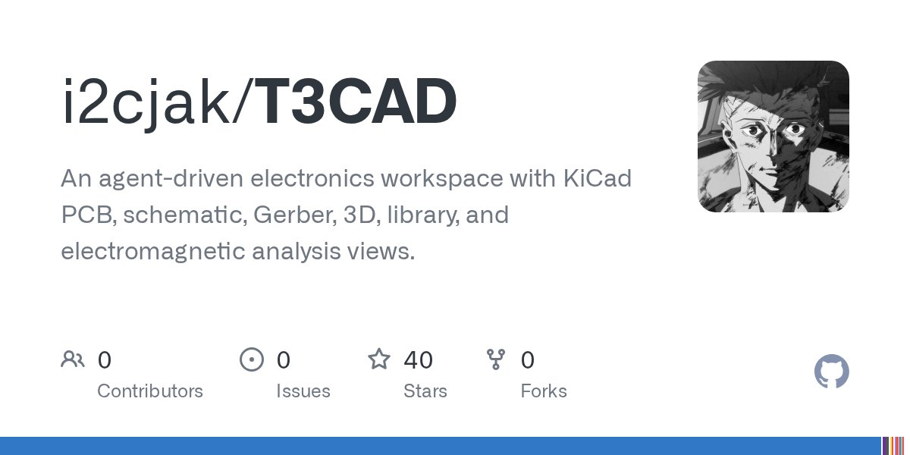

# T3CAD: An agent-driven electronics workspace with KiCad PCB, schematic, Gerber, 3D, library, and more

> Source: https://x.com/adafruit/status/2097033282441404729 — adafruit industries (@adafruit) — Mon Sep 07 18:44:30 +0000 2026 — 802 likes · 69 reposts · 13 replies · 96897 views — captured 2026-09-21T15:29:07Z

## Post

**Author:** adafruit industries (@adafruit)
**URL:** https://x.com/adafruit/status/2097033282441404729

T3CAD: An agent-driven electronics workspace with KiCad PCB, schematic, Gerber, 3D, library, and more

https://blog.adafruit.com/2026/09/07/t3cad-an-agent-driven-electronics-workspace-with-kicad-pcb-schematic-gerber-3d-library-and-more/

## Media

Originals:
- media/photo_0.jpg: https://pbs.twimg.com/media/HRoonANXMAAk-wq.jpg?name=orig

## Comments

**will whang (@will_whang)** — https://x.com/will_whang/status/2101820288443043961

Finally finished this side side project of micro harddrive music player.

Acrylic CNC transparent casing with the drive internals exposed, RP2354 overclocked a bit to 300Mhz + 8MB PSRAM for buffer and FLAC/MP3/WAV decoding and 192/176.4Khz 4x SRC.

## Links

- https://blog.adafruit.com/2026/09/07/t3cad-an-agent-driven-electronics-workspace-with-kicad-pcb-schematic-gerber-3d-library-and-more/
