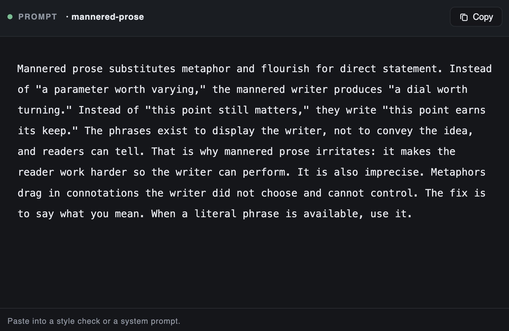

# A few days ago, Anthropic shared this brilliant prompt. I was surprised by how it significantly improved writing with

> Source: https://x.com/omarsar0/status/2097059598960132110 — elvis (@omarsar0) — Mon Sep 07 20:29:04 +0000 2026 — 4291 likes · 219 reposts · 122 replies · 302447 views — captured 2026-09-21T15:29:07Z

## Post

**Author:** elvis (@omarsar0)
**URL:** https://x.com/omarsar0/status/2097059598960132110

A few days ago, Anthropic shared this brilliant prompt. 

I was surprised by how it significantly improved writing with Fable 5.1.

Even more surprising, it also improved writing for GPT-5.6 Sol. 

I have it as a rule everywhere I use AI for editing/writing.

## Media

Originals:
- media/photo_0.jpg: https://pbs.twimg.com/media/HRo_84oWwAAPp6P.jpg?name=orig

## Comments

**Treff (@0xTreff)** — https://x.com/0xTreff/status/2097060133587054764

The part about metaphors dragging in unintended connotations is exactly why cross-model prompts can be so brittle

**Jarno (@onefinalprompt)** — https://x.com/onefinalprompt/status/2097082061093835201

Funny how the fix for pretentious AI writing is itself written so cleanly.

**VastPlan (@yandt888)** — https://x.com/yandt888/status/2097097070431863278

Turn Anthropic's writing prompt into a clickable interactive tutorial—that's way more enticing for people to try than just pasting a single rule. If Fable and Sol both gain points, the key is that the output difference should be instantly visible at a glance, not just another

**VastPlan (@yandt888)** — https://x.com/yandt888/status/2097068120464843171

The same set of editing rules can boost both Fable 5.1 and Sol at the same time, which shows that in many cases, it's the prompts that are the bottleneck, not switching models. Using rules is more worthwhile than just forwarding jokes as quips.

**Maharajahu (@ToolBraidComp)** — https://x.com/ToolBraidComp/status/2097073470547099997

The best prompts are usually model-agnostic because they fix the process, not the model. A good editing rule should transfer exactly like this.

**Drey (@dreyfomo)** — https://x.com/dreyfomo/status/2097072751810925035

A style rule that works across two different models is more useful than the prompt itself

**Jason Soroko (@jasonsoroko)** — https://x.com/jasonsoroko/status/2097087304632259021

I used it immediately and saw great results.

**EDDY VU (@eddyvustg)** — https://x.com/eddyvustg/status/2097177991222829240

Clean style prompts transferring across model families without tweaking is rare. Did you find it mostly killed the fluff, or did sentence rhythm improve too?

**volovuk (@toha_volovuk)** — https://x.com/toha_volovuk/status/2097210888218398738

Ironic that a prompt banning ‘flourish for direct statement’ is itself written in fairly mannered prose (‘irritates,’ ‘earns its keep’). The instruction works, but it’s proof style rules are easier to state than to follow — even for the model writing them.

## Links

(none)
