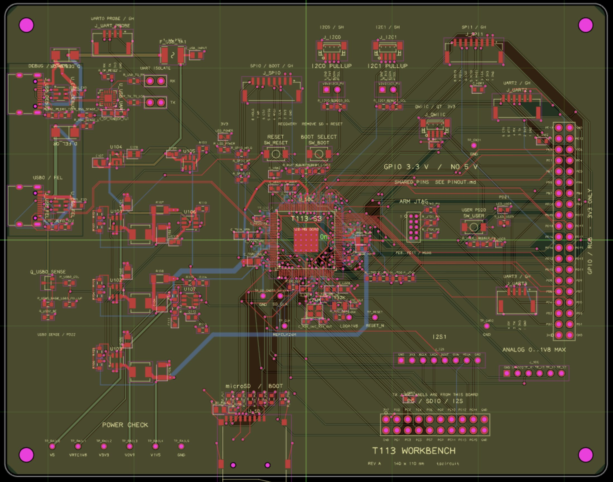
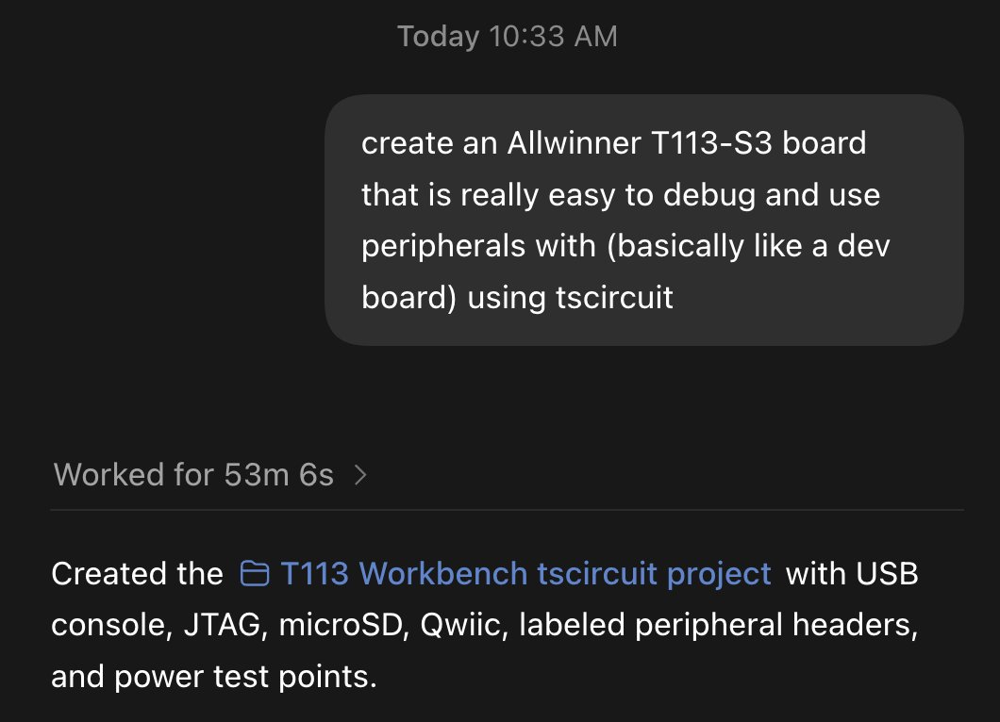
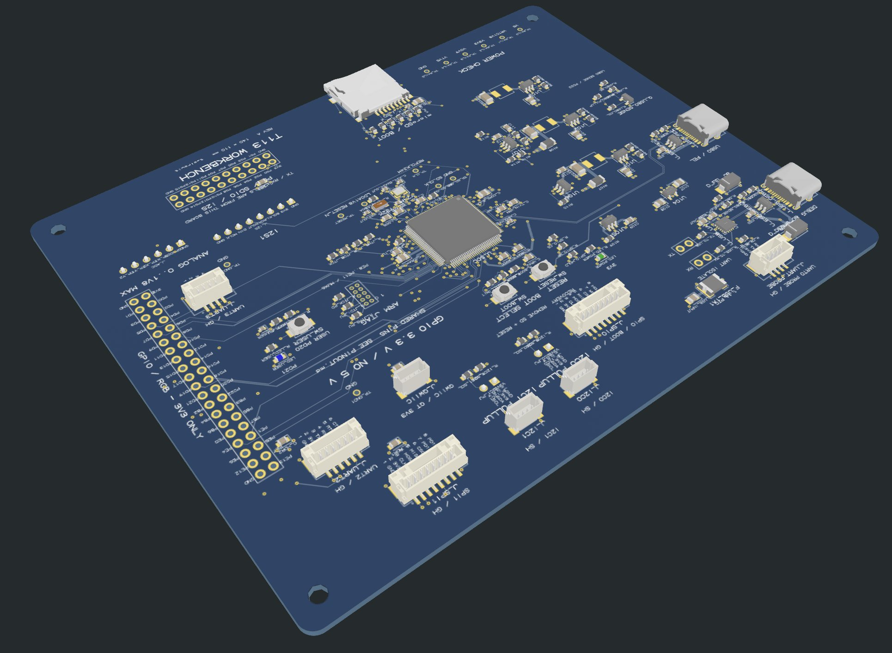

# Instead of letting Astra use KiCad, try asking for tscircuit We've just released the first tscircuit version that

> Source: https://x.com/seveibar/status/2097065106253431233 — Seve (@seveibar) — Mon Sep 07 20:50:57 +0000 2026 — 446 likes · 32 reposts · 28 replies · 23171 views — captured 2026-09-21T15:29:07Z

## Post

**Author:** Seve (@seveibar)
**URL:** https://x.com/seveibar/status/2097065106253431233

Instead of letting Astra use KiCad, try asking for tscircuit

We've just released the first tscircuit version that targets Astra, here you can see a one-shot linux-capable Allwinner T113 dev board

## Media

Originals:
- media/photo_0.jpg: https://pbs.twimg.com/media/HRpEbJabMAAdeb2.jpg?name=orig
- media/photo_1.jpg: https://pbs.twimg.com/media/HRpEi35bsAAKoOh.jpg?name=orig
- media/photo_2.jpg: https://pbs.twimg.com/media/HRpFhb7bYAAtBZa.jpg?name=orig

## Comments

**Daniel Spitze (@sdanielmuc)** — https://x.com/sdanielmuc/status/2097214429393813733

Routing wise it looks pretty bad but still crazy progress on automated design. I believe a bigger bottleneck ist gpt, but the autorouting models and tools it uses…

**Cheena (@simpleCheena)** — https://x.com/simpleCheena/status/2097125124847915206

tscircuit’s first version targeting Astra enables one-shot design of a Linux-capable Allwinner T113 dev board in KiCad alternatives.

**ethereagle · building (@ethereaglehq)** — https://x.com/ethereaglehq/status/2097071529406136425

a board as code is the first time I'd let an agent retry a failed layout without me babysitting KiCad menus. does the T113 one-shot include the power tree or just the MCU?

**Nathan Handyman (@NateTechFuture)** — https://x.com/NateTechFuture/status/2097079974108733710

This tscircuit one-shot dev board is wild. Did you use KiCad before? Do you switch now? And if yes why. Would be interesting to know.

## Links

(none)
