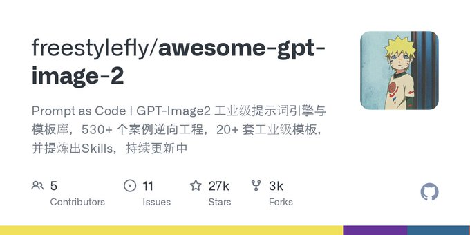

# GPT-Image2提示词库开源才两天，GitHub星标就冲到了18000，你还没上车？ 工业级的提示词引擎、海量模板持续更新、拿来就能用——现在不存，过两周别人都在刷屏晒效果图了，你只能干瞪眼。 🔗

> Source: https://x.com/lksmlabc/status/2097070150390256016 — Lucas (@lksmlabc) — Mon Sep 07 21:11:00 +0000 2026 — 1105 likes · 172 reposts · 45 replies · 109263 views — captured 2026-09-21T15:29:07Z

## Post

**Author:** Lucas (@lksmlabc)
**URL:** https://x.com/lksmlabc/status/2097070150390256016

GPT-Image2提示词库开源才两天，GitHub星标就冲到了18000，你还没上车？

工业级的提示词引擎、海量模板持续更新、拿来就能用——现在不存，过两周别人都在刷屏晒效果图了，你只能干瞪眼。
🔗 https://github.com/freestylefly/awesome-gpt-image-2

## Media

Originals:
- media/photo_0.png: https://pbs.twimg.com/media/HRhOS4ZaoAAPw7i.png?name=orig

## Comments

**數位孫權 | 网红模特经济 (@Danyul6)** — https://x.com/Danyul6/status/2097118773761171765

18,000 stars in two days? That's insanely wild, damn.

**Crio Songo (@shuizhuyu)** — https://x.com/shuizhuyu/status/2097124213861896325

It's mainly because the demand is right there—now everyone generating AI images is short on good prompts, and this is a ready-to-use, out-of-the-box solution, so gaining stars quickly is totally normal. I've already gone and checked it out.

**AI Mastery Guide (@aiseomastery)** — https://x.com/aiseomastery/status/2097487667676262781

18k stars in two days, wild

## Links

- https://github.com/freestylefly/awesome-gpt-image-2
