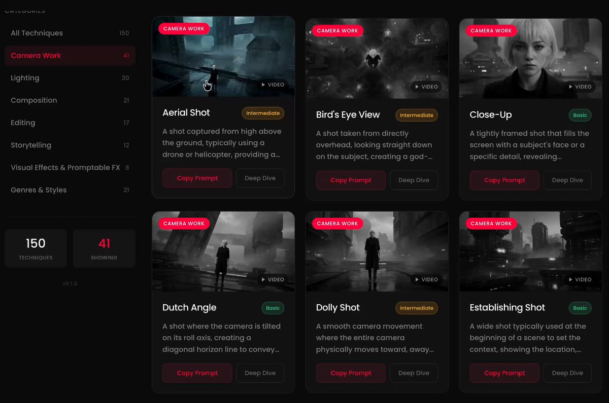

# 영상 연출 기법 150개를 모아둔 프롬프트 라이브러리 카메라 워크부터 조명, 구도, 장르·스타일까지 영화 촬영·연출 기법 150개를 AI 영상 생성용 프롬프트로 정리해둠 예시 이미지, 영상을 선택하면 기법 설명과

> Source: https://x.com/VibeEverything/status/2097191015711121730 — @VibeEverything (LOOPY) — posted Tue Sep 08 05:11:16 +0000 2026 — 74 replies, 812 reposts, 4278 likes, 6765 bookmarks, 215801 views — captured 2026-09-21T15:05:37Z
> Author bio: AI🧑‍💻creator
돈 버는거 맛있는거 재밌는거 예쁜거 좋아함
✉️ DM · vibeeverything@naver.com

## Post

@VibeEverything

영상 연출 기법 150개를 모아둔 프롬프트 라이브러리

카메라 워크부터 조명, 구도, 장르·스타일까지

영화 촬영·연출 기법 150개를
AI 영상 생성용 프롬프트로 정리해둠

예시 이미지, 영상을 선택하면
기법 설명과 활용법을 살펴볼 수 있고
프롬프트까지 복사해서 활용할 수 있음

머릿속에 원하는 장면은 있는데
어떻게 설명할지 막힐 때 참고하기 좋음

## Media

[media/media_0.mp4](media/media_0.mp4)

Original: https://video.twimg.com/amplify_video/2097189026298310657/vid/avc1/1628x1080/z6qz8y9PiLlsxM-W.mp4?tag=29
Original: https://pbs.twimg.com/amplify_video_thumb/2097189026298310657/img/hD9OTPOSSS-w1bxv.jpg

## Comments

**@rosyandr0x1** (2026-09-08T21:03:32.000Z) — https://x.com/rosyandr0x1/status/2097430661837836728

thanks a lot

**@hmazmarketing** (2026-09-10T04:28:28.000Z) — https://x.com/hmazmarketing/status/2097905018250657838

150個って多すぎでしょ（笑）でもダッチアングル一つ知ってるだけで絵の説得力変わるし、映画の文法を言語化してるのは勉強になるな

**@Insight_sua** (2026-09-08T08:08:14.000Z) — https://x.com/Insight_sua/status/2097235548650033415

언제나 감사합니다 루피님!!!!

**@AlibabaGroup** () — https://x.com/AlibabaGroup/status/2101877370210947505/photo/1

Alibaba Cloud is named a Leader in the 2026 Gartner® Magic Quadrant™ for Generative AI Model Providers and Strategic Cloud Platform Services.

This dual recognition highlights our strength in AI and cloud platforms, from Qwen models to agentive cloud infrastructure.

**@Viniai_** (2026-09-08T09:55:01.000Z) — https://x.com/Viniai_/status/2097262423883608569

A hundred and fifty techniques, useful library.

**@5tteang** (2026-09-08T05:39:47.000Z) — https://x.com/5tteang/status/2097198189355127001

Thanks for the sweet tip.

**@Choi___MS** (2026-09-08T09:18:02.000Z) — https://x.com/Choi___MS/status/2097253113896075457

유용한 정보 감사합니다 !

**@RexDgreat** (2026-09-09T03:02:20.000Z) — https://x.com/RexDgreat/status/2097520956839518533

150개 다 훑어보는 데 시간 꽤 걸리겠다

**@hxhxhx0916** (2026-09-08T10:56:32.000Z) — https://x.com/hxhxhx0916/status/2097277903545483690

Thank you~ LOOPY. It is helpful~

**@Brjen** (2026-09-10T01:32:40.000Z) — https://x.com/Brjen/status/2097860778103644656

Wow that's so nice of you to share this!

**@DumbApe18** (2026-09-08T05:39:00.000Z) — https://x.com/DumbApe18/status/2097197995435688081

I love that you can check all the compositions

**@westerncivnews** (2026-09-08T11:03:23.000Z) — https://x.com/westerncivnews/status/2097279627949420648

Wow very useful thanks, incredible how the added video for each scene helps immensely to properly understand and visualise the shot

**@AIBizarrothe** (2026-09-08T11:07:52.000Z) — https://x.com/AIBizarrothe/status/2097280755671994709

ok this is cool. I can see this being very useful for some Ideas I have.

**@josh95235** (2026-09-08T14:59:03.000Z) — https://x.com/josh95235/status/2097338936875962674

Thanks for this

**@niconico_nii2** (2026-09-08T08:28:31.000Z) — https://x.com/niconico_nii2/status/2097240654158180517

루피님 증말... 엑기스같은 정보만 주시네요 너무 감사해요 필요햇던건데 ㅜㅜ
