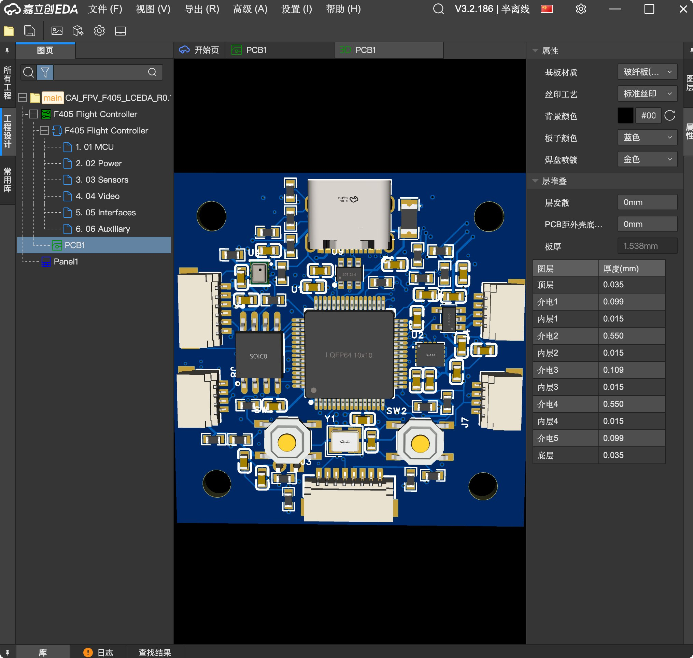
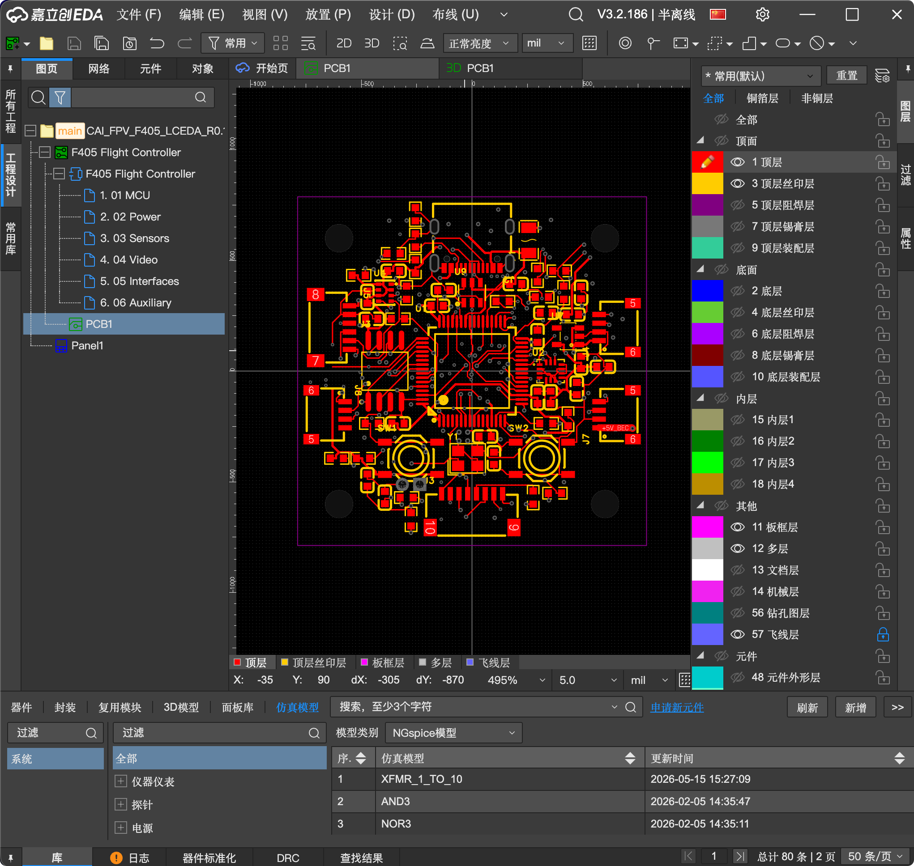
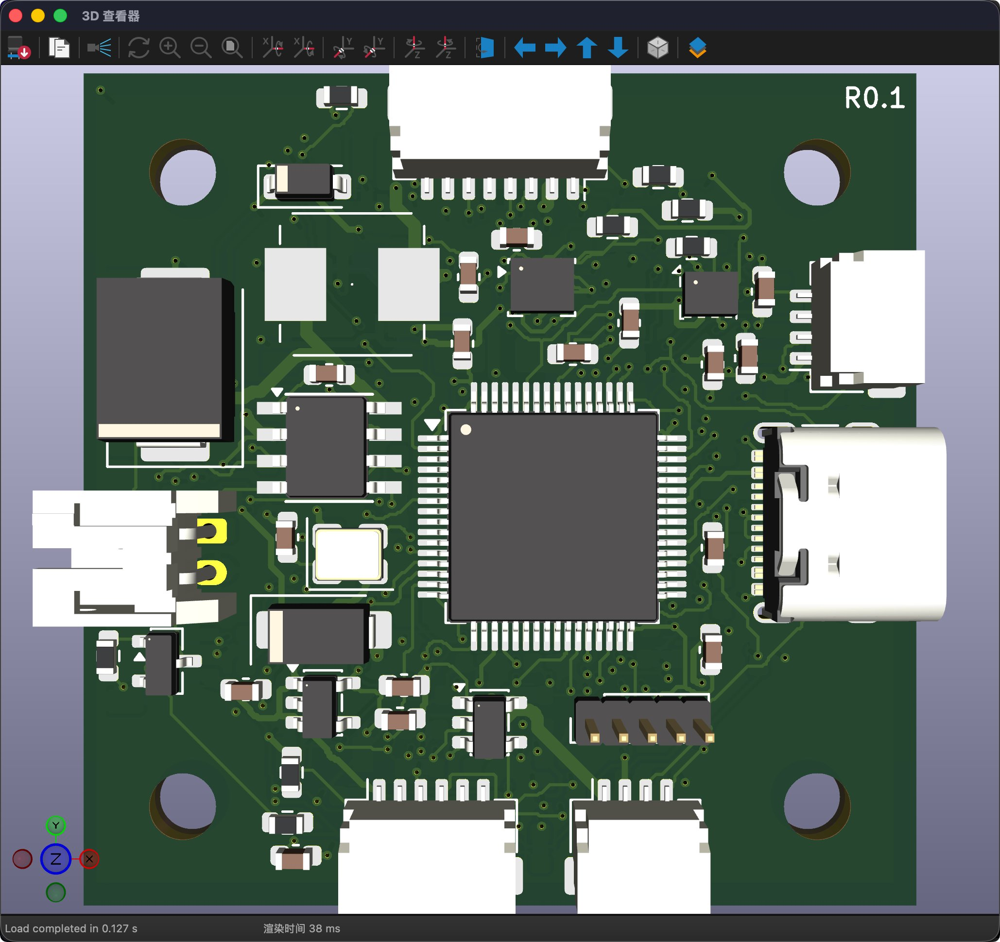
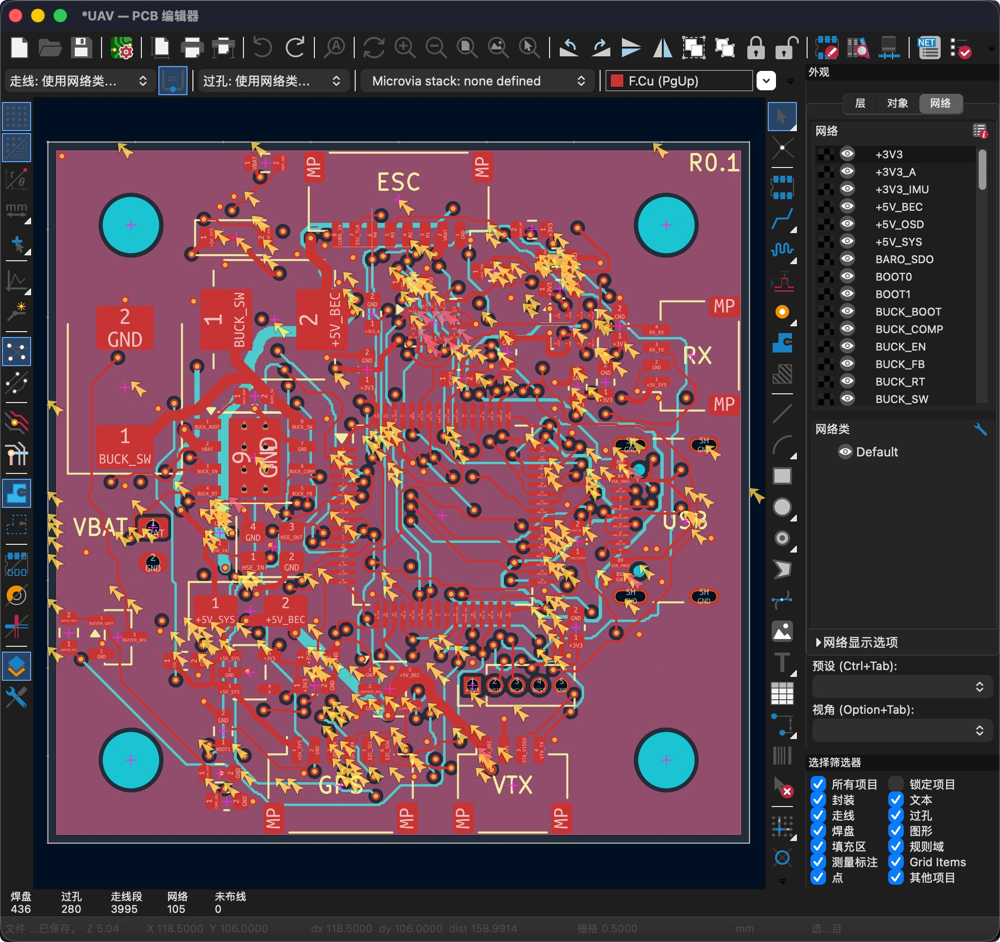

# GPT-6 Astra画FPV无人机飞控PCB板方式对比 1、图一和图二是GPT-6直接使用Codex的Computer Use功能直接自己打开嘉立创EDA在里边画飞控PCB板，没有使用MCP和Skil。

> Source: https://x.com/GoGoFly23/status/2097294226950148499 — @GoGoFly23 (GoFly) — posted Tue Sep 08 12:01:24 +0000 2026 — 23 replies, 44 reposts, 389 likes, 243 bookmarks, 18818 views — captured 2026-09-21T15:05:37Z
> Author bio: Github主页https://github.com/Cai-aa

## Post

@GoGoFly23

GPT-6 Astra画FPV无人机飞控PCB板方式对比 
1、图一和图二是GPT-6直接使用Codex的Computer Use功能直接自己打开嘉立创EDA在里边画飞控PCB板，没有使用MCP和Skil。 
2、图三和图四是GPT-6通过在Codex里安装KiCAD里安装对应的MCP联通KiCAD然后画的的飞控板。 
3、总的消耗时间都差不多是三个多小时。使用MCP在KiCAD里画的耗时少一些。模型的思考强度都是高，没有开最高档的Ultra。 
4、关于Token消耗量，在嘉立创里直接使用Computer Use功能的Token消耗量高一些（6,594万+578万+525万≈7700万个），578万是修复排针干涉、525万是修正三个接口朝向。直接使用Computer Use在嘉立创里画的时候有几个排针接口发生了干涉，而且有三个排针插口的朝向不对，又让GPT-6调整了一下。使用MCP在KiCAD里画的Token消耗量是5200万个，没有做任何调整。以上Token计算量都含缓存输入，由Codex自己计算提供。
你觉得哪种方式画出来的PCB板要好一些。
 #AI #GPT6 #FPV #Agent #PCB #Astra #MCP

## Media

Original: https://pbs.twimg.com/media/HRsViy8aUAALVrR.jpg?name=orig
Original: https://pbs.twimg.com/media/HRsVuGsbQAARU0b.png?name=orig
Original: https://pbs.twimg.com/media/HRsV0AzbYAA3SZd.jpg?name=orig
Original: https://pbs.twimg.com/media/HRsV33RbwAAVO0i.jpg?name=orig

## Thread

**@GoGoFly23** (2026-09-09T04:10:22.000Z) — https://x.com/GoGoFly23/status/2097538075153035627

用的 kicad MCP，就是个搜索 kicad MCP 排第一的那个 github 项目

**@GoGoFly23** (2026-09-09T04:09:36.000Z) — https://x.com/GoGoFly23/status/2097537885163651574

差不多是这么个原理

**@GoGoFly23** (2026-09-09T04:12:22.000Z) — https://x.com/GoGoFly23/status/2097538579702677923

GPT6 自己找的外部库

**@GoGoFly23** (2026-09-09T04:11:33.000Z) — https://x.com/GoGoFly23/status/2097538375171637663

业余 FPV 爱好者，看到 GPT6 宣传的有画电路板的 demo， 就有这个画飞控的想法

**@GoGoFly23** (2026-09-09T04:13:56.000Z) — https://x.com/GoGoFly23/status/2097538973724037330

why

## Comments

**@haiqiang72302** (2026-09-09T02:05:03.000Z) — https://x.com/haiqiang72302/status/2097506538378375172

Using MCP to operate KiCad involves encapsulating the APIs exposed by KiCad into MCP, and Codex operates KiCad by manipulating the API, right?

**@flayed__** (2026-09-09T00:35:49.000Z) — https://x.com/flayed__/status/2097484081726365764

元件3D模型是KiCAD自带的还是外部库？

**@ejsk33382** (2026-09-09T04:05:24.000Z) — https://x.com/ejsk33382/status/2097536827897123152

老哥到底什么专业的啊

**@Badkun33** (2026-09-08T18:20:57.000Z) — https://x.com/Badkun33/status/2097389743373705636

Oda's doing shitty right now

**@VespersoRequiem** (2026-09-09T04:53:55.000Z) — https://x.com/VespersoRequiem/status/2097549036723270037

So cool

**@CIA_0786_AX33** (2026-09-09T10:02:29.000Z) — https://x.com/CIA_0786_AX33/status/2097626689908207879

可以製作無人機在中共大陆，然后不用上報
