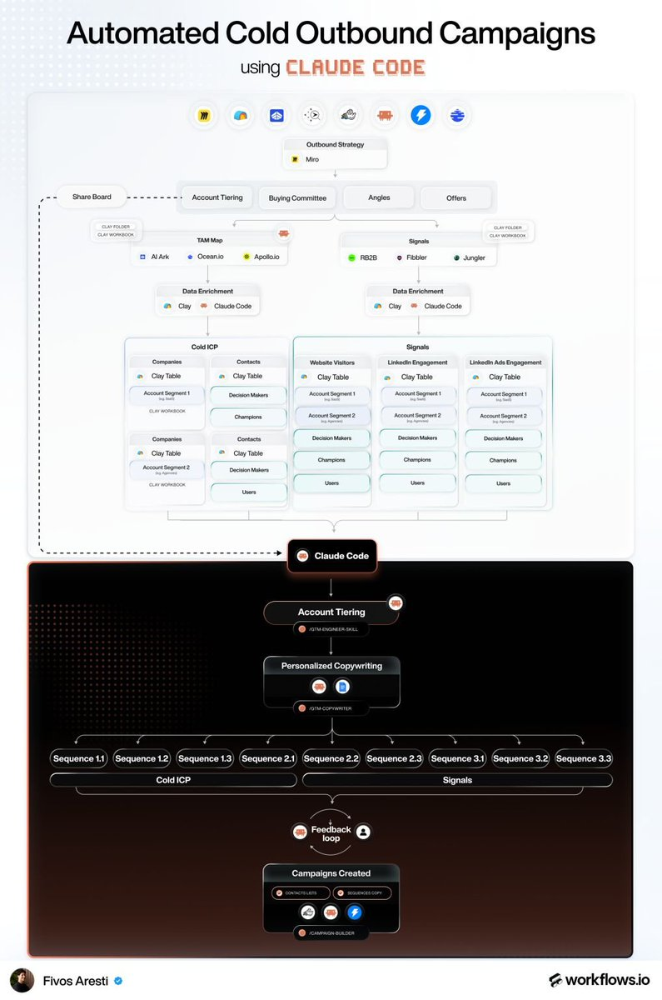

# My company sends millions of cold emails a month on behalf of our clients. Claude code has completely changed the way

> Source: https://x.com/fivosaresti/status/2097324082119254447 — Fivos Aresti (@fivosaresti) — Tue Sep 08 14:00:02 +0000 2026 — 29 likes · 3 reposts · 5 replies · 1553 views — captured 2026-09-21T15:29:07Z

## Post

**Author:** Fivos Aresti (@fivosaresti)
**URL:** https://x.com/fivosaresti/status/2097324082119254447

My company sends millions of cold emails a month on behalf of our clients. 

Claude code has completely changed the way we run outbound. 

Here's how we use it to craft tailored emails for every prospect:

(WITHOUT writing any of them myself)

1) Pick 5 angles
→ Genuinely different from each other
→ 5 separate reasons the account should care

2) Write ONE email by hand
→ Fully personalized
→ This is the quality bar the machine copies

3) Feed Claude Code, per row:
→ A summary of each company
→ That hand-written example email

4) Output
→ A tailored variant for every account
→ Multiple sequences across both motions (cold ICP + signals)

The last mile used to take hours.

With a prompt and a skill, the campaign variants get created and uploaded straight to:
→ Instantly for emails
→ HeyReach for LinkedIn

Write one well, then let Claude Code hold the bar across every row.

## Media

Originals:
- media/photo_0.jpg: https://pbs.twimg.com/media/HRsdQiAbkAAaOaF.jpg?name=orig

## Comments

**Ed. (@Edd08x)** — https://x.com/Edd08x/status/2098682100190720014

Angle libraries beat one clever opener. The win is when every draft still maps to a real buyer constraint.

**Husnain Rafiq (@husnain_rfq)** — https://x.com/husnain_rfq/status/2097396035106787416

How are you handling quality control at that scale? Curious how you catch the bad variants before they go out.

**Anton (@AntonTamozo)** — https://x.com/AntonTamozo/status/2097329888327794731

Impressive! Is a company summary enough context for strong personalization or do you enrich data about the recipient as well to tailor each email?

## Links

(none)
