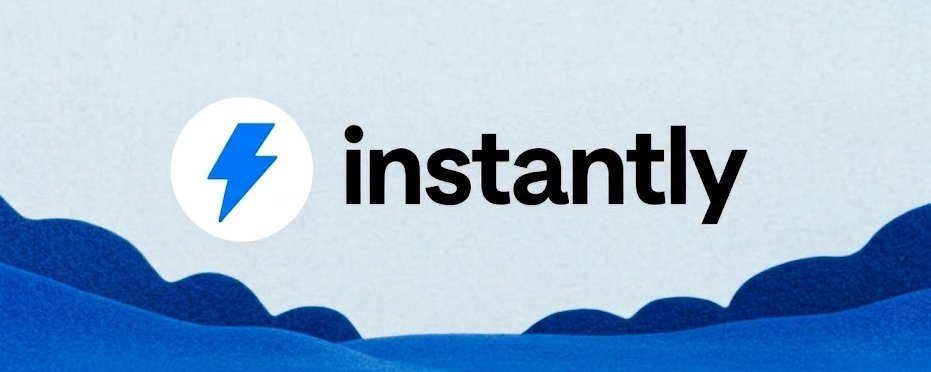

# Instantly’s $3.3M/Mo LinkedIn Playbook (Full Breakdown)

> Source: https://x.com/paolo_scales/status/2097335350930588073 — @paolo_scales (paolo trivellato) — posted Tue Sep 08 14:44:48 +0000 2026 — 17 replies, 6 reposts, 97 likes, 217 bookmarks, 25739 views — captured 2026-09-21T15:05:37Z
> Author bio: founder @ starborn & linkedin wizard

## Post

@paolo_scales

https://x.com/i/article/2097331831204896768

## Article: Instantly’s $3.3M/Mo LinkedIn Playbook (Full Breakdown)

Instantly is doing $3.3M a month. Their LinkedIn company page has ~66k followers. The members behind this company collectively have 500,000+ followers on this platform, about 8 times the size of the corporate account.
Founders look at that and think the company's account was pulling the real weight. Orchestrating big launches. Bringing in all leads behind the scenes. 
But in reality, if it weren't for the smaller accounts from executives, partners, and even AEs, they would be nowhere near where they were now...
Instantly split its content into 4 separate jobs, handed each one to a different person, then built an incentive structure that turned everyone outside the company into a distributor.
The posts are the visible layer. What sits underneath is the part worth stealing, and I'm going to tear the whole thing apart:
Layer One: They Split Content Into Four Jobs
Here's the decision that makes the whole engine work, and most companies never make it at all.
4 distinct content jobs, 4 different people, and none of them doing what the others do.
Nils Schneider owns vision and launches. 
He's the co-founder, has around 32,000 followers, and his profile is considerably less active than those of three of his own employees. That's deliberate. He doesn't need to be the content machine. Just the face of the brand.
Look at how he announced their AI Sales Agent, for example, on the first featured post. 
The hook was "just shipped," followed immediately by a list of things you no longer have to do. Don't learn cold email. Don't learn deliverability. Don't learn lead sourcing. Don't hire an SDR. Enter your website and the AI handles it. Then the proof: 150+ opportunities generated for their own AE team in two weeks.
The whole post is built around removing complexity rather than adding features, which is a completely different pitch from every competitor announcing what their product now includes.
His other move is what he does with releases. When they shipped their B2B Pixel he framed it as a new free mechanism to close more deals, then explained how it identifies anonymous website visitors and feeds them into outreach. The reader thinks "I could use this." Nobody thinks "they're selling software."
2. Hans Dekker owns the methodology. 
He runs education and content, and his job is turning internal expertise and customer results into reusable intellectual property.
His content almost never leads with the product. It leads with a GTM problem, gives you the framework, shows a real campaign, drops the numbers, and lets Instantly show up as the thing that executed it.
The case studies are the strongest format on his profile:
425 emails producing 41 replies, 13 opportunities and 5 closed deals
4,415 contacts at a 4.55% reply rate producing 57 opportunities and 30 meetings
66,000 emails producing $1.36M in pipeline
He also sells the philosophy before the software. He often argues outbound isn't a volume game, then describes testing 5 to 10 variations against 100 to 200 prospects each to find which framing gets replies. 
Another of his post angles argues there are two customers in every outbound campaign: 
The prospect
The sales team executing it
And campaigns die when sales doesn't believe in them, regardless of how good the sequence is.
That's the kind of take that makes the product feel like the obvious implementation of a worldview the reader just adopted.
3. Otto Tatton owns implementation. 
Around 25,000 followers, running the most stealable format on the platform right now. The "I built X" post.
His strongest one was building an entire business in 48 hours using Lovable, LinkedIn and Instantly. Seven documented steps, from building the site through to scaling booked calls. Then: comment "LEADS" for the full playbook.
His stack posts do the same thing. ChatGPT into n8n into Instantly, with the complete automation visible. And there's a psychological detail underneath it most founders miss. The reader doesn't finish thinking "I need that tool." He finishes thinking "I want that entire system," and the tool is sitting inside it.
(Here's an example of a giveaway of his that got 1k+ comments:)
Aaron Reid owns proof and the high ticket. 
He runs Instantly's VIP done-for-you outbound operation, around 14,000 followers, selling "let us run outbound for you," which creates an entire second monetisation layer on top of the SaaS.
His content leads with results. One post opened on $3.2M in pipeline across 120 days, then walked through the process: inbox and domain setup, warmup, an AI reply agent, 150+ playbooks, campaign angle testing, scaling the winners.
Vision creates belief. Methodology creates competence. Implementation creates desire. Proof creates urgency. Run one of the four and your content will produce attention without conversion.
Layer Two: They Staffed the Multiplier Roles
Not every account needs to originate, and this is where founders get it wrong when they try to copy this.
Most people in a distribution network should be multipliers.
Raul Kaevand is the other co-founder, around 10,000 followers, considerably less content-heavy. Product announcements, founder credibility, amplification.
The founders' origin story does real work for the brand though. They ran a lead-gen agency, sent millions of emails for clients, hit scaling problems, built internal software to fix it, then turned that into Instantly. "We built this because we needed it" beats "we researched a market opportunity" every time.
Reio Suun sits around 4,000 followers and does two useful things. He turns specific features into easy wins, like telling people with US B2B traffic to switch on Website Visitors and explaining exactly what happens next. And he owns the beginner rung: don't overcomplicate cold email, start with 2 to 3 domains and 2 to 3 accounts, write simple emails, learn by doing.
He also reposts constantly. Nils, Raul, product updates, other ecosystem voices. That's a real job and it requires inventing nothing.
Ilie Andrei-Leonard leads their AI team and provides technical credibility. As the company moves from cold email platform toward AI-powered GTM infrastructure, having someone who makes the AI story feel engineered rather than marketed matters more than it looks.
Assign everyone to originate and you get silence within three weeks. A network needs originators and it needs amplifiers, and most people are amplifiers.
Layer Three: The Comment Mechanism Nobody Deviates From
Across Hans, Otto and Aaron, the call to action is identical.
Comment one word.
"TEAM" for a set of GTM frameworks. "LEADS" for the launch playbook. "BRAIN" for a trained methodology.
Those posts pulled 505 and 411 comments respectively on accounts far smaller than the numbers suggest.
It works because two loops run simultaneously. The public comment feeds the algorithm and exposes the post to that person's network, which brings more readers and more comments. The private DM delivers the resource and starts a conversation.
Put a link in the post instead and you kill the first loop entirely. The reader leaves the platform, the algorithm reads an exit, and the post dies quietly.
If you want to see what this looks like built for a founder-led company rather than a company with an education lead on payroll, the case studies are at starbornai(.)com.
Layer Four: Magnets That Are Implementation, Not Information
Look at what they actually give away.
Not "10 Cold Email Tips." Instead: a 48-hour launch playbook. An operator's methodology trained into an AI tool. Five GTM experts converted into installable skills. Exact campaign setups. Copy-paste templates.
The reader receives something he runs rather than something he has to interpret and apply.
Aaron's best magnet is the clearest version of this. After taking over Instantly VIP, he trained an AI on his own outbound methodology and offered the install: like and comment "brain" and he'd send the instructions.
The lead magnet was literally his expertise.
An earlier one produced over 1,900 downloads, roughly 1,000 MQLs, 30 enquiries and 20 SQLs. His stated design principle: build the magnet around the customer's core business problem and the outcome they want, not around a topic.
That distinction decides whether reciprocity fires. Perceived value has to land before the reader closes the tab, and information doesn't do that.
Layer Five: One Product, Six Doors In
Here's why the same company monetises a beginner and an agency owner without either feeling the content was written for someone else.
Beginner. Reio's content teaches first campaigns. Product is the software
Operator. Hans shows complete outbound systems. Product is software plus stack
Advanced. Hans and Aaron document seven-figure pipeline. Product is the advanced configuration
Delegator. Aaron shows what VIP produced. Product is the done-for-you service
Agency. Certified Experts and partner content. Product is the partner programme
Creator. Category comparisons and tool reviews. Product is recurring commission
Six entry points, one company, and a named person responsible for each one.
Most B2B businesses force every prospect into a single funnel and lose everyone who doesn't fit it.
Layer Six: Nancy Mai Harnett Acquires the Distributors
This is the job almost nobody staffs and it might be the highest leverage one in the company.
Nancy came in as Head of Growth Partnerships with a mandate to unify affiliate, referral, creator, startup and strategic partnerships into a single engine.
Her audience isn't customers. It's people who can bring thousands of customers.
She's operating one level above the normal funnel. Her content brings in a partner, the partner joins the ecosystem, gets tracking and assets, creates content, sends traffic, and Instantly acquires customers without paying a salary for any of it.
Marc Gaudett works the same layer from the integration side, publicly mapping the partner ecosystem across LinkedIn automation tools like Aimfox, HeyReach and Valley, plus CRM and enrichment partners. That's co-marketing and audience exchange rather than affiliate marketing.
Outside the company, Michel Lieben at ColdIQ functions as agency-side proof that the product holds up for sophisticated operators, and Joakim Ystmark at Affilial runs a meta play, since he helps companies build affiliate engines and Instantly sits inside his own stack.
That last one creates second-order distribution. Instantly reaches Affilial, which reaches its clients, which reach their affiliates, which reach their audiences.
Layer Seven: The Economics That Make It Self-Propelling
Their affiliate structure runs tiered recurring commission, reportedly 20% at Silver, 30% at Gold and 40% at Platinum, with an additional percentage on VIP referrals for a defined window.
Recurring is the word doing the work.
One-time commission buys you a single promotional post. Recurring buys evergreen assets: a tutorial that keeps ranking, a comparison page that keeps converting, a walkthrough still producing signups two years later. Which is exactly why their guidance tells partners to build tutorials, demos, comparisons, client case studies and newsletters rather than one-off social posts.
Then they went further and productised the promoting itself. Their creator programme supplies graphics, templates, post ideas, amplification, community access and direct contact with the team.
They removed the work required to promote them.
Their Certified Experts programme does the same for agencies, giving people like Josh Whitfield a public credential that Instantly then promotes through its own channels.
The loop closes: you promote Instantly, Instantly promotes you, your authority rises, you win more clients, and now you have more reason to keep promoting.
The Objection Every Founder Raises Here
"I can't afford an affiliate programme."
Fair, and it misreads what's being paid for. They're buying distribution with surplus, and commission is only one form of it.
The others cost nothing:
Amplification. Reposting a partner's content converts into their clients, and it's often worth more to them than money
Credibility. A certification costs you a webpage and gives them something they can sell with tomorrow
Access. Direct contact with your team, disproportionately valued by people building next to you
Assets. Templates and graphics that turn promoting you from a two hour job into ten minutes
The question isn't what you can pay people. It's what the people around you already want that you're sitting on. Your clients want to look competent to their peers. Your partners want lead flow. Creators in your space want material that makes them look informed.
The second objection is quieter: this feels like losing control of the message.
You are losing it. That's the trade. A network says things you wouldn't have written, at a volume you could never produce, to audiences you'd never reach. Given the ratio between 63,000 and 500,000, the math is hard to argue against.
What This Actually Costs
The reason Instantly's LinkedIn presence is difficult to copy isn't the posts. It's that the posts are the surface of four content jobs, three multiplier roles, a partnerships function, an affiliate programme, a certification track and a creator programme all running at once.
Copying the posts gets you posts.
For a founder at $500K to $5M, the realistic version is narrower and still demanding. One person owning methodology. One owning proof. A magnet good enough that people feel guilty getting it free. A comment mechanism nobody deviates from. DM delivery inside 24 hours. And something you can give partners that costs you nothing and is worth real money to them.
Sustained for 90 days before the network starts feeding itself.
Most founders hold that for eleven days.
Which is why every one of these people publishes their playbook openly. The constraint was never the information.
If you want us to audit your B2B agency or SaaS and show you how we'd implement this exact LinkedIn GTM system to add $15k-$50k to your MRR in 90 days, DM me "INSTA" and we'll make it happen
($4M+ added to our clients' MRR through LinkedIn GTM funnels, fully done-for-you)
Paolo

## Media

Original: https://pbs.twimg.com/media/HRtFFZKXwAAPJEW.jpg

## Comments

**@ajackm** (2026-09-09T10:29:03.000Z) — https://x.com/ajackm/status/2097633374139785489

What share of new ARR is partner-sourced, and how does its CAC payback compare with founder-led outbound?

**@mosaadat** (2026-09-09T09:07:36.000Z) — https://x.com/mosaadat/status/2097612876940746886

@readwise
 save

**@imtamhn** (2026-09-09T12:43:00.000Z) — https://x.com/imtamhn/status/2097667085279375681

@kinreader_ai
 narrate this

**@thewilliamrb** (2026-09-08T16:31:13.000Z) — https://x.com/thewilliamrb/status/2097362131792568533

bro cookedd

## Links

- https://x.com/i/article/2097331831204896768
