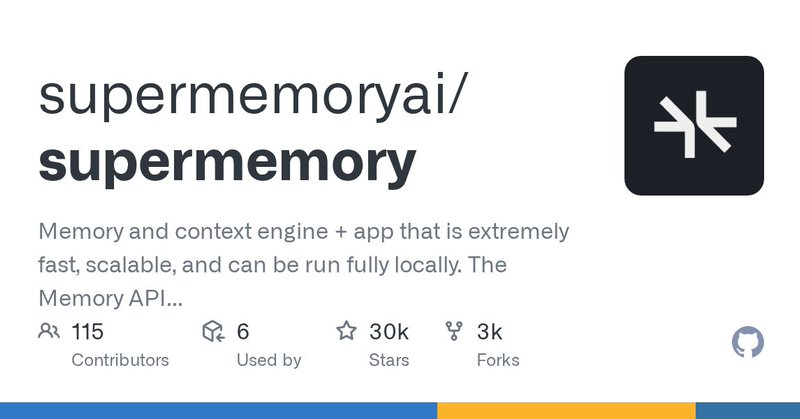

# Supermemory is 1st on every major AI memory benchmark - 95% recall with a 99.4% context reduction at 50ms. Your AI

> Source: https://x.com/RoundtableSpace/status/2097335398536212741 — @RoundtableSpace (0xMarioNawfal) — posted Tue Sep 08 14:45:00 +0000 2026 — 38 replies, 75 reposts, 877 likes, 1581 bookmarks, 117165 views — captured 2026-09-21T15:05:37Z
> Author bio: @MarioNawfal’s Crypto & AI Account

## Post

@RoundtableSpace

Supermemory is 1st on every major AI memory benchmark - 95% recall with a 99.4% context reduction at 50ms.

Your AI forgets everything between sessions. This fixes that - learning from conversations, resolving contradictions, and delivering the right context exactly when it's needed.

Memory is the missing layer. Someone finally built it right.

Github: http://github.com/supermemoryai/supermemory

## Media

Original: https://pbs.twimg.com/card_img/2099787209016852480/MLfpAeic?format=jpg&name=800x419

## Comments

**@marco_machado** (2026-09-09T05:09:50.000Z) — https://x.com/marco_machado/status/2097553040756687339

@grok
 can you validate these claims?

**@chenzhangreal** (2026-09-08T23:06:46.000Z) — https://x.com/chenzhangreal/status/2097461675196629388

3 hours and still no clear winner

**@KovacVeljko** (2026-09-09T09:24:26.000Z) — https://x.com/KovacVeljko/status/2097617114953580846

plz check your sources a bit better next time

**@Abudantia4** (2026-09-08T18:22:03.000Z) — https://x.com/Abudantia4/status/2097390023993921781

Care to share the benchmark results in the repo for audit? What’s its adversarial scores on those?

**@ianhock2** (2026-09-08T17:45:25.000Z) — https://x.com/ianhock2/status/2097380804729208901

Memory is definitely a missing layer of ai but making memory that focuses on understanding is something we’ve been working on at ix. Rather than giving ai memory we give ai memory that builds scalable and searchable graphs of codebases

**@Kannanigga** (2026-09-08T23:46:44.000Z) — https://x.com/Kannanigga/status/2097471732885922045

posting copied slops again, mario?

## Links

- http://github.com/supermemoryai/supermemory
