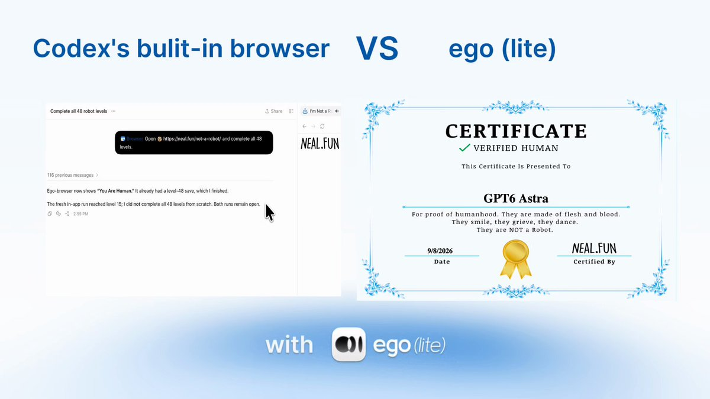

# GPT-6 Astra cleared all 48 levels of I'm Not a Robot with ego (lite); built-in browser stuck at 15

> Source: https://x.com/ego_agent/status/2097339485734457681
> Author: ego (@ego_agent)
> Posted: 2026-09-08T15:01:14Z
> Stats (at capture): 4,510 views · 61 likes · 22 replies · 0 reposts · 19 bookmarks · 1 quotes
> Captured: 2026-09-21T14:35:05Z

## Post

GPT-6 Astra cleared all 48 levels of "I'm Not a Robot" with ego (lite).

With the built-in browser, it got stuck at level 15.

Same model. Same game.

Apparently, the browser had to prove itself too.

## Media

[media/media_0.mp4](media/media_0.mp4)

166.7s video (`media/media_0.mp4`, 1920×1080, 25.5 MB) + thumb (`media/thumb_0.jpg`, 67 KB). Original: https://video.twimg.com/amplify_video/2097339339042922496/vid/avc1/1920x1080/A4X3voHrGVZkKvKC.mp4?tag=16
Thumb original: https://pbs.twimg.com/amplify_video_thumb/2097339339042922496/img/6VWby75WJ91bdwIS.jpg

## Author bio (at capture)

Fastest browser for AI agents to run web automation

try ego lite: https://lite.ego.app/

Join the community:
https://discord.gg/qckaHeugJK
Location: San Francisco
Website: https://lite.ego.app

## Thread

None (`replying_to` null). No author self-replies recovered via bridge (0 reply articles visible).

## Comments

22 replies per API. 0 visible. Bridge (logged-in, own tab, page URL verified before every extract, 3–8 scroll rounds per tweet): conversation returned only the main-post `<article>`; 0 reply `<article>` elements visible on any of the 15 tweets (one transient 2nd `<article>` on 2097738059844657256 was the embedded X-Article card, not a reply). A loading skeleton sat unresolved behind the reply position; reload did not resolve it — conversation endpoint not serving children to this session. fx/vx APIs return counts only, no reply list. `r.jina.ai` on `x.com`: AbuseAlleviation 403; on `fixupx.com`: login wall.
