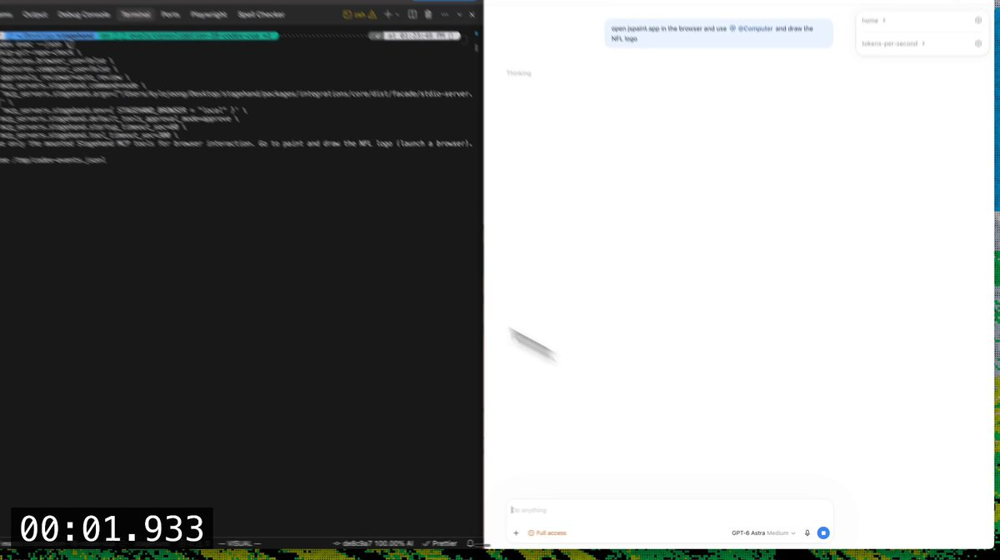

# We just made Astra's computer use 2.5x faster with Stagehand. Astra works by executing code against the a11y tree, we

> Source: https://x.com/kylejeong/status/2097437004204286411
> Author: Kyle Jeong (@kylejeong)
> Posted: Tue Sep 08 21:28:44 +0000 2026
> Stats (at capture): 24,399 views · 157 likes · 12 replies · 15 reposts · 178 bookmarks · 3 quotes
> Captured: 2026-09-21T14:58:35Z

## Post

We just made Astra's computer use 2.5x faster with Stagehand. 

Astra works by executing code against the a11y tree, we built a translator that turns Astra's playwright commands into @Stagehanddev. 

Astra chose to batch the entire logo into one command and one-shotted it.

## Media

[media/media_0.mp4](media/media_0.mp4)

39.3s video (`media/media_0.mp4`, 1930×1080, 9.1 MB) + thumb (`media/media_0_thumb.jpg`, 42 KB). Original: https://video.twimg.com/amplify_video/2097436336512974849/vid/avc1/1930x1080/eFozVtOwbsh90-jg.mp4?tag=29
Thumbnail original: https://pbs.twimg.com/amplify_video_thumb/2097436336512974849/img/ons7vQW1pQdCANol.jpg

## Author bio (at capture)

growth engineering @browserbase | also @vestucla @kp_fellows math/cs @ucla
Location: San Francisco
Website: https://kylejeong.com/

## Thread

### @kylejeong — [https://x.com/kylejeong/status/2097437006372733191](https://x.com/kylejeong/status/2097437006372733191)

Kyle Jeong
@kylejeong
·
Sep 8
See how it works:
Integrations - Stagehand
From docs.stagehand.dev
5
655

## Comments

12 replies per API. 0 captured via bridge (logged-in, own tab t36, page URL verified before every extract, 5 scroll rounds per tweet; conversation returned no reply articles in range after ads/filler filtering).

## Links

- https://docs.stagehand.dev
