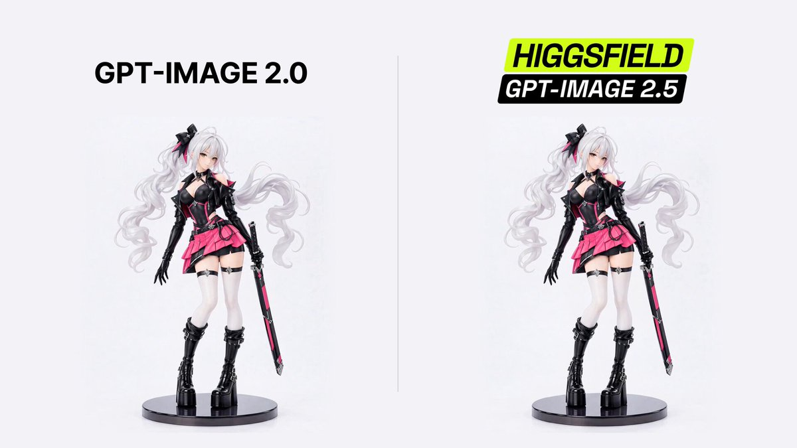

# Comparing GPT-Image 2.0 to GPT-Image 2.5 Sharing the prompt: "Create a continuous 6-second split-screen animation from

> Source: https://x.com/higgsfield/status/2097486959296057609
> Author: Higgsfield AI 🧩 (@higgsfield)
> Posted: Wed Sep 09 00:47:15 +0000 2026
> Stats (at capture): 42,585 views · 575 likes · 15 replies · 57 reposts · 422 bookmarks · 6 quotes
> Captured: 2026-09-21T14:58:35Z

## Post

Comparing GPT-Image 2.0 to GPT-Image 2.5

Sharing the prompt:

"Create a continuous 6-second split-screen animation from the supplied image. Preserve both matching silver-haired gothic anime resin figures and all facial, costume, hair, sword, boot, and base details. Use two equal panels with synchronized motion. Both figures must simultaneously rotate clockwise with their bases through one full 360° turn at 60°/s while gesturing: front at 0s, side at 1.5s, back at 3s, opposite side at 4.5s, and front at 6s. From 0–2s, wave the free right hand beside the face; from 2–4s, brush the hair back with a slight head tilt; from 4–6s, lower the hand to the hip and end in a confident front-facing pose with a soft smile. Keep the left hand holding the fully sheathed katana downward and both feet fixed to the rotating base. Preserve smooth articulation, subtle secondary motion, and the painted-resin finish. Keep both complete figures and bases visible against a near-white studio background. Camera, lighting, scale, divider, and turntable centers stay fixed. No cuts, reversals, camera movement, extra objects, text, watermark, graphics, or audio."

## Media

[media/media_0.mp4](media/media_0.mp4)

6.0s video (`media/media_0.mp4`, 1920×1080, 1.8 MB) + thumb (`media/media_0_thumb.jpg`, 70 KB). Original: https://video.twimg.com/amplify_video/2097486466867941376/vid/avc1/1920x1080/u7HjDp0sfWMqnj5K.mp4?tag=29
Thumbnail original: https://pbs.twimg.com/amplify_video_thumb/2097486466867941376/img/j9bqNMj_21Veq9uK.jpg

## Author bio (at capture)

The AI-native creative suite
Location: San Francisco, CA
Website: https://higgsfield.ai/s/general-higgsfield-IdlJnW

## Thread

None (`replying_to` null). No author self-replies recovered via bridge beyond the main post (0 thread articles) — page URL verified before every extract, own tab t36, 5 scroll rounds per tweet.

## Comments

15 replies per API. 10 captured via bridge (logged-in, own tab t36, page URL verified before every extract, 5 scroll rounds per tweet; deduped by status link, ads and >7-day filler excluded, cap 15).

### @YueWu29543 — [https://x.com/YueWu29543/status/2097509289330131322](https://x.com/YueWu29543/status/2097509289330131322)

> Gemma月
> @YueWu29543
> ·
> Sep 9
> Translated from Chinese
> Show original
> Isn't this an image model? Why can it generate videos?
> 1
> 1.4K

### @acatovicx — [https://x.com/acatovicx/status/2097637338822193297](https://x.com/acatovicx/status/2097637338822193297)

> Armin Catovic
> @acatovicx
> ·
> Sep 9
> What model did you use for video generation?
> 292

### @CoucouNameworks — [https://x.com/CoucouNameworks/status/2097487252213350575](https://x.com/CoucouNameworks/status/2097487252213350575)

> Coucou Nameworks
> @CoucouNameworks
> ·
> Sep 9
> What a prompt 
> 1.2K

### @Mosey_Nyx — [https://x.com/Mosey_Nyx/status/2097487165781397793](https://x.com/Mosey_Nyx/status/2097487165781397793)

> Mosey 𓃵
> @Mosey_Nyx
> ·
> Sep 9
> Higgsfield moves more naturally
> 1.1K

### @laviniavelle — [https://x.com/laviniavelle/status/2097725380170056129](https://x.com/laviniavelle/status/2097725380170056129)

> Lavinia
> @laviniavelle
> ·
> Sep 9
> The side by side results are impressive.
> 74

### @Dipanshu_AI — [https://x.com/Dipanshu_AI/status/2097583058220425593](https://x.com/Dipanshu_AI/status/2097583058220425593)

> Dipanshu Kushwaha
> @Dipanshu_AI
> ·
> Sep 9
> Wow, the improvement is really noticeable! Great job on this update.
> 226

### @sebuzdugan — [https://x.com/sebuzdugan/status/2097702255772275199](https://x.com/sebuzdugan/status/2097702255772275199)

> Sebastian Buzdugan
> @sebuzdugan
> ·
> Sep 9
> noticed single examples hide seed variance; compare twenty runs before calling 2.5 better
> 92

### @NA_DEGEN_GIRL — [https://x.com/NA_DEGEN_GIRL/status/2097574139003564354](https://x.com/NA_DEGEN_GIRL/status/2097574139003564354)

> NA.stand
> @NA_DEGEN_GIRL
> ·
> Sep 9
> Wow
> 246

### @aisongman — [https://x.com/aisongman/status/2097585450852745256](https://x.com/aisongman/status/2097585450852745256)

> AiSongMan｜AI Workflow Lab
> @aisongman
> ·
> Sep 9
> I think this demo is a little misleading.
>
> It’s basically using one image to generate a video — which was already possible before GPT Image 2.5.
>
> A better demo would be:
>
> Generate multiple views/images with GPT Image 2.5 → connect them into a sequence → show how well the
> Show more
> 1
> 3
> 396

### @truevined — [https://x.com/truevined/status/2097525925395181575](https://x.com/truevined/status/2097525925395181575)

> Tonye
> @truevined
> ·
> Sep 9
> That prompt is doing a keyframe's job in prose. Every time I've fought motion like that the fix was pinning the first and last frame and letting the model fill the middle. Cheaper than 200 words of degrees per second, too.
> 1
> 735
