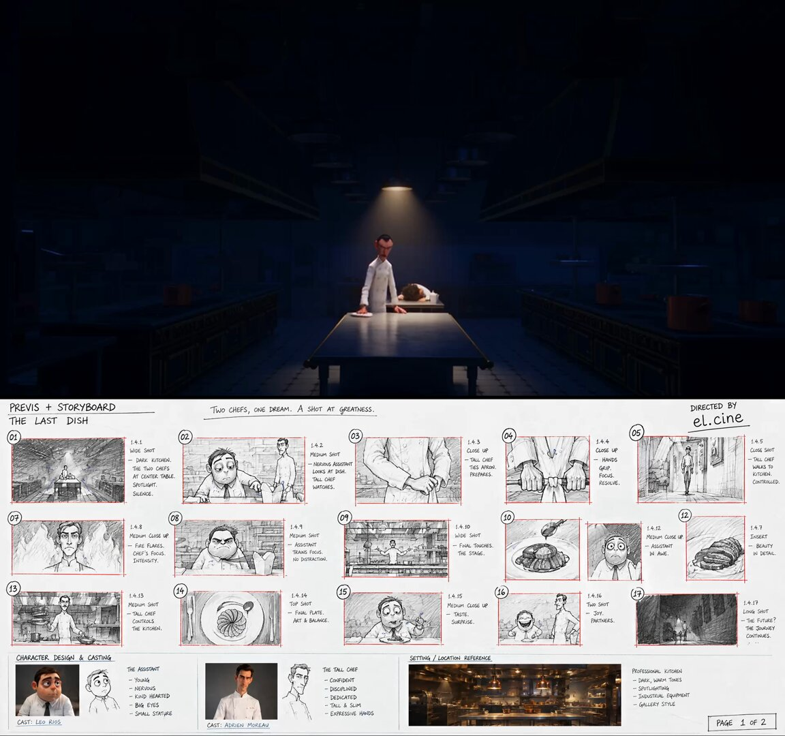

# ChatGPT Image 2.5 is crazy for storytelling.. it turns any idea into detailed storyboard with cast design.. then use

> Source: https://x.com/EHuanglu/status/2097519538632024103
> Author: el.cine (@EHuanglu)
> Posted: Wed Sep 09 02:56:42 +0000 2026
> Stats (at capture): 298,518 views · 4,171 likes · 79 replies · 502 reposts · 5,245 bookmarks · 29 quotes
> Captured: 2026-09-21T14:58:35Z

## Post

ChatGPT Image 2.5 is crazy for storytelling..

it turns any idea into detailed storyboard with cast design.. then use seedance 2.5 to make a full film scene..

check free workflow and prompts 👇

## Media

[media/media_0.mp4](media/media_0.mp4)

28.9s video (`media/media_0.mp4`, 1920×1800, 3.5 MB) + thumb (`media/media_0_thumb.jpg`, 179 KB). Original: https://video.twimg.com/amplify_video/2097519499226632192/vid/avc1/1152x1080/boNKg_pJ-out3UPA.mp4?tag=16
Thumbnail original: https://pbs.twimg.com/amplify_video_thumb/2097519499226632192/img/LZ-m5NC6xwieci8e.jpg

## Author bio (at capture)

AI consultant | film director | sharing practical ways to use AI for you and your business. all views are my own.
Location: San Francisco, CA

## Thread

### @EHuanglu — [https://x.com/EHuanglu/status/2097519550602559935](https://x.com/EHuanglu/status/2097519550602559935)

el.cine
@EHuanglu
·
Sep 9
check the full prompts for character sheets, storyboard and videos for free.. and change the storyline with gpt image 2.5 directly in the workflow
The Last Dish
From filmera.ai
8
26
193
19K

## Comments

79 replies per API. 14 captured via bridge (logged-in, own tab t36, page URL verified before every extract, 5 scroll rounds per tweet; deduped by status link, ads and >7-day filler excluded, cap 15).

### @tryderrick — [https://x.com/tryderrick/status/2097576951644934641](https://x.com/tryderrick/status/2097576951644934641)

> Derrick.dk 
> @tryderrick
> ·
> Sep 9
> Storyboards might be one of the best uses for this.
>
> Not because they replace the shoot, but because a director can test framing, pace and visual ideas before asking a whole crew to spend time and money on them.
> 1
> 1
> 20
> 6.8K

### @skyriser23 — [https://x.com/skyriser23/status/2097560901050417649](https://x.com/skyriser23/status/2097560901050417649)

> ModestMoon
> @skyriser23
> ·
> Sep 9
> Super stylish. 
> 2.1K

### @bisnonnofelice — [https://x.com/bisnonnofelice/status/2097804828852273296](https://x.com/bisnonnofelice/status/2097804828852273296)

> Bisnonno Felice
> @bisnonnofelice
> ·
> Sep 9
> Costs for video ?
> 282

### @themusoau — [https://x.com/themusoau/status/2097941015957262716](https://x.com/themusoau/status/2097941015957262716)

> An Aussie Muso
> @themusoau
> ·
> Sep 10
> Seedance stealing footage from Ratatouille.
> Not original
> Just theft and slop
> 1
> 156

### @Aqsahere_ — [https://x.com/Aqsahere_/status/2097527735090643110](https://x.com/Aqsahere_/status/2097527735090643110)

> Aqsa
> @Aqsahere_
> ·
> Sep 9
> Storytelling is so good in chatgpt
> 2.1K

### @Magiclight0926 — [https://x.com/Magiclight0926/status/2097673407886192830](https://x.com/Magiclight0926/status/2097673407886192830)

> Magiclight
> @Magiclight0926
> ·
> Sep 9
> That would be great for now
> 188

### @EpicVogel — [https://x.com/EpicVogel/status/2098134235458548091](https://x.com/EpicVogel/status/2098134235458548091)

> Daniel Vogel
> @EpicVogel
> ·
> Sep 10
> Amazing work! Thank you for sharing your workflow and setup.
> 67

### @sabir_huss50540 — [https://x.com/sabir_huss50540/status/2097595203355840989](https://x.com/sabir_huss50540/status/2097595203355840989)

> sabir hussain
> @sabir_huss50540
> ·
> Sep 9
> Storyboards make AI filmmaking much easier and faster.
> 1
> 464

### @sebuzdugan — [https://x.com/sebuzdugan/status/2097598030182543712](https://x.com/sebuzdugan/status/2097598030182543712)

> Sebastian Buzdugan
> @sebuzdugan
> ·
> Sep 9
> watched storyboard pipelines fail on cast consistency across cuts, not image quality
> 1
> 439

### @dasepmochly — [https://x.com/dasepmochly/status/2097702959983534220](https://x.com/dasepmochly/status/2097702959983534220)

> Dasep Moch Luay
> @dasepmochly
> ·
> Sep 9
> Consistency across cuts is usually where multi-shot storyboards fall apart once animated. How reliably does Seedance retain facial identity and lighting when you push for dynamic camera angles?
> 442

### @LoongUp — [https://x.com/LoongUp/status/2097591919350288815](https://x.com/LoongUp/status/2097591919350288815)

> Loong
> @LoongUp
> ·
> Sep 9
> storyboard → video workflow is exactly the gap. most people use image gen for static stuff, but pairing 2.5 with seedance basically turns ChatGPT into a pre-vis studio. workflow post is gold.
> 1
> 1
> 829

### @CoderGeeta — [https://x.com/CoderGeeta/status/2097710226006810816](https://x.com/CoderGeeta/status/2097710226006810816)

> Geeta
> @CoderGeeta
> ·
> Sep 9
> the storyboard is the cheat code here keeps the model from freelancing the plot 
> 241

### @MrBrjan — [https://x.com/MrBrjan/status/2097849351523705059](https://x.com/MrBrjan/status/2097849351523705059)

> Brjan | AI Builder
> @MrBrjan
> ·
> Sep 10
> turning ideas into detailed storyboards sounds like a huge timesaver for creators
> 153

### @TukisDailyveqz — [https://x.com/TukisDailyveqz/status/2097787782249034168](https://x.com/TukisDailyveqz/status/2097787782249034168)

> Tuki's Daily Sunshine
> @TukisDailyveqz
> ·
> Sep 9
> Please dm
> 94
