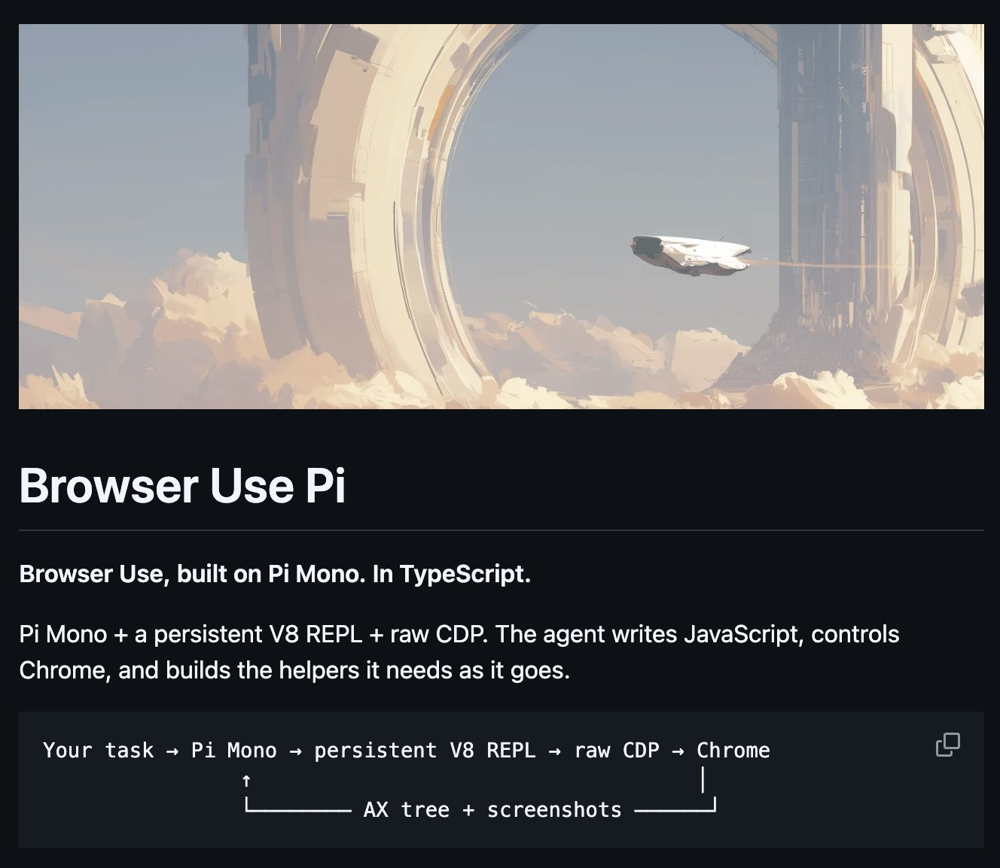

# Browser Use Pi: tiny TypeScript web agent — Pi Mono + persistent V8 REPL + raw CDP

> Source: https://x.com/gregpr07/status/2097576334302355854
> Author: Gregor Zunic (@gregpr07)
> Posted: 2026-09-09T06:42:23Z
> Stats (at capture): 44,632 views · 573 likes · 29 replies · 41 reposts · 666 bookmarks · 9 quotes
> Captured: 2026-09-21T14:35:05Z

## Post

Introducing: Browser Use Pi 🥧

A tiny TypeScript web agent, built with Astra and improved through real browser evals.

We’ve built Browser Use, Browser Harness and BrowserCode. This time we asked Astra to combine what worked, with as little code and as few heuristics as possible. Then Astra hill climbed:

> Run real browser tasks
> Read traces
> Fix what breaks
> Delete complexity
> Run again and repeat.

The result? Pi Mono + persistent V8 REPL + raw CDP. Fully in TypeScript. Cloud browsers, persistent sessions, streaming and step limits included 🌀

npm install @browser_use/pi

## Media

Photo (`media/media_0.jpg`, 1328×1154, 116 KB). Original: https://pbs.twimg.com/media/HRwPXf_agAA7t0M.jpg?name=orig

## Author bio (at capture)

founder @browser_use
Location: San Francisco
Website: http://browser-use.com

## Thread

None (`replying_to` null). No author self-replies recovered via bridge (0 reply articles visible).

## Comments

29 replies per API. 0 visible. Bridge (logged-in, own tab, page URL verified before every extract, 3–8 scroll rounds per tweet): conversation returned only the main-post `<article>`; 0 reply `<article>` elements visible on any of the 15 tweets (one transient 2nd `<article>` on 2097738059844657256 was the embedded X-Article card, not a reply). A loading skeleton sat unresolved behind the reply position; reload did not resolve it — conversation endpoint not serving children to this session. fx/vx APIs return counts only, no reply list. `r.jina.ai` on `x.com`: AbuseAlleviation 403; on `fixupx.com`: login wall.
