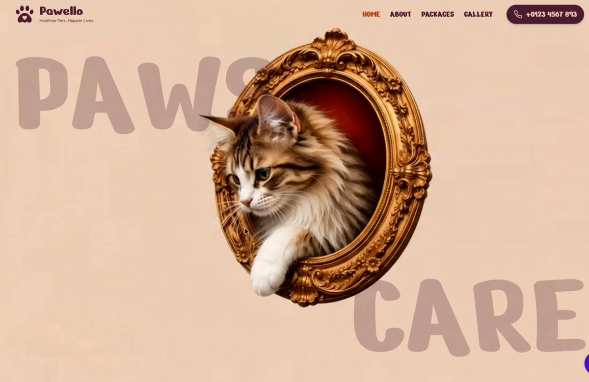

# GPT 6 Astra + GPT Image 2.5 = Insane result

> Source: https://x.com/iamtanzil_/status/2097656569651679248
> Author: Tanzil Chowdhury (@iamtanzil_)
> Posted: Wed Sep 09 12:01:13 +0000 2026
> Stats (at capture): 12,706 views · 219 likes · 12 replies · 11 reposts · 120 bookmarks · 1 quotes
> Captured: 2026-09-21T14:58:35Z

## Post

GPT 6 Astra + GPT Image 2.5 = Insane result

## Media

[media/media_0.mp4](media/media_0.mp4)

8.0s video (`media/media_0.mp4`, 1664×1080, 2.3 MB) + thumb (`media/media_0_thumb.jpg`, 80 KB). Original: https://video.twimg.com/amplify_video/2097656238142369792/vid/avc1/1664x1080/wKGiN6OdJKGYY3n4.mp4?tag=29
Thumbnail original: https://pbs.twimg.com/amplify_video_thumb/2097656238142369792/img/5FOnohTOY9CsIFLz.jpg

## Author bio (at capture)

Building @jirobuild
The best design prompt library.
One prompt, one landing page
Grab the prompt👇
Website: https://www.jiro.build/

## Thread

### @iamtanzil_ — [https://x.com/iamtanzil_/status/2097656571723751636](https://x.com/iamtanzil_/status/2097656571723751636)

Tanzil Chowdhury
@iamtanzil_
·
Sep 9
Find 1000+ design prompts
Jiro — The Design Prompt Library to Vibe Code Better Websites
From jiro.build
5
605

### @iamtanzil_ — [https://x.com/iamtanzil_/status/2097992340829040864](https://x.com/iamtanzil_/status/2097992340829040864)

Tanzil Chowdhury
@iamtanzil_
·
Sep 10
Thank you, Bro.
27

## Comments

12 replies per API. 1 captured via bridge (logged-in, own tab t36, page URL verified before every extract, 5 scroll rounds per tweet; deduped by status link, ads and >7-day filler excluded, cap 15).

### @GoffartMth — [https://x.com/GoffartMth/status/2097991168499884437](https://x.com/GoffartMth/status/2097991168499884437)

> Mathieu Goffart
> @GoffartMth
> ·
> Sep 10
> It's literally insane bro
> 1
> 1
> 33
