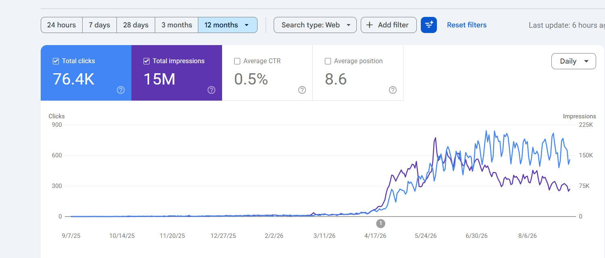

# SEO isn't instant: 7-8 months of nothing, then it compounds — publish, fix, improve daily

> Source: https://x.com/danielkbuilds/status/2097675323793973367
> Author: DanielK (@danielkbuilds)
> Posted: 2026-09-09T13:15:44Z
> Stats (at capture): 5,510 views · 101 likes · 29 replies · 1 reposts · 44 bookmarks · 2 quotes
> Captured: 2026-09-21T14:35:05Z

## Post

Look at the first 7-8 months of this graph. Basically nothing.

SEO isn't instant. You keep publishing, keep fixing errors, keep improving, day after day, month after month, and if you're doing it right, it could eventually end up like this.

## Media

Photo (`media/media_0.jpg`, 1501×641, 69 KB). Original: https://pbs.twimg.com/media/HRxwhgOacAALnvR.jpg?name=orig

## Author bio (at capture)

http://CountryTaxCalc.com (~$1k/mo). 
http://Bevizio.com — is ChatGPT recommending your rival?
http://TheLaunchWall.com 🧱 free launch wall, add yours →.
Location: London
Website: https://www.bevizio.com/

## Thread

None (`replying_to` null). No author self-replies recovered via bridge (0 reply articles visible).

## Comments

29 replies per API. 0 visible. Bridge (logged-in, own tab, page URL verified before every extract, 3–8 scroll rounds per tweet): conversation returned only the main-post `<article>`; 0 reply `<article>` elements visible on any of the 15 tweets (one transient 2nd `<article>` on 2097738059844657256 was the embedded X-Article card, not a reply). A loading skeleton sat unresolved behind the reply position; reload did not resolve it — conversation endpoint not serving children to this session. fx/vx APIs return counts only, no reply list. `r.jina.ai` on `x.com`: AbuseAlleviation 403; on `fixupx.com`: login wall.
