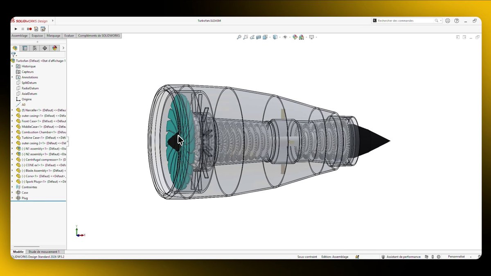

# GPT-6 Astra on CAD (SolidWorks 2026) with the MecAgent harness

> Source: https://x.com/MecAgent/status/2097676816592797816
> Author: MecAgent (@MecAgent)
> Posted: 2026-09-09T13:21:40Z
> Stats (at capture): 467,462 views · 1,735 likes · 45 replies · 126 reposts · 1,120 bookmarks · 33 quotes
> Captured: 2026-09-21T14:35:05Z

## Post

GPT-6 Astra on CAD (SolidWorks 2026) with the MecAgent harness.

## Media

[media/media_0.mp4](media/media_0.mp4)

23.4s video (`media/media_0.mp4`, 1920×1080, 5.9 MB) + thumb (`media/thumb_0.jpg`, 86 KB). Original: https://video.twimg.com/amplify_video/2097676576628641792/vid/avc1/1920x1080/ixfaVGiQ3U-NL4Yn.mp4?tag=29
Thumb original: https://pbs.twimg.com/amplify_video_thumb/2097676576628641792/img/5LmOcRt0PTh5Wpd9.jpg

## Author bio (at capture)

AI for CAD
Location: San Francisco 
Website: http://www.mecagent.com

## Thread

None (`replying_to` null). No author self-replies recovered via bridge (0 reply articles visible).

## Comments

45 replies per API. 0 visible. Bridge (logged-in, own tab, page URL verified before every extract, 3–8 scroll rounds per tweet): conversation returned only the main-post `<article>`; 0 reply `<article>` elements visible on any of the 15 tweets (one transient 2nd `<article>` on 2097738059844657256 was the embedded X-Article card, not a reply). A loading skeleton sat unresolved behind the reply position; reload did not resolve it — conversation endpoint not serving children to this session. fx/vx APIs return counts only, no reply list. `r.jina.ai` on `x.com`: AbuseAlleviation 403; on `fixupx.com`: login wall.
