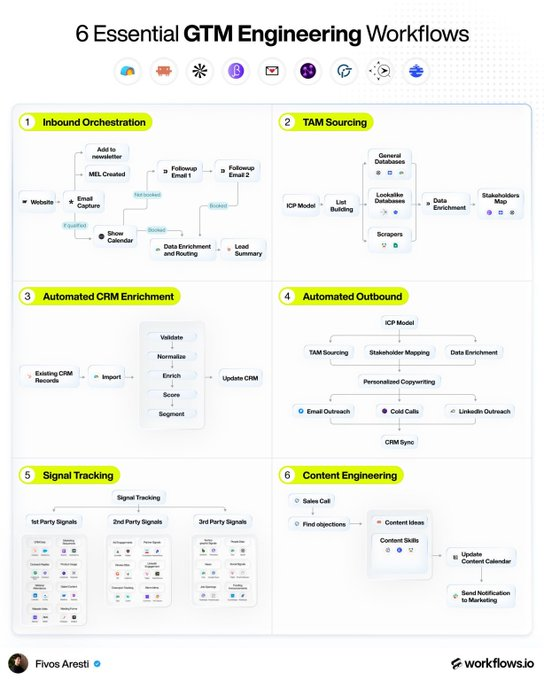

# 6 workflows to master in GTM engineering: inbound, TAM sourcing, enrichment, outbound, signals

> Source: https://x.com/fivosaresti/status/2097686550234419573
> Author: Fivos Aresti (@fivosaresti)
> Posted: 2026-09-09T14:00:21Z
> Stats (at capture): 1,436 views · 34 likes · 5 replies · 4 reposts · 42 bookmarks · 0 quotes
> Captured: 2026-09-21T14:35:05Z

## Post

6 workflows to master if you’re in GTM engineering:

1) Inbound Orchestration.

Every: 

• Form fill
• Demo request
• Newsletter signup

ALL routed automatically through: 

• Clay
• Customer(.)io
• Cal(.)com
• Tally
• HubSpot.

2) TAM Sourcing. 

Every account worth selling to, with the full buying committee mapped through:

• Apollo
• AI Ark
• Ocean(.)io
• DiscoLike
• Apify
• Serper.

3) Automated CRM Enrichment. 

• Validate
• Normalize
• Enrich
• Score
• Segment
• Update CRM.

Built once, runs on every new record.

4) Automated Outbound. 

End-to-end sequences across email through:

• Instantly
• HeyReach (linkedin)
• OutboundSync (cold calls)

5) Signal Tracking.

• First-party
• Second-party
• Third-party signals

Each trigger their own play.

6) Content Engineering. 

• Sales calls captured by Ergo
• Objections surfaced
• Content ideas generated
• Calendar updated
• Marketing notified.

Master these 6 and the rest of the GTM team moves faster behind you.

## Media

Photo (`media/media_0.jpg`, 544×680, 51 KB). Original: https://pbs.twimg.com/media/HRx6zF0WsAAMJR7.jpg?name=orig

## Author bio (at capture)

Co-Founder @ http://Workflows.io | B2B Growth playbooks using AI
Location: New York
Website: http://workflows.io

## Thread

None (`replying_to` null). No author self-replies recovered via bridge (0 reply articles visible).

## Comments

5 replies per API. 0 visible. Bridge (logged-in, own tab, page URL verified before every extract, 3–8 scroll rounds per tweet): conversation returned only the main-post `<article>`; 0 reply `<article>` elements visible on any of the 15 tweets (one transient 2nd `<article>` on 2097738059844657256 was the embedded X-Article card, not a reply). A loading skeleton sat unresolved behind the reply position; reload did not resolve it — conversation endpoint not serving children to this session. fx/vx APIs return counts only, no reply list. `r.jina.ai` on `x.com`: AbuseAlleviation 403; on `fixupx.com`: login wall.
