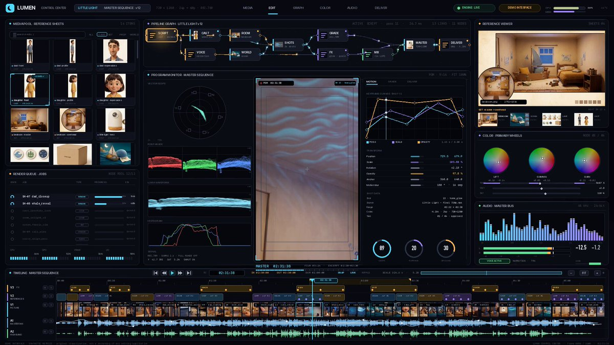

# i finally cracked long-form AI ads with GPT-6 Astra... my setup now produces 5min+ videos on autopilot in 4k 60fps,

> Source: https://x.com/EXM7777/status/2097713112250253528
> Author: Machina (@EXM7777)
> Posted: Wed Sep 09 15:45:54 +0000 2026
> Stats (at capture): 160,326 views · 1,442 likes · 42 replies · 139 reposts · 2,916 bookmarks · 8 quotes
> Captured: 2026-09-21T14:58:35Z

## Post

i finally cracked long-form AI ads with GPT-6 Astra...

my setup now produces 5min+ videos on autopilot in 4k 60fps, here's how it works (running inside Codex):

- it starts in the meta ads library, pulling the winning ads in the niche before writing a single line
- from that research it writes the full script, every scene mapped before anything generates
- image models handle the character and environment sheets
- video models handle the actual sequences
- Suno generates the soundtrack to sit under the whole thing
- one CLI controls what generates, in what order, and with which model
- delivery comes out with cinematic motion, fluid camera work, any ratio from vertical 9:16 to widescreen 21:9

i explain how to build this in the article below:

## Media

[media/media_0.mp4](media/media_0.mp4)

58.4s video (`media/media_0.mp4`, 1920×1080, 18.9 MB) + thumb (`media/media_0_thumb.jpg`, 167 KB). Original: https://video.twimg.com/amplify_video/2097713022726963200/vid/avc1/1920x1080/yyLSSStQzyncq9HD.mp4?tag=16
Thumbnail original: https://pbs.twimg.com/amplify_video_thumb/2097713022726963200/img/DQC0pJKbGWUy8y24.jpg

## Author bio (at capture)

running ai-powered agencies | http://weeklyaiops.com
Website: http://machina.fyi

## Thread

### @EXM7777 — [https://x.com/EXM7777/status/2097717062458335262](https://x.com/EXM7777/status/2097717062458335262)

Machina
@EXM7777
·
Sep 9
join 15k founders using my system, plus one email per week (it's free)
Meet your AI co-founder
From weeklyaiops.com
1
3.6K

## Comments

42 replies per API. 4 captured via bridge (logged-in, own tab t36, page URL verified before every extract, 5 scroll rounds per tweet; deduped by status link, ads and >7-day filler excluded, cap 15).

### @murphimadeit — [https://x.com/murphimadeit/status/2097739752988418555](https://x.com/murphimadeit/status/2097739752988418555)

> 𝕄ade.It 
> @murphimadeit
> ·
> Sep 9
> Bro? That must be for full stack business owners.. this process must cost thousand of $$$
> 174

### @Gifted_Geek — [https://x.com/Gifted_Geek/status/2097824570380312689](https://x.com/Gifted_Geek/status/2097824570380312689)

> Rajesh
> @Gifted_Geek
> ·
> Sep 10
> This is cracked! What device do you run this on? 
> Just asking to check if my M1 Max MacBook pro 64GB can handle this
> 155

### @Viswana34226652 — [https://x.com/Viswana34226652/status/2097713608990060578](https://x.com/Viswana34226652/status/2097713608990060578)

> Viswanadh Reddy
> @Viswana34226652
> ·
> Sep 9
> 218

### @ladoublery — [https://x.com/ladoublery/status/2097774886387065090](https://x.com/ladoublery/status/2097774886387065090)

> Lorenzo
> @ladoublery
> ·
> Sep 9
> Always good shit
> 127
